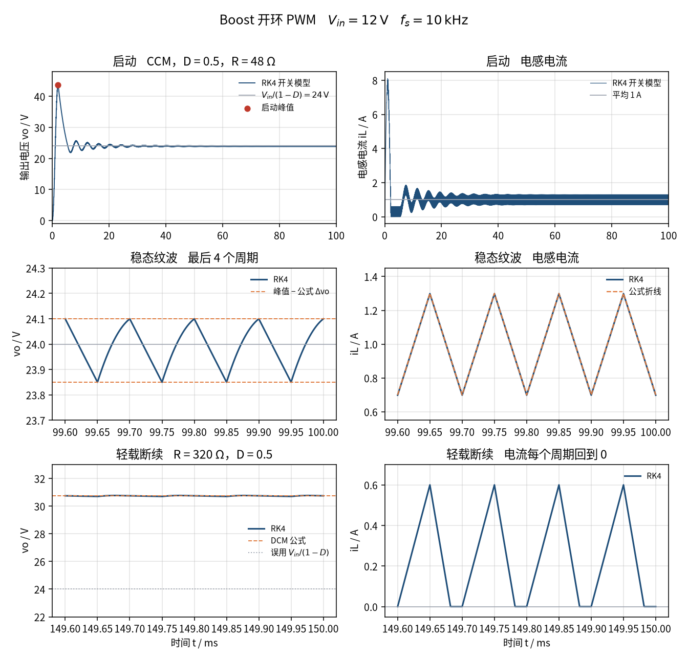

# Boost 变换器开环 PWM（boost-pwm）

> 适用课程：电力电子技术 / 电源技术 ｜ 难度：★★☆ ｜ 课时：约 45 分钟

参数是课堂用的圆整值，用来把升压比、纹波和连续/断续边界算在整数附近，不是某一台电源的实测数据。本卡只讲「升压从哪来、纹波说明什么」，不作为毕业设计或课程设计的电源成品。

和 [`buck-pwm`](../buck-pwm/README.md) 接在一起看：同样是一个开关、一个二极管、一个 L 和一个 C，只是位置换了。Buck 的电感在输出侧，`Vo = D·Vin`；Boost 的电感在输入侧，`Vo = Vin/(1−D)`。

## 1. 目标

看懂理想 Boost 在开环、固定占空比下的三件事。

连续导通（CCM）时，稳态平均输出电压只看占空比：`Vo = Vin/(1−D)`。这条式子来自电感的伏秒平衡：导通时电感两端是 `Vin`，关断时是 `Vin − Vo`，一个周期平均为 0。输入电流就是电感电流，平均值 `IL = Io/(1−D)`，比负载电流大。

纹波由 L、C 决定：电感电流峰峰值 `ΔiL = Vin·D/(L·fs)`；开关导通时二极管截止，电容独自给负载供电，所以输出电压峰峰值 `Δvo = Io·D/(C·fs)`。和 Buck 不同，Boost 的电压纹波是锯齿，不是抛物线。

负载轻到每个周期电流都回到 0，就是断续（DCM）。这时 `Vo = Vin/(1−D)` 不再成立，开环电压会更高。边界条件写成 `K = 2·L·fs/R < D·(1−D)²` 时进入断续，本卡参数下 `Rcrit = 160 Ω`。

## 2. 接线图示意

理想开关 S 由占空比 `D`、频率 `fs` 的方波驱动，接在「开关节点」和参考地之间。二极管阳极接开关节点，阴极接输出。`t = 0` 以前 `iL = 0`、`vo = 0`。

```text
              iL(t) →                 二极管
   Vin = 12 V ---( L )---+---|>|---+--------+---- vo
                         |         |        |
                        [ S ]     === C    [ R ]
                  q = 1 的时间占 D  |        |
                         |         |        |
              参考地 ----+---------+--------+---- 参考地
```

三种拓扑，元件方程相同：

```text
开关导通（q = 1）           vL = Vin          二极管截止，C 单独给 R 供电
关断且 iL > 0               vL = Vin - vo     二极管导通，L 和电源一起给 C、R 充电
iL = 0 且 vo > Vin（DCM）   vL = 0，iL 保持 0  电容只给电阻放电

L diL/dt = vL
C dvo/dt = (二极管导通 ? iL : 0) - vo/R
```

没有 Simscape 时，连续导通可以把二极管换成和 S 互补的理想开关（同步整流），用 `q` 写成两条式子：

```text
L diL/dt = Vin - (1-q)·vo
C dvo/dt = (1-q)·iL - vo/R
```

这条链允许电流变负，轻载时不会进入断续。Boost 开环的启动过冲很大，主工况 `R = 48 Ω` 在 2.2–5.4 ms 之间也会短暂断续，所以两种模型的启动段不同，稳态相同。`R = 320 Ω` 的断续对照要以脚本或 Simscape 里的二极管为准。方框图见 [`simulink/README.md`](simulink/README.md)。

## 3. 参数表

| 符号 | 含义 | 取值 | 单位 |
|------|------|------|------|
| Vin | 直流输入 | 12 | V |
| D | 开环占空比，主工况 | 0.5 | — |
| fs | 开关频率 | 10000 | Hz |
| T | 开关周期 1/fs | 100 | μs |
| L | 电感（1 mH） | 0.001 | H |
| C | 电容（100 μF，为凑整纹波而取） | 100e-6 | F |
| R | 负载，主工况，连续导通 | 48 | Ω |
| Vo | CCM 平均输出 Vin/(1−D) | 24 | V |
| Io | 负载电流 Vo/R | 0.5 | A |
| IL | 电感（输入）电流平均值 Io/(1−D) | 1 | A |
| ΔiL | 电流纹波峰峰值 Vin·D/(L·fs) | 0.6 | A |
| Δvo | 电压纹波 Io·D/(C·fs) | 0.25 | V |
| Rcrit | CCM/DCM 边界电阻 2·L·fs/(D·(1−D)²) | 160 | Ω |
| R_dcm | 断续对照负载 | 320 | Ω |
| iL(0), vo(0) | 初值 | 0 | A, V |
| t_end | 主工况仿真时长 | 100 | ms |

心算主工况：`12/(1−0.5) = 24 V`，`24/48 = 0.5 A`，`0.5/0.5 = 1 A`，`12×0.5/(0.001×10000) = 0.6 A`，`0.5×0.5/(100e-6×10000) = 0.25 V`，`2×0.001×10000/(0.5×0.25) = 160 Ω`。

脚本里用国际单位：`L = 1e-3`，`C = 100e-6`，`D = 0.5`。不要把占空比写成 `50`。仿真时长要 100 ms，是因为开环 Boost 的启动振荡衰减得很慢（见第 4 节）。

同一组 L、C、R、fs 下再看两个占空比：`D = 0.25` 时期望 `Vo = 16 V`、`ΔiL = 0.3 A`；`D = 0.75` 时期望 `Vo = 48 V`、`IL = 4 A`、`ΔiL = 0.9 A`。`D` 越接近 1，电压和输入电流都涨得越快。

## 4. 预期曲线

CCM 稳态（`t` 已经离开启动振荡）：

```text
Vo  = Vin / (1 − D)
IL  = Io / (1 − D) = Vo / (R · (1 − D))
ΔiL = Vin · D / (L · fs)
Δvo = Io · D / (C · fs)
```

第一式也可以从能量看：理想电路里输入功率等于输出功率，`Vin·IL = Vo·Io`，电压升高几倍，输入电流就是负载电流的几倍。

电压纹波：开关导通的 `D·T` 时间里二极管截止，电容以恒定的 `Io` 放电，电压线性下降 `Io·D·T/C`；关断后电感电流灌进电容，电压回升。所以 `vo` 是一条锯齿，峰在每个周期开始的时刻，谷在关断的时刻，而且不关于平均值对称。读数用峰峰值。

对照下图（由 `python/boost_pwm.py` 生成）。主工况是 `D = 0.5`、`R = 48 Ω`。



可量化指标（默认参数，脚本打印到 6 位小数）：

- 理论 `Vo = 24 V`，最后两个开关周期里开关模型平均 `23.987672 V`，`rel_err_Vo = -0.000514`。这 12 mV 不是公式错了：100 ms 时启动振荡还没完全消失。
- 公式 `ΔiL = 0.600000 A`，模型测得 `0.600012 A`。电流在 `0.698432 A` 和 `1.298444 A` 之间，平均 `0.998210 A`，公式折线是 `0.7 A` 到 `1.3 A`。
- 公式 `Δvo = 0.250000 V`，模型测得 `0.249740 V`（`rel_err_dvo = -0.001040`）。峰约 `24.10 V`，谷约 `23.85 V`。
- 三个占空比，负载仍是 48 Ω，都还在连续区：

| D | Vo 公式 | Vo 实测 | IL 公式 | IL 实测 | ΔiL 公式 | ΔiL 实测 | Δvo 公式 | Δvo 实测 |
|---|--------:|--------:|--------:|--------:|---------:|---------:|---------:|---------:|
| 0.25 | 16 V | 15.995377 V | 0.444444 A | 0.443800 A | 0.300000 A | 0.300005 A | 0.083333 V | 0.085228 V |
| 0.50 | 24 V | 23.987672 V | 1.000000 A | 0.998210 A | 0.600000 A | 0.600012 A | 0.250000 V | 0.249740 V |
| 0.75 | 48 V | 47.986235 V | 4.000000 A | 3.996660 A | 0.900000 A | 0.900018 A | 0.750000 V | 0.749780 V |

`D = 0.25` 的 Δvo 实测比公式高约 2%。这一档阻尼更小，读数时启动振荡的尾巴可能还叠在锯齿上，可以把仿真时长加长再对比。

- 连续/断续边界：`K = 2·L·fs/R`，主工况 `K = 0.416667`，边界 `D·(1−D)² = 0.125`，离边界很远。
- 断续对照 `R = 320 Ω`，`K = 0.062500 < 0.125`。DCM 电压比 `M = (1 + √(1 + 4D²/K))/2 = 2.561553`，所以 `Vo = 30.738634 V`，不是 24 V。开关模型测得 `30.736731 V`，电流峰值 `0.600000 A`（导通段和 CCM 一样是 `Vin·D/(L·fs)`），谷值 `0.000000 A`，一个周期里约 `0.182` 的时间停在 0。图上那条 24 V 的虚线是误用 CCM 公式的位置。
- 启动不是纹波，而且 Boost 的启动很猛。平均模型等效成 `L/(1−D)²` 接在 `Vin/(1−D)` 后面的 LC 滤波器：`ω0 = (1−D)/√(LC) = 1581.138830 rad/s`，`ζ = √(L/C)/(2R(1−D)) = 0.065881`。峰值时刻 `tp = 1.991244 ms`，超调比例 `0.812677`，峰值 `43.504254 V`，2% 调节时间约 `38.4 ms`。开关模型的最高点在 `2.000 ms`，`vo = 43.672334 V`，电感电流峰值 `8.107388 A`，是稳态平均值的 8 倍。
- 过冲时 `vo` 远高于 24 V，电感电流在 `2.1765 ms` 到 `5.4 ms` 之间反复放到 0，二极管截止，这是启动里的短暂断续。换成同步整流的版本，电流会变负，最低 `−4.836021 A`，电压峰值仍是 `43.672334 V`。20 ms 时电压离 24 V 还有约 0.57 V 的偏差。

改负载时先问连续还是断续。`R` 从 48 Ω 加大、还没到 160 Ω 时，平均电压仍是 `Vin/(1−D)`，平均电流下降，`ΔiL` 不变，`Δvo` 随 `Io` 变小。一旦越过 160 Ω，平均电压改用 DCM 的 `M`，CCM 的 `IL`、`Δvo` 公式停用。

## 5. 常见报错

| 现象 | 原因 | 处理 |
|------|------|------|
| 输出只有 12 V 出头，几乎不升压 | Pulse Generator 的 Pulse width 填了 `0.5`，那是 0.5% 占空比 | Pulse width 是百分数，填 `50`。公式、脚本、PWM Generator (DC-DC) 里的 `D` 才填 `0.5` |
| 输出升不起来，接近 0 V，电流很大 | 二极管反了，或开关接在了输出端到地。开关一导通，电容经二极管被短路 | 阳极接开关节点，阴极接 `vo`。开关在开关节点和地之间 |
| 只看到 43 V 左右的尖峰，以为 Vo 公式错了 | 把启动过冲当成了稳态。开环 Boost 的 `ζ ≈ 0.066`，过冲约 81% | 仿真到 100 ms，在最后几个周期读数。要缩短启动，给 vo 加软启动或闭环，那是另一张卡的内容 |
| 稳态电压比 24 V 低零点几伏 | 开关 Ron、二极管压降或电感电阻设得太大。Boost 对损耗很敏感，`D` 越大越明显 | 本卡 Forward voltage = `0`，Ron = `0.01` Ω，电感串联电阻 `0`。讲真实损耗时先声明公式会偏低 |
| `D` 设成 0.9 以上，电压没有到 120 V，反而下降 | 有寄生电阻时，实际升压比在 `D` 接近 1 时会掉头。理想公式只在无损时成立 | 本卡只用 0.25、0.5、0.75。`D → 1` 的电压上限是讨论题，不要在实验里去试 |
| 启动段电流贴在 0 好几个周期，以为接错了 | 过冲时 `vo > Vin` 很多，电感放电很快，二极管 Boost 进入短暂断续 | 正常现象，大约在 2.2–5.4 ms。稳态以后电流在 0.7–1.3 A，不再到 0 |
| 轻载仍拿 24 V 去对示波器 | 把 CCM 的 `Vin/(1−D)` 用到了断续 | `Rcrit = 160 Ω`。`R = 320 Ω` 时期望约 30.7 V |
| 开路（不接电阻）跑出几百伏 | 开环 Boost 空载时每个周期都把能量灌进电容，没有地方消耗 | 永远保留负载。理想模型空载电压没有上限，真实电路靠损耗或保护 |
| 电压纹波看起来像抛物线，峰峰值对不上 0.25 V | 套用了 Buck 的 `ΔiL/(8·C·fs)` | Boost 用 `Io·D/(C·fs)`。导通期间电容独自放电，波形是锯齿 |
| 一个周期里台阶数不对，纹波发毛 | 最大步长大于开关周期，求解器跨过了开通或关断 | Max step size ≤ `1e-6`。脚本的步长是 `T/200`，沿正好落在步上 |
| 电压纹波有台阶，比 0.25 V 大一截 | 电容 ESR 没有设成 0，二极管电流跳变时 `iC·ESR` 跳一下 | 本卡串联电阻设为 0。ESR 纹波是另一张卡的内容 |
| 电流纹波只有 0.0006 A | 1 mH 写成了 1 H | `L = 1e-3`。先心算 `12×0.5/(0.001×10000) = 0.6 A` |
| 基础库方框图的启动和 Simscape 不一样 | 方框图是同步整流，电流可以变负，没有启动断续 | 正常。两者稳态相同，启动段以二极管版本为准 |
| Python 报 `ModuleNotFoundError: scipy`（或 matplotlib） | 未装案例依赖 | 在 `python/` 下执行 `pip install -r requirements.txt` |
| MATLAB 曲线与命令行数字对不上 | 改了工作区里的参数后没有重新运行脚本 | 重新运行 `boost_pwm.m`；以命令行打印的 `delta_iL_meas_A` 为准 |

## 6. 平台指引

三个平台用同一组参数。Python 与 MATLAB 都给出可运行脚本；Simulink 按下面的模块清单搭，不附带 `.slx`。逐步点击说明见 [`simulink/README.md`](simulink/README.md)。

### Simulink

实验室若装了 Simscape Electrical，按物理电路搭。开关用理想开关，二极管的前向压降设为 0，这样才能和 `Vo = Vin/(1−D)` 对齐。

| 模块 | 库路径 | 参数 |
|------|--------|------|
| Solver Configuration | Simscape / Utilities | 默认。接到电路任意节点 |
| DC Voltage Source | Simscape / Foundation Library / Electrical / Electrical Sources | Constant voltage = `12` V |
| Inductor | Simscape / Foundation Library / Electrical / Electrical Elements | `1e-3` H，串联电阻 `0`，初始电流 `0`。接在电源正极和开关节点之间 |
| Ideal Semiconductor Switch | Simscape / Electrical / Semiconductors & Converters | Ron = `0.01` Ω，Goff = `1e-6` 1/Ω，Threshold = `0.5` V。接在开关节点和地之间 |
| Diode | Simscape / Electrical / Semiconductors & Converters | Piecewise linear，Forward voltage = `0`，On resistance = `0.01` Ω，Off conductance = `1e-6` 1/Ω。阳极接开关节点，阴极接 `vo` |
| Capacitor | Simscape / Foundation Library / Electrical / Electrical Elements | `100e-6` F，ESR `0`，初始电压 `0` |
| Resistor | 同上 | `48` Ω |
| Electrical Reference | 同上 | 电路的公共地 |
| Current Sensor | Simscape / Foundation Library / Electrical / Electrical Sensors | 串在电感支路 |
| Voltage Sensor | 同上 | 正端接 `vo`，负端接参考地 |
| Pulse Generator | Simulink / Sources | Time based，Amplitude = `1`，Period = `1e-4`，Pulse width = `50`（百分数），Phase delay = `0` |
| Simulink-PS Converter | Simscape / Utilities | 单位 `1`，Filtering and derivatives 选 Provide signals |
| PS-Simulink Converter ×2 | Simscape / Utilities | 单位分别是 `A` 和 `V`，再进 Scope |
| Scope ×2 | Simulink / Sinks | 一个看 `vo`，一个看 `iL` |

求解器：**Variable-step / ode23t**，Stop time = `0.1`，Max step size = `1e-6`，Relative tolerance = `1e-4`。

读数：约 2 ms 处电压冲到 43.7 V 附近，40 ms 以后收到 24 V。把横轴放到 99.6–100 ms，电流应在 0.7–1.3 A，电压锯齿峰峰值约 0.25 V。Ron 不为 0，平均电压会比 24 V 低几十毫伏。断续对照把电阻改成 `320`、Stop time 改成 `0.15`，电压应停在 30.7 V 附近。

没有 Simscape 时用第 2 节的同步整流方程搭方框图，只做主工况。Gain：`1/L = 1000`，`1/C = 10000`，`1/R = 1/48`，两个积分器初值都是 0，求解器 **ode45**。

已安装 Specialized Power Systems 时，可用 `powergui`（Continuous）+ DC Voltage Source + Ideal Switch + Diode + 三段 Series RLC Branch，PWM Generator (DC-DC) 的 Duty cycle = `0.5`（分数），缓冲电路去掉。细节见搭建步骤。

### MATLAB

脚本：[`matlab/boost_pwm.m`](matlab/boost_pwm.m)。只用基础函数（定步长 RK4、`expm`、`plot`），不需要工具箱。文件末尾的局部函数从 R2016b 起属于基础语言。

```matlab
run('cases/boost-pwm/matlab/boost_pwm.m')
```

脚本用和 Python 相同的步长积分开关模型，打印同一组字段，画出启动、稳态纹波和断续对照。主工况再用同步整流版本和 `expm` 对照（二极管版本启动时会断续，不是线性模型，不能直接拿去比）。电流、电压最大偏差应小于 `1e-4`，否则脚本会报错停下。图片写到 `img/boost_pwm_curves_matlab.png`（运行后才有）。三组工况共要积分约 70 万步，普通电脑上需要几秒到十几秒。

### Python

脚本：[`python/boost_pwm.py`](python/boost_pwm.py)。依赖 numpy、scipy、matplotlib，见 [`python/requirements.txt`](python/requirements.txt)。`scipy` 用于 `expm` 对照。积分用纯 Python 循环，运行要等一会儿。

```bash
pip install -r cases/boost-pwm/python/requirements.txt
python cases/boost-pwm/python/boost_pwm.py
```

控制台应出现：

```text
Boost open-loop PWM
  Vin_V                      = 12.000000
  duty                       = 0.500000
  fs_Hz                      = 10000.000000
  L_H                        = 0.001000
  C_F                        = 0.000100
  R_ohm                      = 48.000000
  Vo_theory_V                = 24.000000
  Io_theory_A                = 0.500000
  iL_theory_A                = 1.000000
  delta_iL_theory_A          = 0.600000
  delta_vo_theory_V          = 0.250000
  iL_min_theory_A            = 0.700000
  iL_max_theory_A            = 1.300000
  K_ccm                      = 0.416667
  K_crit                     = 0.125000
  Rcrit_ohm                  = 160.000000
  omega0_rad_s               = 1581.138830
  zeta                       = 0.065881
  tp_avg_ms                  = 1.991244
  os_avg_frac                = 0.812677
  vo_peak_avg_model_V        = 43.504254
  settle_2pct_avg_ms         = 38.400000
  vo_peak_switched_V         = 43.672334
  t_peak_ms                  = 2.000000
  iL_peak_startup_A          = 8.107388
  startup_dcm_from_ms        = 2.176500
  startup_dcm_to_ms          = 5.400000
  iL_min_sync_startup_A      = -4.836021
  vo_peak_sync_V             = 43.672334
  Vo_meas_V                  = 23.987672
  iL_meas_A                  = 0.998210
  delta_iL_meas_A            = 0.600012
  delta_vo_meas_V            = 0.249740
  iL_min_meas_A              = 0.698432
  iL_max_meas_A              = 1.298444
  rel_err_Vo                 = -0.000514
  rel_err_diL                = 0.000019
  rel_err_dvo                = -0.001040
  duty_low                   = 0.250000
  Vo_theory_low_V            = 16.000000
  iL_theory_low_A            = 0.444444
  delta_iL_theory_low_A      = 0.300000
  delta_vo_theory_low_V      = 0.083333
  Vo_meas_low_V              = 15.995377
  iL_meas_low_A              = 0.443800
  delta_iL_meas_low_A        = 0.300005
  delta_vo_meas_low_V        = 0.085228
  duty_high                  = 0.750000
  Vo_theory_high_V           = 48.000000
  iL_theory_high_A           = 4.000000
  delta_iL_theory_high_A     = 0.900000
  delta_vo_theory_high_V     = 0.750000
  Vo_meas_high_V             = 47.986235
  iL_meas_high_A             = 3.996660
  delta_iL_meas_high_A       = 0.900018
  delta_vo_meas_high_V       = 0.749780
  R_dcm_ohm                  = 320.000000
  K_dcm                      = 0.062500
  M_dcm                      = 2.561553
  Vo_dcm_theory_V            = 30.738634
  Vo_dcm_if_ccm_V            = 24.000000
  Vo_dcm_meas_V              = 30.736731
  iL_max_dcm_A               = 0.600000
  iL_min_dcm_A               = 0.000000
  zero_frac_dcm              = 0.182045
  max_abs_err_il_A           = 2.544e-12
  max_abs_err_vo_V           = 7.798e-12
```

上面这些 6 位小数字段，MATLAB 脚本应逐行相同。`max_abs_err_il_A` 和 `max_abs_err_vo_V` 是同步整流 RK4 相对矩阵指数的最大偏差，应远小于 `1e-4`；MATLAB 的 `expm` 末位可以不同。曲线保存为 [`img/boost_pwm_curves.png`](img/boost_pwm_curves.png)。没有图形界面时只保存图片、不弹窗。

## 7. 课堂提问

1. 导通时电感两端是多少伏，关断时是多少伏？只用「一个周期平均为 0」，推出 `Vo = Vin/(1−D)`。
2. 输出 24 V、0.5 A，为什么电源要给出 1 A？`D = 0.75` 时输入电流是多少，这对电感和开关的选型意味着什么？
3. 为什么 Boost 的电压纹波是锯齿，而 Buck 是抛物线？只把 C 加倍，`Δvo` 和启动过冲各怎么变？
4. 负载从 48 Ω 改到 320 Ω 以后，开环电压为什么升到 30.7 V？完全不接负载会怎样？
5. 启动峰值约 43.7 V，是稳态的 1.8 倍。如果电容耐压只有 35 V，开环直接上电会发生什么？有哪些办法？

## 8. 相关链接

- 案例卡字段约定：[docs/case-convention.md](../../docs/case-convention.md)
- 同一组元件换个位置：[Buck 变换器开环 PWM（buck-pwm）](../buck-pwm/README.md)。Buck 的电感在输出侧、`Vo = D·Vin`；Boost 的电感在输入侧、`Vo = Vin/(1−D)`。
- 二阶振荡与阻尼比：[RLC 串联阶跃（rlc-series-step）](../rlc-series-step/README.md)。这里的等效电感是 `L/(1−D)²`，电阻并联在电容上。
- 直流母线从哪来：[单相桥式整流 + 电容滤波（single-phase-rectifier）](../single-phase-rectifier/README.md)。母线上的纹波同样是电流乘时间再除以 C；那里的时间是半个工频周期，不是开关导通时间。
