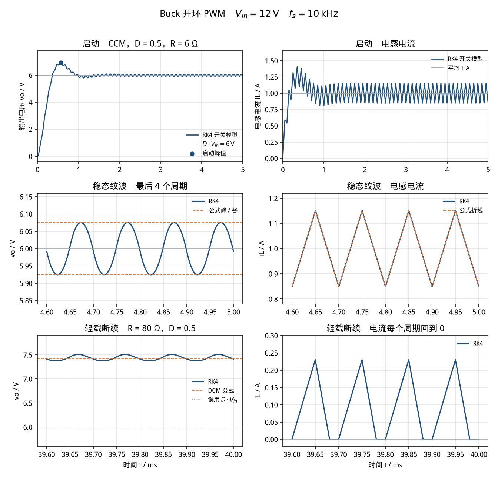

# Buck 变换器开环 PWM（buck-pwm）

> 适用课程：电力电子技术 / 电源技术 ｜ 难度：★★☆ ｜ 课时：约 45 分钟

参数是课堂用的圆整值，用来把占空比、纹波和连续/断续边界算在整数附近，不是某一台电源的实测数据。本卡只讲「这条纹波说明什么」，不作为毕业设计或课程设计的电源成品。

和 [`rlc-series-step`](../rlc-series-step/README.md) 接在一起看：那边电阻和 L、C 串联，稳态电容电压等于电源。这边 L、C 是输出滤波器，电阻并联在电容上，稳态电压由占空比决定，L 和 C 留下的是纹波。

## 1. 目标

看懂理想 Buck 在开环、固定占空比下的两件事。

连续导通（CCM）时，稳态平均输出电压只看占空比：`Vo = D·Vin`。电感和电容不决定这个平均值。它们决定纹波：电感电流峰峰值 `ΔiL = (Vin−Vo)·D/(L·fs)`，输出电压峰峰值大约 `Δvo = ΔiL/(8·C·fs)`。`ΔiL` 对占空比是一条开口向下的抛物线，`D = 0.5` 时最大，`D = 0.25` 和 `D = 0.75` 一样大。

负载轻到每个周期电流都回到 0，就是断续（DCM）。这时 `Vo = D·Vin` 不再成立，开环电压会高于 `D·Vin`。边界电阻可以手算：`Rcrit = 2·L·fs/(1−D)`。

## 2. 接线图示意

理想开关 S 由占空比 `D`、频率 `fs` 的方波驱动。二极管阳极接参考地，阴极接开关和电感的公共点。`t = 0` 以前 `iL = 0`、`vo = 0`。

```text
                         iL(t) →
              q = 1 的时间占 D，周期 T = 1/fs
                 |
   Vin = 12 V ---+---[ S ]---+---( L )---+--------+---- vo
                 |           |           |        |
                 |           |           |       [ R ]
                 |           |          === C     |
                 |          [D]          |        |
                 |       阳极在下        |        |
                 |           |           |        |
                 +-----------+-----------+--------+---- 参考地
```

三种拓扑，元件方程相同：

```text
开关导通（q = 1）       vL = Vin - vo     二极管截止
关断且 iL > 0           vL = -vo          二极管导通
两端都断（DCM）         vL = 0，iL 保持 0  电容只给电阻放电

L diL/dt = vL
C dvo/dt = iL - vo/R
```

没有 Simscape 时，连续导通可以用一条式子搭方框图。`q` 是 0/1 的脉冲，`vL = q·Vin − vo`：`q = 1` 时就是 `Vin − vo`，`q = 0` 时就是 `−vo`。

```text
Pulse(q) --×(Vin)-->(+) Sum(+-) --> ×(1/L) --> ∫ --> iL --> Scope
                         (-)
                          ^
                          +---------------------------- vo

iL -->(+) Sum(+-) --> ×(1/C) --> ∫ --> vo --> Scope
       (-)
        ^
        +-------------- ×(1/R) <--- vo
```

这条链允许电流变负，等价于同步整流，轻载时不会进入断续。二极管 Buck 在电流回到 0 之后必须把电感断开。主工况 `R = 6 Ω` 电流下不去 0，两条模型重合；`R = 80 Ω` 的断续对照要以脚本或 Simscape 里的二极管为准。

## 3. 参数表

| 符号 | 含义 | 取值 | 单位 |
|------|------|------|------|
| Vin | 直流输入 | 12 | V |
| D | 开环占空比，主工况 | 0.5 | — |
| fs | 开关频率 | 10000 | Hz |
| T | 开关周期 1/fs | 100 | μs |
| L | 电感（1 mH） | 0.001 | H |
| C | 电容（25 μF，为凑整纹波而取） | 25e-6 | F |
| R | 负载，主工况，连续导通 | 6 | Ω |
| Vo | CCM 平均输出 D·Vin | 6 | V |
| IL | 电感电流平均值 Vo/R | 1 | A |
| ΔiL | 电流纹波峰峰值 (Vin−Vo)·D/(L·fs) | 0.3 | A |
| Δvo | 电压纹波估算 ΔiL/(8·C·fs) | 0.15 | V |
| Rcrit | CCM/DCM 边界电阻 2·L·fs/(1−D) | 40 | Ω |
| Icrit | 边界平均电流 ΔiL/2 | 0.15 | A |
| R_dcm | 断续对照负载 | 80 | Ω |
| iL(0), vo(0) | 初值 | 0 | A, V |
| t_end | 主工况仿真时长 | 5 | ms |

心算主工况：`(12−6)×0.5 / (0.001×10000) = 0.3 A`，`0.3 / (8×25e-6×10000) = 0.15 V`，`2×0.001×10000 / 0.5 = 40 Ω`。

脚本里用国际单位：`L = 1e-3`，`C = 25e-6`，`D = 0.5`。不要把 1 mH 写成 `1`，也不要把占空比写成 `50`。25 μF 是为了让 Δvo 落在 0.15 V 上，不是目录里的标称电容。

同一组 L、C、R、fs 下再看两个占空比，用来对照「电压跟着 D 走、纹波在 D = 0.5 最大」：`D = 0.25` 时期望 `Vo = 3 V`、`ΔiL = 0.225 A`；`D = 0.75` 时期望 `Vo = 9 V`、`ΔiL` 仍是 `0.225 A`。

## 4. 预期曲线

CCM 稳态（`t` 已经离开启动振荡）：

```text
Vo  = D · Vin
ΔiL = (Vin − Vo) · D / (L · fs) = Vin · D · (1 − D) / (L · fs)
Δvo = ΔiL / (8 · C · fs)
```

第二式把 `Vo = D·Vin` 代进去，只在连续导通时成立。`D·(1−D)` 在 `D = 0.5` 取到最大 0.25，所以同样的 L、fs，电流纹波在半占空比最大。

电压纹波是电荷除以电容。一个周期里，电容电流高出平均值的那一块，是底为 `T/2`、高为 `ΔiL/2` 的三角形：

```text
ΔQ = (1/2) · (T/2) · (ΔiL/2) = ΔiL / (8 · fs)
Δvo = ΔQ / C
```

电流纹波是折线。电压纹波是一段一段的抛物线，放大后有点像正弦，读数仍用峰峰值，不要按正弦幅值去换算。

公式把一个周期里的 `vo` 看成常数。`vo` 自己有 0.15 V 的起伏时，开关模型会比公式略大一点，大约 1% 以内。这是公式的近似，不是步长误差。

对照下图（由 `python/buck_pwm.py` 生成）。主工况是 `D = 0.5`、`R = 6 Ω`。



可量化指标（默认参数，脚本打印到 6 位小数）：

- `Vo = 6.000000 V`，`IL = 1.000000 A`。最后两个开关周期里，开关模型的平均值就是这两个数（`rel_err_Vo = 0.000000`）。
- 公式 `ΔiL = 0.300000 A`，模型测得 `0.302497 A`，相对差 `rel_err_diL = 0.008323`（高 0.83%）。电流在 `0.848752 A` 和 `1.151249 A` 之间，公式折线是 `0.85 A` 到 `1.15 A`。
- 公式 `Δvo = 0.150000 V`，模型测得 `0.150865 V`，相对差 `rel_err_dvo = 0.005766`（高 0.58%）。峰和谷大约在 `6 ± 0.075 V`。
- 三个占空比，负载仍是 6 Ω，都还在连续区：

| D | Vo 公式 | Vo 实测 | ΔiL 公式 | ΔiL 实测 | Δvo 公式 | Δvo 实测 |
|---|--------:|--------:|---------:|---------:|---------:|---------:|
| 0.25 | 3 V | 3.000000 V | 0.225000 A | 0.226405 A | 0.112500 V | 0.113038 V |
| 0.50 | 6 V | 6.000000 V | 0.300000 A | 0.302497 A | 0.150000 V | 0.150865 V |
| 0.75 | 9 V | 8.999999 V | 0.225000 A | 0.226405 A | 0.112500 V | 0.113038 V |

`D = 0.75` 的平均电压打印成 `8.999999 V`，和 9 V 差在微伏这一位。`D = 0.25` 和 `D = 0.75` 的纹波印到 6 位小数是同一个数。

- 连续/断续边界：`Rcrit = 40 Ω`，`Icrit = 0.150000 A`。主工况 `R = 6 Ω`，`K = 2·L·fs/R = 3.333333`，大于 `1−D = 0.5`，电流最小还有约 0.85 A，离 0 很远。
- 断续对照 `R = 80 Ω`，`K = 0.250000 < 0.5`。DCM 电压比 `M = 2 / (1 + √(1 + 4K/D²)) = 0.618034`，所以 `Vo = 7.416408 V`，不是 6 V。开关模型测得 `7.437525 V`（约高 0.28%），电流峰值 `0.230122 A`，谷值 `0.000000 A`，一个周期里大约 `0.195` 的时间停在 0。图上那条 6 V 的虚线是误用 CCM 公式的位置。
- 启动不是纹波。输出 LC 的自然角频率 `ω0 = 1/√(LC) = 6324.555320 rad/s`。电阻并联在电容上，阻尼比 `ζ = √(L/C) / (2R) = 0.527046`。平均模型（把开关换成 6 V 直流）的峰值时刻 `tp = 0.584500 ms`，超调比例 `0.142511`，电压 `6.855069 V`。开关模型的最高点在 `0.571000 ms`，`vo = 6.937705 V`。多出来的大约 0.08 V，是纹波骑在这轮振荡上。大约 2 ms 以后只剩下开关纹波。

改负载时先问连续还是断续。`R` 从 6 Ω 加大，但还没到 40 Ω，平均电压仍是 `D·Vin`，平均电流 `Vo/R` 下降，纹波公式不变。一旦越过 40 Ω，平均电压改用 DCM 的 `M`，CCM 的 `ΔiL`、`Δvo` 公式停用。

## 5. 常见报错

| 现象 | 原因 | 处理 |
|------|------|------|
| 平均电压变成几百伏，或几乎是 0 | 占空比写成了 50。公式和脚本里的 `D` 是分数 | 公式、脚本、PWM Generator (DC-DC) 填 `0.5`。Pulse Generator 的 Pulse width 才是百分数，填 `50` |
| 输出是一条直线，看不见纹波 | 用了平均模型（受控源直接等于 `D·Vin`），或示波器时间轴拉满 5 ms、纵轴是 0–12 V | 开关必须按 `fs` 通断。横轴放大到最后 0.4 ms，电压纵轴改成 5.8–6.2 V |
| 一个周期里台阶数不对，纹波发毛 | 最大步长大于开关周期，求解器跨过了开通或关断 | Max step size ≤ `1e-6`（`T/100`）。脚本的步长是 `T/200`，沿正好落在步上 |
| 一运行电流冲得很大，电源像被短路 | 二极管反了，阴极接到了地。开关一导通，二极管把电源短接 | 阳极接参考地，阴极接开关和电感的公共点 |
| 稳态电压比 6 V 低零点几伏，以为公式错了 | 二极管前向压降仍是 0.7 V 左右，或导通电阻设得太大 | 本卡为了对齐 `D·Vin`，Forward voltage 设为 `0`，Ron 只用 `0.01` Ω。要讲真实管压降时，先声明公式会低一个结压 |
| 轻载仍拿 6 V 去对示波器 | 把 CCM 的 `Vo = D·Vin` 用到了断续 | `Rcrit = 40 Ω`。`R = 80 Ω` 时期望约 7.42 V，电流每个周期回到 0 |
| 轻载电流出现负值，电压却不升高 | 下管是理想开关，电流可以反向，这是同步整流，始终连续 | 二极管 Buck 在电流回到 0 后要断开。方框图那条 `vL = q·Vin − vo` 做不到这件事 |
| 电流纹波只有 0.0003 A，图上像没有纹波 | 1 mH 写成了 1 H | `L = 1e-3`。先心算 `(12−6)×0.5/(0.001×10000) = 0.3 A` |
| 电压纹波是方波台阶，比 0.15 V 大一截 | 电容 ESR 没有设成 0，`iC·ESR` 盖过了电容上的抛物线 | 本卡串联电阻设为 0。ESR 纹波是另一张卡的内容 |
| 启动没有上冲，一上来就是 6 V 附近的小波纹 | 电容初始电压被设成了 6 V | 两个初值保持 0，才能看到 0.57 ms 附近大约 6.94 V 的峰值 |
| 阻尼比和 RLC 案例对不上 | 把串联公式 `ζ = (R/2)·√(C/L)` 套到了并联负载上 | 这里 `ζ = √(L/C)/(2R)`。R 在电容两端，R 越大，启动振荡越收不住 |
| 示波器上「纹波」有好几伏 | 把启动那段 LC 振荡的峰峰值当成了开关纹波 | 先等过 2 ms，再在最后几个周期里读 0.15 V 和 0.30 A |
| Python 报 `ModuleNotFoundError: scipy`（或 matplotlib） | 未装案例依赖 | 在 `python/` 下执行 `pip install -r requirements.txt` |
| MATLAB 曲线与命令行数字对不上 | 改了工作区里的 `D`、`L`、`C` 后没有重新运行脚本 | 重新运行 `buck_pwm.m`；以命令行打印的 `delta_iL_meas_A` 为准 |

## 6. 平台指引

三个平台用同一组参数。Python 与 MATLAB 都给出可运行脚本；Simulink 按下面的模块清单搭，不附带 `.slx`。逐步点击说明见 [`simulink/README.md`](simulink/README.md)。

### Simulink

实验室若装了 Simscape Electrical，按物理电路搭。开关用理想开关，二极管的前向压降设为 0，这样才能和 `Vo = D·Vin` 对齐。

| 模块 | 库路径 | 参数 |
|------|--------|------|
| Solver Configuration | Simscape / Utilities | 默认。接到电路任意节点 |
| DC Voltage Source | Simscape / Foundation Library / Electrical / Electrical Sources | Constant voltage = `12` V |
| Ideal Semiconductor Switch | Simscape / Electrical / Semiconductors & Converters | Ron = `0.01` Ω，Goff = `1e-6` 1/Ω，Threshold = `0.5` V。栅极是物理信号 |
| Diode | Simscape / Electrical / Semiconductors & Converters | 模型 Piecewise linear，Forward voltage = `0`，On resistance = `0.01` Ω，Off conductance = `1e-6` 1/Ω。有反向恢复或结电容选项时保持关闭 |
| Inductor | Simscape / Foundation Library / Electrical / Electrical Elements | `1e-3` H，串联电阻 `0`，初始电流 `0` |
| Capacitor | 同上 | `25e-6` F，串联电阻（ESR）`0`，初始电压 `0` |
| Resistor | 同上 | `6` Ω |
| Electrical Reference | 同上 | 电路的公共地 |
| Current Sensor | Simscape / Foundation Library / Electrical / Electrical Sensors | 串在电感支路，方向从开关节点指向输出 |
| Voltage Sensor | 同上 | 正端接 `vo`，负端接参考地 |
| Pulse Generator | Simulink / Sources | Time based，Amplitude = `1`，Period = `1e-4`，Pulse width = `50`（百分数），Phase delay = `0`，Sample time = `0` |
| Simulink-PS Converter | Simscape / Utilities | 单位 `1`。Filtering and derivatives 选 Provide signals，不要给栅极加滤波 |
| PS-Simulink Converter ×2 | Simscape / Utilities | 单位分别是 `A` 和 `V`，再进 Scope |
| Scope ×2 | Simulink / Sinks | 一个看 `vo`，一个看 `iL` |

求解器：**Variable-step / ode23t**，Stop time = `0.005`，Max step size = `1e-6`，Relative tolerance = `1e-4`。

读数：约 0.57 ms 处电压上冲到 7 V 附近；2 ms 以后收到 6 V。把横轴放到 4.6–5.0 ms，电流应在 0.85–1.15 A，电压纹波约 0.15 V。Ron 设成 0.01 Ω 以后，平均电压会比 6 V 低若干毫伏，不要去抠小数点后第三位。断续对照把电阻改成 `80`、Stop time 改成 `0.04`，电压应停在 7.4 V 附近，电流每个周期贴到 0。

没有 Simscape 时用第 2 节的方框图，只做主工况。Gain：`Vin = 12`，`1/L = 1000`，`1/C = 40000`，`1/R = 1/6`。两个积分器初值都是 0。求解器改成 **ode45**，停止时间和最大步长同上。这条链不能用来看 `R = 80 Ω` 的断续。

已安装 Specialized Power Systems 时，可用 `powergui`（Continuous）+ DC Voltage Source + Ideal Switch + Diode + 三段 Series RLC Branch。PWM Generator (DC-DC) 的 Switching frequency = `10000`，Duty cycle = `0.5`（这里是分数，不是 50）。缓冲电路去掉：Snubber resistance = `inf`，Snubber capacitance = `0`。求解器 `ode23tb`，停止时间和最大步长同上。细节见搭建步骤。

### MATLAB

脚本：[`matlab/buck_pwm.m`](matlab/buck_pwm.m)。只用基础函数（定步长 RK4、`expm`、`plot`），不需要工具箱。文件末尾的局部函数从 R2016b 起属于基础语言。

```matlab
run('cases/buck-pwm/matlab/buck_pwm.m')
```

脚本用和 Python 相同的步长积分开关模型，打印同一组字段，并画出启动、稳态纹波和断续对照。CCM 主工况再用 `expm` 走一遍同一线性模型。电流最大偏差应小于 `1e-4` A，电压最大偏差应小于 `1e-4` V，否则脚本会报错停下。图片写到 `img/buck_pwm_curves_matlab.png`（运行后才有）。

### Python

脚本：[`python/buck_pwm.py`](python/buck_pwm.py)。依赖 numpy、scipy、matplotlib，见 [`python/requirements.txt`](python/requirements.txt)。`scipy` 用于 `expm` 对照。

```bash
pip install -r cases/buck-pwm/python/requirements.txt
python cases/buck-pwm/python/buck_pwm.py
```

控制台应出现：

```text
Buck open-loop PWM
  Vin_V                      = 12.000000
  duty                       = 0.500000
  fs_Hz                      = 10000.000000
  L_H                        = 0.001000
  C_F                        = 0.000025
  R_ohm                      = 6.000000
  Vo_theory_V                = 6.000000
  iL_theory_A                = 1.000000
  delta_iL_theory_A          = 0.300000
  delta_vo_theory_V          = 0.150000
  iL_min_theory_A            = 0.850000
  iL_max_theory_A            = 1.150000
  Rcrit_ohm                  = 40.000000
  Icrit_A                    = 0.150000
  K_ccm                      = 3.333333
  omega0_rad_s               = 6324.555320
  zeta                       = 0.527046
  tp_avg_ms                  = 0.584500
  os_avg_frac                = 0.142511
  vo_peak_avg_model_V        = 6.855069
  Vo_meas_V                  = 6.000000
  iL_meas_A                  = 1.000000
  delta_iL_meas_A            = 0.302497
  delta_vo_meas_V            = 0.150865
  iL_min_meas_A              = 0.848752
  iL_max_meas_A              = 1.151249
  rel_err_Vo                 = 0.000000
  rel_err_diL                = 0.008323
  rel_err_dvo                = 0.005766
  vo_peak_switched_V         = 6.937705
  t_peak_ms                  = 0.571000
  duty_low                   = 0.250000
  Vo_theory_low_V            = 3.000000
  delta_iL_theory_low_A      = 0.225000
  delta_vo_theory_low_V      = 0.112500
  Vo_meas_low_V              = 3.000000
  delta_iL_meas_low_A        = 0.226405
  delta_vo_meas_low_V        = 0.113038
  duty_high                  = 0.750000
  Vo_theory_high_V           = 9.000000
  delta_iL_theory_high_A     = 0.225000
  delta_vo_theory_high_V     = 0.112500
  Vo_meas_high_V             = 8.999999
  delta_iL_meas_high_A       = 0.226405
  delta_vo_meas_high_V       = 0.113038
  R_dcm_ohm                  = 80.000000
  K_dcm                      = 0.250000
  M_dcm                      = 0.618034
  Vo_dcm_theory_V            = 7.416408
  Vo_dcm_if_ccm_V            = 6.000000
  Vo_dcm_meas_V              = 7.437525
  iL_max_dcm_A               = 0.230122
  iL_min_dcm_A               = 0.000000
  zero_frac_dcm              = 0.195000
```

上面这些 6 位小数字段，MATLAB 脚本应逐行相同。`max_abs_err_il_A` 和 `max_abs_err_vo_V` 是 RK4 相对矩阵指数的最大偏差，应远小于 `1e-4`；Python 一次运行大约是 `6.846e-13` A 和 `4.518e-12` V，MATLAB 的 `expm` 末位可以不同。曲线保存为 [`img/buck_pwm_curves.png`](img/buck_pwm_curves.png)。没有图形界面时只保存图片、不弹窗。

## 7. 课堂提问

1. `D` 从 0.5 改到 0.25，平均电压为什么变成 3 V，电流纹波却只从 0.30 A 变成 0.225 A，不是减半？
2. 只把 L 或 C 加大，稳态平均电压变不变？`ΔiL` 和 `Δvo` 各跟着谁变？
3. 负载从 6 Ω 改到 80 Ω 以后，开环电压为什么反而升高？这时还能用 `ΔiL = (Vin−Vo)·D/(L·fs)` 吗？
4. 启动峰值大约 6.94 V，平均模型给出 6.86 V。这两个数差在哪？它和稳态那 0.15 V 的纹波是不是同一件事？

## 8. 相关链接

- 案例卡字段约定：[docs/case-convention.md](../../docs/case-convention.md)
- 输出滤波器上的二阶振荡从这里来：[RLC 串联阶跃（rlc-series-step）](../rlc-series-step/README.md)。那边电阻串联，ζ 用 `(R/2)·√(C/L)`；这边电阻并联在电容上，ζ 用 `√(L/C)/(2R)`。
- 同一组元件换个位置升压：[Boost 变换器开环 PWM（boost-pwm）](../boost-pwm/README.md)。电感挪到输入侧，`Vo = Vin/(1−D)`，电压纹波变成锯齿。
