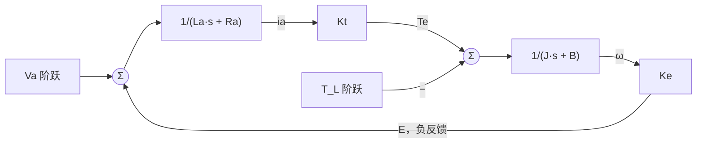
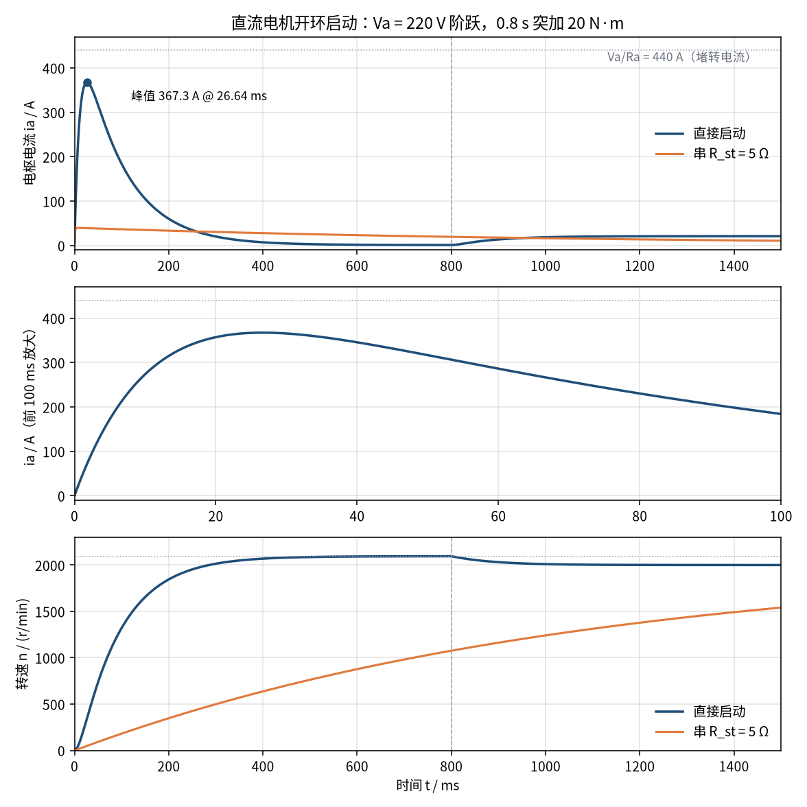

# 直流电机开环启动（dc-motor-open-loop）

> 适用课程：电机学 / 电力拖动自动控制系统 ｜ 难度：★★☆ ｜ 课时：约 40 分钟

参数是课堂用的圆整数，用来让启动电流、时间常数和稳态转速都落在好算的数附近。这是一台 **220 V、约 4 kW 量级的他励（励磁恒定）/ 永磁直流电机示例**，额定点取 20 A、20 N·m、约 2000 r/min，不是某一台电机的铭牌，也没有实测数据。本卡只讲「开环直接加额定电压时电流为什么会冲那么高、多久回落、最后转速停在哪」。不作为毕业设计或课程设计的调速系统成品。

和 [`rl-step`](../rl-step/README.md) 接在一起看：转子卡住不动时，电枢回路就是一个串联 RL，电流按 `τ_e = La/Ra` 升向 `Va/Ra`。转子一转起来，反电势 `E = K·ω` 把电流往回拉，所以电流先冲后落。

## 1. 目标

看懂开环启动的三件事。

**启动电流。** 合闸瞬间 `ω = 0`，反电势为 0，限制电流的只有很小的 `Ra` 和 `La`。若转子卡住，电流会升到堵转电流 `Va/Ra = 440 A`，是额定 20 A 的 22 倍。转子能转时，反电势在电流升上去的同时也在长，峰值落在 **367.289 A（约 18.4 倍额定）、26.642 ms**。这就是直流电机「不允许直接启动」（容量稍大就要限流）的原因。

**两个时间常数。** 电气时间常数 `τ_e = La/Ra = 10 ms` 决定电流能升多快；机电时间常数 `τ_m = J·Ra/K² = 100 ms` 决定转速多快跟上。两者都是近似：系统是二阶，真实的两个特征根对应 **11.271 ms 和 88.505 ms**。`τ_m` 比 `τ_e` 大得越多，近似越准。

**稳态转速由电压和负载决定。** 稳态时 `di/dt = 0`、`dω/dt = 0`：

```text
Va = Ra·Ia + K·ω          K·Ia = T_L + B·ω
ω  = (K·Va − Ra·T_L) / (K² + Ra·B)
```

空载 2095.606 r/min，加 20 N·m 后 2000.351 r/min，掉了 95.255 r/min。开环没有任何东西把转速拉回去，这就是下一张卡要加转速环的原因。

## 2. 接线图示意

励磁恒定（他励的励磁电流不变，或永磁），只画电枢回路。`t = 0` 开关 S 闭合；对照工况在电枢回路串入启动电阻 `R_st`。

```text
            S (t = 0)        R_st（对照工况才串入）
   + ───────/ ──────────────[ R_st ]──────┐
   │                                      │ ia →
  Va = 220 V                            [ Ra ]
   │                                      │
   │                                     ( La )
   │                                      │
   │                                   (  E  )  E = K·ω     ═══ 轴 ═══ J, B ══ 负载 T_L
   │                                      │
   − ─────────────────────────────────────┘
```

方程（Ke = Kt = K，SI 单位下两者数值相等）：

```text
电气   La·dia/dt = Va − Ra·ia − K·ω
机械   J·dω/dt   = K·ia − B·ω − T_L
```

方框图（Simulink 基础库按这个搭，详见 [`simulink/README.md`](simulink/README.md)）：



## 3. 参数表

| 符号 | 含义 | 取值 | 单位 |
|------|------|------|------|
| Va | 电枢电压（额定，阶跃） | 220 | V |
| Ra | 电枢电阻 | 0.5 | Ω |
| La | 电枢电感（5 mH） | 0.005 | H |
| K | 反电势系数 Ke = 转矩系数 Kt | 1.0 | V·s/rad = N·m/A |
| J | 电机 + 负载折算转动惯量 | 0.2 | kg·m² |
| B | 粘滞摩擦系数 | 0.005 | N·m·s/rad |
| T_L | 额定负载转矩，t = 0.8 s 突加 | 20 | N·m |
| I_N | 示例额定电流（只用来算倍数） | 20 | A |
| R_st | 对照工况启动电阻 | 5 | Ω |
| τ_e | 电气时间常数 La/Ra | 10 | ms |
| τ_m | 机电时间常数 J·Ra/K² | 100 | ms |
| t_end | 仿真时长 | 1.5 | s |

心算：`220/0.5 = 440 A`；`0.005/0.5 = 10 ms`；`0.2×0.5/1 = 0.1 s`；空载转速约 `220/K = 220 rad/s ≈ 2100 r/min`；加载掉速约 `Ra·T_L/K² = 10 rad/s ≈ 95.5 r/min`。

单位要统一成 SI：`La = 0.005`，不要写成 5；`K` 用 V·s/rad，若手里是 V/(1000 r/min) 要先换算（1 V·s/rad ≈ 104.72 V/(1000 r/min)）。转速 rad/s 乘 `60/(2π)` 才是 r/min。

## 4. 预期曲线

对照下图（由 `python/dc_motor_open_loop.py` 生成；蓝线是直接启动 + 0.8 s 加载，橙线是串 5 Ω 启动电阻、空载）。



可量化指标（默认参数，脚本打印到 6 位小数；全部来自矩阵指数解析解，RK45 只做核对）：

| 量 | 数值 | 说明 |
|----|-----:|------|
| 堵转电流 Va/Ra | 440 A | 22 倍额定；转子卡住时的稳态 |
| 启动电流峰值 | 367.288656 A | 18.36 倍额定 |
| 峰值时刻 | 26.641625 ms | 约 2.7 个 τ_e，此时反电势已约 36 V |
| τ_e / τ_m（近似） | 10 ms / 100 ms | La/Ra、J·Ra/K² |
| 真实两个时间常数 | 11.271 ms / 88.505 ms | 特征根约 −88.73、−11.30 s⁻¹ |
| 空载稳态转速 | 2095.606233 r/min（219.451372 rad/s） | 不是 2100：B 吃掉了一点 |
| 空载电流 | 1.097257 A | 只用来克服 B·ω |
| 0.8 s 加载前转速 | 2095.321223 r/min | 已基本稳定 |
| 带载稳态转速 | 2000.351404 r/min（209.476309 rad/s） | |
| 带载电流 | 21.047382 A | (T_L + B·ω)/K |
| 加载掉速 | 95.254829 r/min | 开环无法补回 |
| 带载反电势 | 209.476309 V | Va − Ra·Ia |
| 轴功率 T_L·ω | 4189.526185 W | 约 4.2 kW |
| 串 R_st 堵转电流 | 40 A | 2 倍额定 |
| 串 R_st 峰值 | 39.798433 A @ 6.462360 ms | 几乎就是 Va/(Ra+R_st) |
| 串 R_st 慢时间常数 | 1.069674 s | 总电阻 11 倍，τ_m 也约 11 倍 |
| 串 R_st 在 1.5 s 时转速 | 1541.149799 r/min | 还没到稳态 |

读图要点：

- 电流的上升沿和 `rl-step` 的 RL 曲线很像，斜率 `Va/La = 44000 A/s`；但它在 440 A 之前就掉头了，因为转速和反电势在同时上升。
- 转速曲线是一条「近似一阶」的上升，约 0.44 s（5 个 88.5 ms）到稳态；看不出过冲，因为本卡参数是过阻尼（`τ_m/τ_e = 10 > 4`）。
- 0.8 s 加载时转速往下掉，电流往上升，新稳态的电流由负载决定，与电压无关；转速由电压和负载共同决定。
- 串电阻把峰值压到 40 A，代价是启动慢了一个数量级。实际做法是分级切除电阻，或者降压启动；闭环系统里是电流环限幅，放到下一张卡。

## 5. 常见报错

| 现象 | 原因 | 处理 |
|------|------|------|
| 电流一下到 440 A 不回落，转速一直是 0 | 机械环没接上，或 Kt 的 Gain 填了 0，转矩出不来 | 检查 `ia → Kt → Sum2 → 1/J → ∫` 这条链 |
| 转速冲到几万 r/min 并一直涨 | 反电势反馈接成了正号，或忘了 Ke 那一路 | Sum1 符号 `+--`，Ke 的输出接到减号口 |
| 稳态转速 2.2 万 r/min 或 21 r/min | `K` 单位错了一百倍或用了 V/(1000 r/min) 原值 | 统一 SI；先心算 `ω ≈ Va/K` |
| 电流峰值只有几 A，像没有冲击 | `La` 写成 5（H）而不是 0.005，`τ_e` 变成 10 s | 电感用亨利，`τ_e = 10 ms` |
| 曲线一出来就是阶梯或锯齿 | 固定步长太大，或变步长没限 Max step | Max step size `2e-4`（约 τ_e/50） |
| 加载后转速反而升高 | Simscape 的 Ideal Torque Source 方向与本卡相反，或 Sum2 里 T_L 接在了加号口 | 负载转矩应从 Te 中减去；Simscape 中把 Step 终值改成 `-20` 或交换端口 |
| 用一个传递函数看到的「电流」和本卡对不上 | 只建了 `ω/Va` 的传递函数，把输出当成了电流 | 电流要从电气环积分器取，或单独写 `Ia/Va = (J s + B)/((La s+Ra)(J s+B)+K²)` |
| Python 报 `ModuleNotFoundError: scipy`（或 matplotlib） | 未装案例依赖 | `pip install -r cases/dc-motor-open-loop/python/requirements.txt` |
| MATLAB 报 「脚本中的函数定义必须出现在文件末尾」或找不到 `dcA` | 版本早于 R2016b，不支持脚本内局部函数 | 用 R2016b 以上；或把文件末尾 5 个函数各存成同名 `.m` |

## 6. 平台指引

三个平台用同一组参数。Python 与 MATLAB 都给出可运行脚本；Simulink 按步骤搭，不附 `.slx`。

### Simulink

两种搭法见 [`simulink/README.md`](simulink/README.md)：

- **基础库**：两个积分器 + 五个 Gain（`1/La = 200`、`Ra = 0.5`、`Kt = Ke = 1`、`1/J = 5`、`B = 0.005`）+ 两个 Step（Va 在 0 s 到 220，T_L 在 0.8 s 到 20）。求解器 `ode45`，Stop time `1.5`，Max step `2e-4`。
- **Simscape Electrical**：`DC Motor`（Electromechanical / Brushed Motors，按等效电路参数：Armature resistance `0.5`、Armature inductance `0.005`、Back-emf constant `1`、Rotor inertia `0.2`、Rotor damping `0.005`）+ DC Voltage Source + Current Sensor + Ideal Rotational Motion Sensor + Ideal Torque Source。求解器 `ode23t`。

两种搭法的读数都应对上第 4 节：峰值约 367.3 A，稳态约 2095.6 / 2000.4 r/min。

### MATLAB

脚本：[`matlab/dc_motor_open_loop.m`](matlab/dc_motor_open_loop.m)。只用基础函数（`expm`、`eig`、`ode45`、`plot`），不需要工具箱；脚本末尾有局部函数，需要 R2016b 以上。

```matlab
run('cases/dc-motor-open-loop/matlab/dc_motor_open_loop.m')
```

脚本用矩阵指数算解析解，用 `ode45` 核对，偏差超限就 `error` 停下。命令行打印的数字与下面 Python 的输出逐行相同。图片写到 `img/dc_motor_open_loop_curves_matlab.png`（运行后才有）。

### Python

脚本：[`python/dc_motor_open_loop.py`](python/dc_motor_open_loop.py)。依赖 numpy、scipy、matplotlib，见 [`python/requirements.txt`](python/requirements.txt)。

```bash
pip install -r cases/dc-motor-open-loop/python/requirements.txt
python cases/dc-motor-open-loop/python/dc_motor_open_loop.py
```

控制台应出现：

```text
DC motor open-loop start (separately excited / PM)
  tau_e_s            = 0.010000
  tau_m_s            = 0.100000
  tau_fast_s         = 0.011271
  tau_slow_s         = 0.088505
  i_stall_A          = 440.000000
  i_stall_over_In    = 22.000000
  t_peak_ms          = 26.641625
  i_peak_A           = 367.288656
  i_peak_over_In     = 18.364433
  w0_rad_s           = 219.451372
  n0_rpm             = 2095.606233
  ia0_A              = 1.097257
  n_at_load_rpm      = 2095.321223
  w1_rad_s           = 209.476309
  n1_rpm             = 2000.351404
  ia1_A              = 21.047382
  dn_load_rpm        = 95.254829
  e1_V               = 209.476309
  p_shaft_W          = 4189.526185
  i_stall_rst_A      = 40.000000
  i_peak_rst_A       = 39.798433
  t_peak_rst_ms      = 6.462360
  tau_slow_rst_s     = 1.069674
  n_end_rst_rpm      = 1541.149799
```

随后两行 `max_abs_err_i_A`、`max_abs_err_w` 是 RK45 相对解析解的最大偏差（本机约 `8.7e-05` A、`6.6e-05` rad/s），超过 0.05 A 或 0.01 rad/s 时脚本返回非零。曲线保存为 [`img/dc_motor_open_loop_curves.png`](img/dc_motor_open_loop_curves.png)。没有图形界面时只保存图片、不弹窗。

## 7. 课堂提问

1. 合闸瞬间（`t = 0+`）电流是多少？为什么「启动电流约 Va/Ra」这句话说的是上限而不是实际峰值？本卡的峰值为什么是 367 A 而不是 440 A？
2. 把 `La` 加倍到 10 mH，`τ_e` 变成多少？你猜峰值电流会变大还是变小、出现得早还是晚？用脚本验证。
3. 把 `J` 减到 0.05 kg·m²，`τ_m/τ_e` 变成多少？转速曲线还会是单调上升吗？
4. 空载转速为什么是 2095.6 r/min 而不是 220 rad/s 对应的 2100.8 r/min？把 `B` 设为 0 再算一次。
5. 加 20 N·m 以后掉了约 95 r/min。想让转速回到 2095 r/min，开环情况下应该把 `Va` 调到多少？如果负载一直在变，这个办法还行吗？
6. 串 5 Ω 启动电阻把峰值压到 40 A，但 1.5 s 才到约 1541 r/min。为什么实际要分级切除电阻？切掉的那一刻电流会怎样？

## 8. 相关链接

- 案例卡字段约定：[docs/case-convention.md](../../docs/case-convention.md)
- 电枢回路本身就是一阶 RL：[RL 电路阶跃响应（rl-step）](../rl-step/README.md)。转子卡住时本卡的电流就是那条曲线，`τ = La/Ra = 10 ms`、稳态 `Va/Ra`。
- 交流电机的同一个问题：[异步电机 V/f 恒压频比控制（motor-vf）](../motor-vf/README.md)。那边直接加 50 Hz、380 V 的起动电流是 26.3 A，所以用频率斜坡启动；这边用的是启动电阻对照。
- 下一张卡：[直流电机 PI 转速环（pi-speed-loop）](../pi-speed-loop/README.md)。在本卡的电机模型外面加转速 PI，把加载掉的 95 r/min 拉回来（带载稳态 Va = 167.47 V），并说明单环 + 电压限幅为什么压不住 367 A 的启动电流。
