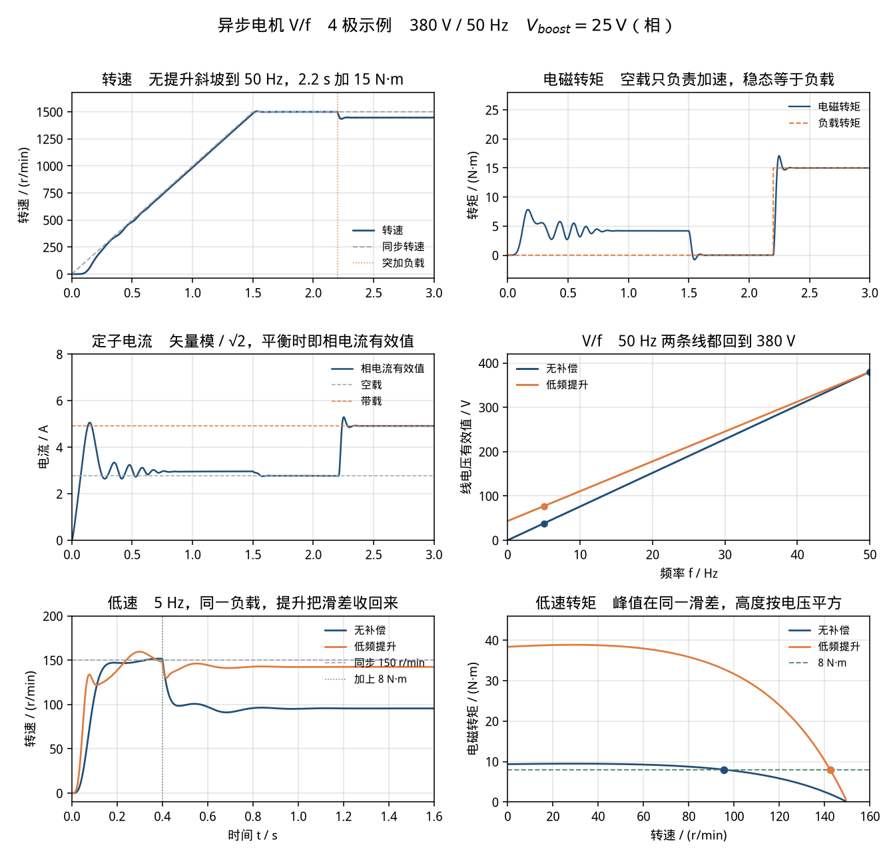

# 异步电机 V/f 恒压频比控制（motor-vf）

> 适用课程：电机学 / 电力拖动自动控制系统 ｜ 难度：★★★ ｜ 课时：约 50 分钟

参数是课堂用的圆整数，用来把同步转速、滑差和低频电压提升算在整数附近。这是一台 **4 极、Y 接、380 V / 50 Hz 量级的笼型异步电机示例**，约 2.2 kW 这一档的轴功率，不是某一台电机的铭牌，也没有实测数据。本卡只讲「频率决定同步转速，电压跟着频率走是为了磁通；低频时定子电阻会把转矩吃掉」。不作为毕业设计或课程设计的变频器成品。

和 [`three-phase-inverter-spwm`](../three-phase-inverter-spwm/README.md) 接在一起看：那边的桥把直流母线切成三相斩波，线电压基波由调制比决定。这里把逆变器换成理想正弦，电压有效值按 V/f 给定，专门看转速和转矩。斩波边带不进这个模型。两边的电压数字各算各的：那边母线是 200 V 的课堂圆整值，这边是 380 V 的示例电机。

## 1. 目标

看懂恒压频比（V/f）的三件事。

同步转速只看频率和极对数：

```text
n_sync = 60 · f / n_p
```

4 极是极对数 `n_p = 2`，不是 4。50 Hz 的同步转速是 1500 r/min，5 Hz 是 150 r/min。摩擦取 0、负载也是 0 时，稳态转速落到同步转速上。

加上恒转矩负载以后，转子必须有滑差，电磁转矩才出得来。稳态转速是同步转速减去滑差转速，电磁转矩回到负载转矩。本卡 50 Hz、15 N·m 时，滑差 `s = 0.035724`，转速是 1446.414 r/min，轴功率 2272.022 W。

电压按频率成比例下降，是为了让每极磁通大致不变。频率很低时，`R_s I` 占掉相电压的一大截，磁通下降，同一转矩需要的滑差变大，最大转矩也下降。把零频处的相电压抬高 `V_boost`，并在额定频率仍回到额定电压，就是低频电压提升（转矩提升，按预设电流做的 IR 补偿）。5 Hz、同一个 8 N·m：无补偿转速 95.613 r/min，有提升 142.469 r/min。

## 2. 接线图示意

Y 接，中性点能承受相电压。频率指令 `f*` 同时决定旋转速度和电压幅值。电机侧是静止 αβ 模型，幅值不变的 Clarke 变换：相电压峰值等于 `v_sα`、`v_sβ` 合成矢量的长度。

```text
 f* ──┬── ×(2π) ── ∫ ── θ ── cos / sin ──┐
      │                                    ├── v_sα , v_sβ ──► 异步电机
      └── V/f 曲线 ── V_ph(f) ── ×√2 ─────┘                      │
                                                                 │ Te
                                                                 ▼
                              T_L  ──────────────►  J dω_m/dt = Te − T_L
```

两条电压规律，`f ≤ 50 Hz`。超过 50 Hz 的弱磁本卡不做。

```text
无补偿     V_ph = V_ph,n · f / 50
           V_ll = 380 · f / 50 = 7.6 · f          （线电压有效值）

低频提升   V_ph = 25 + (V_ph,n − 25) · f / 50
           f = 0  时相电压 25 V，线电压 43.301 V
           f = 50 时两条规律都是相电压 219.393 V、线电压 380 V
```

25 V 是 `R_s × 11.364 A`。11.364 A 比空载电流 2.770 A 大，所以这是按负载电流预设的转矩提升，不是只补励磁电流，也没有用实测电流做闭环。

静止坐标系里的动态模型（脚本和 MATLAB 都是这一组）：

```text
dθ/dt = 2π f
v_sα = √2 · V_ph(f) · cos θ
v_sβ = √2 · V_ph(f) · sin θ          正序，转速为正

τ_r = L_r / R_r          σ = 1 − L_m² / (L_s L_r)          ω_r = n_p ω_m

dψ_rα/dt = −ψ_rα/τ_r − ω_r ψ_rβ + (L_m/τ_r) i_sα
dψ_rβ/dt = −ψ_rβ/τ_r + ω_r ψ_rα + (L_m/τ_r) i_sβ

σ L_s di_sα/dt = v_sα − R_s i_sα − (L_m/L_r) dψ_rα/dt
σ L_s di_sβ/dt = v_sβ − R_s i_sβ − (L_m/L_r) dψ_rβ/dt

T_e = (3/2) · n_p · (L_m/L_r) · (ψ_rα i_sβ − ψ_rβ i_sα)
J dω_m/dt = T_e − T_L
```

`3/2` 来自幅值不变的 Clarke。换成功率不变（系数 `√(2/3)`）时，这个 `3/2` 要拿掉，电压电流的标度也一起变。两套不能各取一半。

稳态对照用 T 型等效电路，转子量已经折算到定子。滑差 `s = (n_sync − n) / n_sync`，电磁转矩是气隙功率除以同步机械角速度：

```text
T_e = P_ag / ω_sync,m          ω_sync,m = 2π f / n_p
P_ag = 3 · |I_r|² · (R_r / s)
```

没有 Simscape 时，用上面的积分搭方框图，或把导数放进 MATLAB Function，见 [`simulink/README.md`](simulink/README.md)。

## 3. 参数表

| 符号 | 含义 | 取值 | 单位 |
|------|------|------|------|
| n_p | 极对数（4 极） | 2 | — |
| f_n | 额定频率 | 50 | Hz |
| V_ll | 额定线电压有效值 | 380 | V |
| V_ph | 额定相电压有效值 V_ll/√3 | 219.393102 | V |
| V_ph,peak | 额定相电压峰值 | 310.268701 | V |
| R_s | 定子电阻 | 2.2 | Ω |
| R_r | 转子电阻，已折算到定子 | 1.8 | Ω |
| L_ls | 定子漏感 | 0.012 | H |
| L_lr | 转子漏感，已折算 | 0.012 | H |
| L_m | 励磁电感 | 0.24 | H |
| L_s, L_r | L_ls+L_m ，两边相同 | 0.252 | H |
| σ | 漏磁系数 | 0.092971 | — |
| τ_r | 转子时间常数 L_r/R_r | 0.140 | s |
| J | 转动惯量 | 0.04 | kg·m² |
| B | 粘滞摩擦 | 0 | N·m·s |
| V_boost | 低频提升，相电压有效值，f = 0 | 25 | V |
| I_preset | 提升所对应的预设电流 V_boost/R_s | 11.363636 | A |
| T_L | 50 Hz 突加负载，t = 2.2 s | 15 | N·m |
| f_low | 低速对照频率 | 5 | Hz |
| T_L,low | 低速对照负载，t = 0.4 s 加上 | 8 | N·m |
| t_ramp | 频率从 0 升到 50 Hz | 1.5 | s |
| h | RK4 步长 | 0.2 | ms |
| n_sync | 50 Hz 同步转速 | 1500 | r/min |
| n_sync,low | 5 Hz 同步转速 | 150 | r/min |

心算：`60×50/2 = 1500`，`60×5/2 = 150`，`380/50 = 7.6 V/Hz`，`380×5/50 = 38 V`（5 Hz 无补偿的线电压）。`25/2.2 ≈ 11.36 A`。

主工况斜坡**不开**提升。50 Hz 以后两条电压规律相同，稳态滑差与提升无关。提升只出现在 V/f 曲线和 5 Hz 对照里。

脚本里电感用亨利：`L_m = 0.24`，不要写成 240。极对数填 `2`。相电压用 `380/sqrt(3)`，不要把 380 直接当成一相的正弦峰值。

## 4. 预期曲线

50 Hz、电压已经是额定值时，空载转速就是同步转速，带载转速由等效电路的稳定滑差决定：

```text
n = n_sync · (1 − s)          T_e(s) = T_L          0 < s < s_bd
```

`s_bd` 是最大转矩那个滑差。稳定运行在它的左侧（转速更高的那一侧）。本卡 50 Hz 的 `s_bd = 0.234403`，最大转矩 43.067 N·m。15 N·m 离它还远。

5 Hz 时漏抗很小，最大转矩几乎按电压的平方变化。无补偿最大转矩 9.468 N·m，有提升 38.847 N·m，比值 4.102879，和相电压比的平方印到 6 位小数是同一个数。8 N·m 已经贴近无补偿的最大转矩，所以滑差很大；有提升以后 8 N·m 只占最大转矩的一小截，滑差回到 0.05 附近。

线性电感没有饱和，也没有铁耗。5 Hz 有提升时相电压 44.439 V，是无补偿 21.939 V 的两倍出头，模型里的磁通大约也是两倍。真实电机这时会饱和，补偿后的转矩是上限，不是饱和以后的实测。

对照下图（由 `python/motor_vf.py` 生成）。



可量化指标（默认参数，脚本打印到 6 位小数）。这些是演示读数，用来对曲线，不是作业的标准答案。等效电路一列和 RK4 在稳态窗口里的平均值应该对得上。

额定频率，无提升斜坡，读数窗口是 2.00–2.20 s（空载）和 2.70–3.00 s（带载）：

| 量 | 等效电路 | RK4 窗口 | 差 |
|----|--------:|---------:|----|
| 空载转速 | 1500 r/min | 1500.000211 r/min | +0.000211 r/min |
| 空载相电流 | 2.770161 A | 2.770154 A | 励磁电流 |
| 带载转速 | 1446.414189 r/min | 1446.414411 r/min | +0.000221 r/min |
| 带载电磁转矩 | 15 N·m | 14.999994 N·m | 回到负载 |
| 带载相电流 | 4.913894 A | 4.913888 A | |
| 轴功率 T_L·ω_m | 2272.022095 W | — | 约 2.27 kW |

滑差转速是 `1500 − 1446.414 = 53.586 r/min`。相对误差 `rel_err_n_load` 印成 0.000000，是因为相对误差约 `1.5×10⁻⁷`，小于 `5×10⁻⁷`。绝对差在 `abs_err_n_load_rpm = 0.000221`。

加速段电磁转矩大约 4 N·m，正好是把 `J = 0.04` 在 1.5 s 内拉到 157 rad/s 所需的平均转矩：`0.04 × (2π×50/2) / 1.5 ≈ 4.19 N·m`。1.5 s 频率到位以后转矩回到 0，2.2 s 的阶跃再把它拉回 15 N·m。加载瞬间转矩会冲到 17 N·m 附近，随后贴住 15。

电流是空间矢量的模再除以 √2。三相对称时，它就是定子相电流有效值，所以稳态是一条平线，不是 50 Hz 的正弦。正弦在 α、β 两个分量里。加速段电流短时到 5 A 上下，然后收到 2.770 A。这是斜坡启动。若在静止时直接加上 50 Hz、380 V，等效电路给出起动电流 26.335 A、起动转矩 21.614 N·m（滑差 = 1）。最大转矩 43.067 N·m 在滑差 0.234，不在堵转点。

5 Hz 对照。0.4 s 以前空载，两条转速都奔向 150 r/min；加上 8 N·m 以后分开。窗口是 1.30–1.60 s。

| 量 | 无补偿 | 低频提升 |
|----|-------:|---------:|
| 相电压有效值 | 21.939310 V | 44.439310 V |
| 线电压有效值 | 38.000000 V | 76.971143 V |
| 临界滑差 | 0.805311 | 0.805311 |
| 最大转矩 | 9.468199 N·m | 38.846871 N·m |
| 8 N·m 的稳定滑差 | 0.362590 | 0.050205 |
| 转速，等效电路 | 95.611532 r/min | 142.469294 r/min |
| 转速，RK4 | 95.613002 r/min | 142.469022 r/min |
| 电磁转矩，RK4 | 8.000659 N·m | 8.000202 N·m |
| 相电流，等效电路 | 3.600077 A | 5.263624 A |
| 相电流，RK4 | 3.599598 A | 5.263453 A |

两条 RK4 转速相差 `dn_boost_rpm = 46.856020`。无补偿的转速误差 0.001470 r/min，有提升的误差 −0.000272 r/min。

有提升时电流更大，转矩却仍是 8 N·m。电流变大是因为磁通上来了，励磁电流上来了；滑差变小，转子电流反而下去。低速转矩看磁通，不看谁的电流表数字更大。

转矩–转速曲线在 5 Hz 很平：无补偿从堵转到 60 r/min，转矩都在 9.2–9.5 N·m。8 N·m 的水平线和它交在 95.6 r/min，离峰值不远，所以转速掉得厉害。有提升的整条曲线大约高到 4.1 倍，8 N·m 交在 142.5 r/min，贴着 150。峰值在同一滑差（电压不改变 `s_bd`），高度按电压平方走。峰值左侧（转速更低）是不稳定区，时间曲线上的稳态落在峰值右侧。

## 5. 常见报错

| 现象 | 原因 | 处理 |
|------|------|------|
| 空载转速停在 3000 r/min 或 750 r/min | 极对数和极数填反。4 极是 `n_p = 2` | `n_sync = 60×50/2 = 1500`。示波器若以 rad/s 显示，机械同步角速度是 `157.08`，电角速度才是 `314.16` |
| 带载以后转速仍是 1500，转矩却上不去 | 滑差被钉死了，或负载转矩没有加到机械方程上 | 稳态应是 1446.414 r/min，转矩 15 N·m。负载在 2.2 s 才加上 |
| 加载后转速升高 | 负载转矩的符号和电磁转矩相同，变成了拖动转矩 | `J dω/dt = Te − T_L`，T_L 为正才是负载。Simulink 里符号反了就把阶跃改成负 |
| 线电压基波拿 310 V 或 537 V 去对 | 310.269 V 是相电压峰值。537 V 是把 380 再乘了 √2，那是线电压峰值 | 相电压有效值 219.393 V，线电压有效值 380 V |
| 5 Hz 时期望线电压 19 V 或 110 V | 7.6 V/Hz 是线电压。19 V 多半是把相电压又除了一遍 √3；110 V 是把 380 只乘了 5/√3 而没有除 50 | 无补偿就是 `7.6×5 = 38 V` 线电压 |
| 提升打开以后，50 Hz 的电压变成 380 V 再加 25 V | 提升加在零频，斜率要减小，额定点才回到 380 V | 用 `V = V_boost + (V_n − V_boost)·f/f_n`。两条线在 50 Hz 重合 |
| 5 Hz 有提升时期望转速也只比 96 r/min 高一点点 | 把 25 V 看成额定电压的 11%，觉得磁通只多 11% | 5 Hz 无补偿的相电压只有 21.9 V，25 V 的抬高已经和它同一量级。相电压从 21.939 V 变成 44.439 V |
| 补偿后电流从 3.6 A 升到 5.3 A，认为转矩也变大了 | 稳态转矩被 8 N·m 的负载定死 | 转矩两条都是 8 N·m。电流变大是磁通变大。转速从 95.6 升到 142.5，才是转矩能力回来了 |
| 直接 50 Hz 合闸，电流二十多安，和斜坡的 5 A 对不上 | 滑差 = 1 的起动电流是 26.335 A。斜坡把频率慢慢加上，滑差一直很小 | 本卡主曲线是斜坡。起动电流用等效电路 `s = 1` 那一列，不要和斜坡的电流包络比 |
| 转速反了，或一直停在 0 | β 轴电压符号反了，正序变成负序；或转矩公式里 α、β 乘反了 | `v_sβ = Vm sin θ`，θ 增大为正转。转矩是 `ψ_rα i_sβ − ψ_rβ i_sα` |
| 电流和转矩差了 1.5 倍 | 幅值不变和功率不变的 Clarke 各用了一半 | 本卡电压峰值等于相电压峰值，转矩保留 `3/2` |
| 励磁电感写成 0.24 mH，空载电流特别大 | 0.24 H 写成了 0.24×10⁻³ H | `L_m = 0.24`。空载电流应是 2.770 A |
| 漏感和励磁电感对调 | L_ls = 0.24 H 会使漏抗大过励磁电抗，转矩很小 | 漏感 0.012 H，励磁 0.24 H |
| 转子电阻忘记折算，或滑差公式里分母用了机械频率 | 等效电路里的 R_r 必须是折到定子侧的；滑差的分母是同步转速 | 本卡 R_r = 1.8 Ω 已经折算。`s = (1500 − n)/1500` |
| 频率指令 50，正弦周期大约 126 ms | Sine Wave 的 Frequency 单位是 rad/s | 本卡不用 Sine Wave 的频率框。角度是 `∫ 2π f dt`，f 的单位才是 Hz |
| 5 Hz 的正弦填成 `sin(5t)` | 5 的单位是 rad/s，实际大约 0.8 Hz | `sin(2π·5·t)`，或积分器输入 `2*pi*5` |
| 求解器一步跨过电暂态，转矩发毛 | σ L_s / R_s 大约 5 ms 量级，步长却是 10 ms | 定步长用 `2e-4`。Simulink 最大步长 `1e-4` |
| 电机惯量又串了一个 J，转速爬得特别慢 | 电机模块里已经有 `J = 0.04`，外面又接了惯性块 | 只留电机里的惯量。摩擦设为 0，空载才落在 1500 |
| 低速提升后转矩远小于脚本 | 线性模型没有饱和。真实电机或 Simscape 打开了饱和，磁通被卡住 | 本卡对的是不饱和读数。饱和打开以后，5 Hz 的提升转矩会比 38.8 N·m 小，要在讲义里单独声明 |
| 主斜坡也打开 25 V 提升，10 Hz 以前转速来回冲 | 提升把低速转矩能力做得很大，`J = 0.04` 又小 | 主曲线故意不开提升，额定点两种规律相同。提升放在 5 Hz 的定点对照里看 |
| Python 报 `ModuleNotFoundError: scipy`（或 matplotlib、numpy） | 未装案例依赖 | 在 `python/` 下执行 `pip install -r requirements.txt` |
| MATLAB 曲线和命令行数字对不上 | 改了工作区里的电阻、惯量后没有重新运行脚本 | 重新运行 `motor_vf.m`。以命令行的 `n_meas_load_rpm` 为准 |

## 6. 平台指引

三个平台用同一组参数。Python 与 MATLAB 都给出可运行脚本，积分都是步长 0.2 ms 的 RK4，打印同一组字段。Simulink 按下面的模块清单搭，不附带 `.slx`。逐步点击说明见 [`simulink/README.md`](simulink/README.md)。

### Simulink

实验室若装了 Simscape Electrical，用笼型感应电机加三只受控电压源。相电压峰值由 V/f 算出来，中性点接电气参考。负载转矩用阶跃，2.2 s 加到 15 N·m，符号以「加载后转速下降」为准。

求解器：**Variable-step / ode23t**，Stop time = `3`，Max step size = `1e-4`，Relative tolerance = `1e-4`。空载段转速应在 157.1 rad/s（1500 r/min）附近，2.2 s 以后收到约 151.5 rad/s（1446 r/min）。

5 Hz 对照把频率定在 5 Hz，Stop time = `1.6`，0.4 s 加 8 N·m。无补偿相电压峰值 `sqrt(2)*380/sqrt(3)*5/50`，有提升用 `sqrt(2)*(25+(380/sqrt(3)-25)*5/50)`。转速大约 10.01 rad/s 和 14.92 rad/s，也就是 96 r/min 和 142 r/min。

没有 Simscape 时，用积分器生成 θ，MATLAB Function 输出第 2 节那 6 个导数，再送回 6 个积分器。方程和脚本相同。

已安装 Specialized Power Systems 时，用 `powergui`（Continuous）+ Asynchronous Machine SI Units + 三只 Controlled Voltage Source。摩擦 `F = 0`，极对数 `2`，饱和关掉。测量解复用器读转子转速和电磁转矩。

### MATLAB

脚本：[`matlab/motor_vf.m`](matlab/motor_vf.m)。只用基础函数（定步长 RK4、`sin`、`cos`、复数等效电路、`plot`），不需要工具箱。文件末尾的局部函数从 R2016b 起属于基础语言。

```matlab
run('cases/motor-vf/matlab/motor_vf.m')
```

脚本和 Python 用同一套步长、同一套三分法搜临界滑差、同一套二分法搜负载滑差。打印同一组字段。图片写到 `img/motor_vf_curves_matlab.png`（运行后才有）。校验不通过会用 `error` 停下来。

### Python

脚本：[`python/motor_vf.py`](python/motor_vf.py)。依赖 numpy、scipy、matplotlib，见 [`python/requirements.txt`](python/requirements.txt)。`scipy.optimize.brentq` 核对二分滑差，`scipy.integrate.solve_ivp` 在锁定的稳态转速上核对 RK4 转矩。这两项只做校验，不另起一行打印，所以命令行和 MATLAB 逐行相同。

```bash
pip install -r cases/motor-vf/python/requirements.txt
python cases/motor-vf/python/motor_vf.py
```

没有图形界面时只保存图片、不弹窗。校验失败时进程返回码不是 0。

控制台应出现：

```text
Induction motor V/f
  np_pairs                   = 2.000000
  f_rated_Hz                 = 50.000000
  Vll_rated_V                = 380.000000
  Vph_rated_V                = 219.393102
  Vph_peak_V                 = 310.268701
  Rs_ohm                     = 2.200000
  Rr_ohm                     = 1.800000
  Lls_H                      = 0.012000
  Llr_H                      = 0.012000
  Lm_H                       = 0.240000
  Ls_H                       = 0.252000
  Lr_H                       = 0.252000
  sigma                      = 0.092971
  tau_r_s                    = 0.140000
  J_kgm2                     = 0.040000
  Vboost_V                   = 25.000000
  Vll_boost0_V               = 43.301270
  I_boost_preset_A           = 11.363636
  vf_line_V_per_Hz           = 7.600000
  n_sync_rpm                 = 1500.000000
  I0_theory_A                = 2.770161
  Tl_Nm                      = 15.000000
  s_bd_rated                 = 0.234403
  Temax_rated_Nm             = 43.066674
  s_load                     = 0.035724
  n_load_theory_rpm          = 1446.414189
  I_load_theory_A            = 4.913894
  P_shaft_W                  = 2272.022095
  n_meas_noload_rpm          = 1500.000211
  I_meas_noload_A            = 2.770154
  n_meas_load_rpm            = 1446.414411
  Te_meas_load_Nm            = 14.999994
  I_meas_load_A              = 4.913888
  f_low_Hz                   = 5.000000
  n_sync_low_rpm             = 150.000000
  Tl_low_Nm                  = 8.000000
  Vph_low_off_V              = 21.939310
  Vph_low_on_V               = 44.439310
  Vll_low_off_V              = 38.000000
  Vll_low_on_V               = 76.971143
  s_bd_low                   = 0.805311
  Temax_low_off_Nm           = 9.468199
  Temax_low_on_Nm            = 38.846871
  Temax_ratio_low            = 4.102879
  V_ratio_sq_low             = 4.102879
  I_start_50_A               = 26.334775
  Te_start_50_Nm             = 21.613747
  s_low_off                  = 0.362590
  n_low_off_theory_rpm       = 95.611532
  I_low_off_theory_A         = 3.600077
  s_low_on                   = 0.050205
  n_low_on_theory_rpm        = 142.469294
  I_low_on_theory_A          = 5.263624
  n_meas_low_off_rpm         = 95.613002
  n_meas_low_on_rpm          = 142.469022
  Te_meas_low_off_Nm         = 8.000659
  Te_meas_low_on_Nm          = 8.000202
  I_meas_low_off_A           = 3.599598
  I_meas_low_on_A            = 5.263453
  dn_boost_rpm               = 46.856020
  abs_err_noload_rpm         = 0.000211
  abs_err_n_load_rpm         = 0.000221
  abs_err_n_low_off_rpm      = 0.001470
  abs_err_n_low_on_rpm       = -0.000272
  rel_err_n_load             = 0.000000
  rel_err_I_load             = -0.000001
  rel_err_n_low_off          = 0.000015
  rel_err_n_low_on           = -0.000002
```

上面这些 6 位小数字段，MATLAB 脚本应逐行相同。`rel_err_n_load` 印成 0，是因为相对误差远小于 `5×10⁻⁷`；绝对差看 `abs_err_n_load_rpm`。曲线保存为 [`img/motor_vf_curves.png`](img/motor_vf_curves.png)。

## 7. 课堂提问

1. 4 极、50 Hz，同步转速为什么是 1500 r/min？空载摩擦为 0 时，转速为什么落到 1500，而不是停在一个「额定转速」上？
2. 2.2 s 加上 15 N·m 以后，转速为什么变成大约 1446 r/min？这 54 r/min 的差和滑差 `s = 0.035724` 是什么关系？电磁转矩为什么最后等于 15 N·m，而不是等于最大转矩 43 N·m？
3. 只把频率调到 5 Hz，线电压按 7.6 V/Hz 降到 38 V。同一个 8 N·m，为什么转速掉到大约 96 r/min，而不是 150 r/min 减去一个小滑差？
4. 低频提升把 5 Hz 的相电压从 21.939 V 抬到 44.439 V。最大转矩为什么大约变成 4.1 倍？50 Hz 时电压还是 380 V，这条提升改不改额定点的滑差？
5. 补偿以后相电流从 3.60 A 变成 5.26 A，转矩却还是 8 N·m。多出来的电流去哪了？线性模型给出的 38.8 N·m，到了会饱和的真实电机上还成立吗？

## 8. 相关链接

- 案例卡字段约定：[docs/case-convention.md](../../docs/case-convention.md)
- 正弦电压从哪来：[三相 SPWM 逆变器（three-phase-inverter-spwm）](../three-phase-inverter-spwm/README.md)。那边把直流母线切成斩波，线电压基波由调制比决定；这里把斩波换成理想正弦，专门看 V/f 和低频提升。
