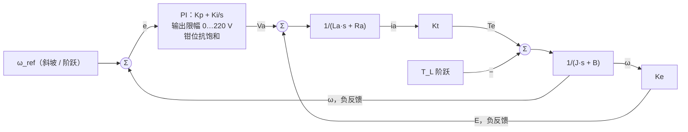
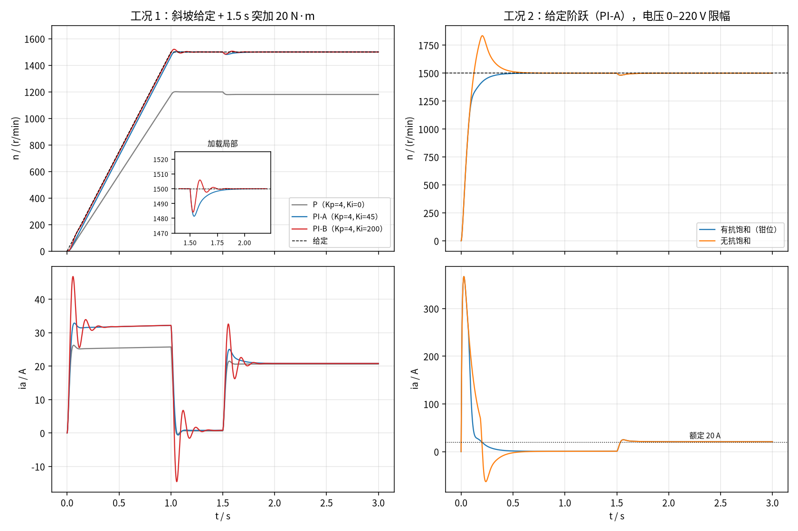

# 直流电机 PI 转速环（pi-speed-loop）

> 适用课程：电力拖动自动控制系统 / 自动控制原理 ｜ 难度：★★☆ ｜ 课时：约 45 分钟

电机参数和 [`dc-motor-open-loop`](../dc-motor-open-loop/README.md) 完全相同（220 V、约 4 kW 量级的他励励磁恒定 / 永磁示例，额定点约 20 A、20 N·m），不是某台电机的铭牌，也没有实测数据。上一张卡的结论是「开环加载会掉 95 r/min，自己拉不回来」；这张卡在外面套一个**转速 PI**，看 Kp / Ki 各管什么，以及为什么单独一个转速环解决不了启动电流冲击。不作为毕业设计或课程设计的调速系统成品。

为了把注意力放在「调参」上，本卡做了三个简化：变流器当成**理想可控电压源**（输出 0–220 V，电流可以双向，相当于二象限斩波器）；转速测量没有滤波和延时；没有电流环。真正的双闭环在本卡最后一节作为引子。

## 1. 目标

**P 有静差，PI 无静差。** 只用比例 `Kp = 4` 时，闭环直流增益 `Kp·G(0)/(1 + Kp·G(0))`（`G(0) = K/(K² + Ra·B) ≈ 0.9975`）只有 0.7996，给定 1500 r/min、空载只到 **1199.4 r/min**，加载后再掉到 **1180.3 r/min**。加上积分以后，稳态误差为零：带载稳态仍是 1500 r/min，积分器自己把电压从约 157 V 加到 **167.47 V**。

**Ki 调「快慢」也调「抖不抖」。** Kp 固定为 4：

- `Ki = 45`（PI-A）：积分零点 `Ki/Kp = 11.25 s⁻¹`，几乎正好消掉电机的慢极点 `−11.30 s⁻¹`，剩下 `s² + 88.73 s + 4000`，`ζ ≈ 0.70`。加载掉 18.6 r/min，约 232 ms 回到 ±2 r/min 内，几乎不振荡。
- `Ki = 200`（PI-B）：`ζ ≈ 0.29`，恢复快一点（约 162 ms），但斜坡结束时转速超调 20.3 r/min，电流振荡到 46.8 A 和 −14.5 A。

**单环 + 电压限幅压不住启动电流，还会带来积分饱和。** 给定直接阶跃到 1500 r/min 时，PI 输出立刻顶到 220 V，这和上一张卡「直接合闸」完全一样，峰值仍是 **367.3 A（18.4 倍额定）**。限幅期间积分器若继续积分（无抗饱和），出限幅后转速冲到 **1834.7 r/min**（超调 334.7 r/min）；用钳位抗饱和后不超调。启动电流要靠斜坡给定或电流内环来限，这是双闭环的由来。

## 2. 接线图示意

主电路（只画电枢回路，励磁恒定）：

```text
          理想可控电压源（0–220 V）
   + ─────[ Va = sat(Kp·e + z) ]────────┐
   │                                    │ ia →
   │                                  [ Ra ]
   │                                  ( La )
   │                                 (  E  )  E = K·ω    ═══ 轴 ═══ J, B ══ 负载 T_L（1.5 s 突加）
   − ───────────────────────────────────┘                     │
                                                              ▼ 测速（理想，无延时）
                                                              ω ──► 回到 PI 的减号口
```

控制框图（Simulink 按这个搭，详见 [`simulink/README.md`](simulink/README.md)）：



方程：

```text
La·dia/dt = Va − Ra·ia − K·ω
J·dω/dt   = K·ia − B·ω − T_L
e = ω_ref − ω,   u = Kp·e + z,   Va = min(max(u, 0), 220)
dz/dt = Ki·e     （钳位：u > 220 且 e > 0，或 u < 0 且 e < 0 时 dz/dt = 0）
```

## 3. 参数表

| 符号 | 含义 | 取值 | 单位 |
|------|------|------|------|
| Ra | 电枢电阻 | 0.5 | Ω |
| La | 电枢电感 | 0.005 | H |
| K | Ke = Kt | 1.0 | V·s/rad = N·m/A |
| J | 折算转动惯量 | 0.2 | kg·m² |
| B | 粘滞摩擦系数 | 0.005 | N·m·s/rad |
| V_max / V_min | 控制器输出（电枢电压）限幅 | 220 / 0 | V |
| n_ref | 转速给定（ω_ref = 157.0796 rad/s） | 1500 | r/min |
| t_ramp | 工况 1 给定斜坡时间 | 1.0 | s |
| T_L | 负载转矩，t = 1.5 s 突加 | 20 | N·m |
| Kp | 比例增益（三组都一样） | 4 | V/(rad/s) |
| Ki | 积分增益：P / PI-A / PI-B | 0 / 45 / 200 | V/rad |
| I_N | 示例额定电流（只用来算倍数） | 20 | A |
| t_end | 仿真时长 | 3.0 | s |

心算：电机 `ω/Va = K/((La s + Ra)(J s + B) + K²) = 1000/(s² + 100.025 s + 1002.5)`，两个极点 `−88.73`、`−11.30 s⁻¹`（就是上一张卡的 88.5 ms / 11.3 ms 两个时间常数取倒数）。斜坡期间的加速转矩 `J·dω/dt = 0.2 × 157.08 / 1 = 31.4 N·m`，所以 PI 跟住斜坡时电流约 32 A。

Kp 的单位是「每 rad/s 误差给多少伏」：`Kp = 4` 意味着差 10 r/min（1.047 rad/s）只多给 4.19 V。若控制器里转速用 r/min，`Kp` 要除以 `60/(2π) ≈ 9.549`，`Ki` 同理。

## 4. 预期曲线

对照下图（由 `python/pi_speed_loop.py` 生成）。左列是工况 1：斜坡给定 + 1.5 s 加载，灰 / 蓝 / 红分别是 P、PI-A、PI-B；右列是工况 2：PI-A 给定阶跃，蓝线有抗饱和、橙线无抗饱和。



可量化指标（默认参数，脚本打印到 3 位小数；数值解 RK45，Radau 核对偏差 < 1e-6 rad/s，带载末值与解析稳态比对）：

| 量 | P（4, 0） | PI-A（4, 45） | PI-B（4, 200） | 说明 |
|----|---:|---:|---:|------|
| 闭环极点 | −50.01 ± 50.01j，0 | −44.39 ± 45.10j，−11.24 | −15.28 ± 51.44j，−69.46 | P 的 0 极点是积分器状态恒为 0 |
| 主导阻尼比 ζ | 0.707 | 0.702 | 0.285 | |
| 加载前转速 | 1199.400 r/min | 1499.999 r/min | 1500.004 r/min | P 有静差约 300 r/min |
| 带载稳态转速（解析） | 1180.311 r/min | 1500 r/min | 1500 r/min | 开环同样负载掉 95.255 r/min |
| 加载动态跌落 | 20.369 r/min | 18.608 r/min | 15.853 r/min | 相对加载前 |
| 回到 ±2 r/min 用时 | 24.3 ms* | 231.9 ms | 162.0 ms | *P 以它自己的 1180.3 为目标 |
| 斜坡结束超调 | −298.992（静差） | 2.231 r/min | 20.286 r/min | 1.0–1.5 s 内最大值 − 1500 |
| 最大电流 | 26.232 A | 32.854 A | 46.782 A | 斜坡阶段 |
| 最小电流 | −0.46 A | −0.62 A | −14.54 A | 斜坡结束时减速（需二象限） |
| 带载稳态电流 | 20.618 A | 20.785 A | 20.785 A | (T_L + B·ω)/K |
| 带载稳态电压 | 133.911 V | 167.472 V | 167.472 V | Ra·Ia + K·ω |
| 最大电压 | 135.960 V | 169.676 V | 173.135 V | 均未碰 220 V 限幅 |

工况 2（PI-A，给定阶跃 0 → 1500 r/min）：

| 量 | 有抗饱和（钳位） | 无抗饱和 | 说明 |
|----|---:|---:|------|
| 最大电流 | 367.288 A（18.36 倍） | 367.288 A | 与开环直接启动峰值相同，26.6 ms |
| 输出最后一次顶在 220 V | 67.3 ms | 183.9 ms | 积分器「欠的账」要还 |
| 转速峰值 | 1500.000 r/min | 1834.696 r/min | 超调 0 / 334.696 r/min |
| 最小电流 | 0 A | −62.9 A | 无抗饱和时被迫反向制动 |
| 3 s 末转速 | 1500.000 r/min | 1500.000 r/min | 最终都无静差 |

读图要点：

- **P 的静差不是仿真误差。** 想让电机转起来就得有电压，纯 P 的电压只能来自误差，误差为零电压就为零。Kp 越大静差越小，但只要是有限值就不为零。
- **积分作用就是「自动调 Va」。** 上一张卡的课堂提问 5 问过「开环想补回 95 r/min 要把 Va 调到多少」；PI 的积分器就是在自动做这件事，带载稳态 167.47 V 正是 `Ra·Ia + K·ω_ref`。
- **PI-A 恢复慢的原因是零极点对消。** 消掉的慢极点 `−11.30` 在负载扰动下仍然露面（扰动从电机内部进来，绕过了控制器的零点），所以加载后的拖尾时间常数约 1/11.24 ≈ 89 ms。想快就增大 Kp（同时按比例增大 Ki），而不是只加 Ki。
- **PI-B 的振荡也出现在电流上。** 转速上看只有 20 r/min 的超调，电流却在 47 A 和 −15 A 之间来回，对功率器件和机械都不友好。
- **右图的 367 A 和上一张卡的峰值一位不差**：电压一旦顶到 220 V，闭环就「断开」了，等于开环直接合闸。限电流靠斜坡给定（左图，最大约 33 A）或电流内环 + 转速环输出限幅。

## 5. 常见报错

| 现象 | 原因 | 处理 |
|------|------|------|
| 加 PI 以后转速冲上几万 r/min 一直涨 | 转速反馈接成正反馈（Sum 符号 `++`），或 Ke 那一路反电势漏接 | 给定减反馈：Sum 符号 `+-`；电机模型先单独复现上一张卡的开环数字 |
| 纯 P 转速只到 1200 r/min，以为是模型错了 | P 控制本来就有静差，`1500 × 4/(4 + 1.0025) = 1199.4` | 不是错误；加 Ki 或比较不同 Kp 的静差 |
| PI 稳态仍差几十 r/min | PID 块 I 填了 0，或积分器被外部复位 / 限幅了 | 检查 PID 块 I = `45`；Saturation 上限是 220 V 不是 200 |
| 稳态转速对了，但所有数字差 9.55 倍 | 控制器里转速用 r/min，增益没换算 | 本卡 Kp/Ki 针对 rad/s；用 r/min 时把增益除以 `60/(2π)` |
| 阶跃给定后转速大幅超调、久久回不来 | 输出限幅了但没开抗饱和，积分器一直累积 | PID 块 *Anti-windup method* 选 `clamping`；或改用斜坡给定 |
| 用 Saturation 块限幅后超调依旧 | 限幅放在 PID 块外面，积分器不知道已饱和 | 用 PID 块自带的 *Limit output* + clamping；或手搭时把条件积分逻辑写进去 |
| 电流出现负值，有人说「仿真不对」 | 斜坡结束 / 超调时需要制动转矩；本卡电源允许电流反向 | 不可逆单象限斩波器做不到；讨论时把它当二象限，或加电流 ≥ 0 限制观察差别 |
| Simulink 曲线有台阶、振荡频率对不上 | 固定步长过大或 Max step 没限 | `ode45`，Max step `1e-4`；PID 块选 Continuous-time |
| Python 报 `ModuleNotFoundError: scipy`（或 matplotlib） | 未装案例依赖 | `pip install -r cases/pi-speed-loop/python/requirements.txt` |
| MATLAB 报「脚本中的函数定义必须出现在文件末尾」 | 版本早于 R2016b | 用 R2016b 以上；或把末尾 3 个函数各存成同名 `.m` |

## 6. 平台指引

三个平台用同一组参数。Python 给出已实际运行验证的脚本；MATLAB 脚本与 Python 同方程、同分段；Simulink 按步骤搭，不附 `.slx`。

### Simulink

步骤见 [`simulink/README.md`](simulink/README.md)。要点：

- 电机部分直接复用 `dc-motor-open-loop` 的基础库搭法（两个积分器、Ke = Kt = 1），把 Va 的 Step 换成 PID 输出。
- `PID Controller`（Simulink / Continuous）：Controller = PI，Form = Parallel，P = `4`，I = `45`（对比时改 `0`、`200`）；*Output saturation* 勾 *Limit output*，Upper = `220`，Lower = `0`；*Anti-windup method* = `clamping`（对比时选 `none`）。
- 给定：`Ramp`（Slope = `1500*2*pi/60`）+ `Saturation`（0 … `1500*2*pi/60`）；阶跃工况换成 `Step`。负载 `Step`：Step time `1.5`，Final `20`。
- 求解器 `ode45`，Stop time `3`，Max step `1e-4`。

### MATLAB

脚本：[`matlab/pi_speed_loop.m`](matlab/pi_speed_loop.m)。只用基础函数（`ode45`、`eig`、`plot`），不需要工具箱；末尾有局部函数，需要 R2016b 以上。

```matlab
run('cases/pi-speed-loop/matlab/pi_speed_loop.m')
```

打印的字段与 Python 相同（不含 Radau 核对行），积分器不同，末位可能差 1。图片写到 `img/pi_speed_loop_curves_matlab.png`（运行后才有）。说明：本仓库自动化环境没有 MATLAB，该脚本未在 MATLAB 中实际运行过；第一次上课前请先跑一遍，对照第 4 节的数字。

### Python

脚本：[`python/pi_speed_loop.py`](python/pi_speed_loop.py)。依赖 numpy、scipy、matplotlib，见 [`python/requirements.txt`](python/requirements.txt)。运行约 20–30 s（6 次带限幅的细步长积分）。

```bash
pip install -r cases/pi-speed-loop/python/requirements.txt
python cases/pi-speed-loop/python/pi_speed_loop.py
```

控制台应出现（节选）：

```text
DC motor PI speed loop (single loop, Va limited to 0..220 V)
  n_ref_rpm                 = 1500.000
  w_ref_rad_s               = 157.079633
  open_loop_drop_rpm        = 95.255
[P] Kp = 4 V·s/rad, Ki = 0 V/rad
  n_ss_loaded_rpm           = 1180.311
[PI-A] Kp = 4 V·s/rad, Ki = 45 V/rad
  zeta                      = 0.702
  dip_rpm                   = 18.608
  t_recover_ms              = 231.900
  va_ss_V                   = 167.472
[PI-B] Kp = 4 V·s/rad, Ki = 200 V/rad
  zeta                      = 0.285
  hold_max_minus_ref_rpm    = 20.286
  ia_max_A                  = 46.782
[step+AW] PI-A, 给定阶跃到 1500 r/min，抗饱和 = True
  ia_max_A                  = 367.288
  overshoot_rpm             = 0.000
[step-noAW] PI-A, 给定阶跃到 1500 r/min，抗饱和 = False
  n_peak_rpm                = 1834.696
  overshoot_rpm             = 334.696
```

每组最后一行 `rk45_vs_radau_rad_s` 是 RK45 与 Radau 两种积分器的最大转速差（本机约 1e-11 ~ 2e-7 rad/s）。超过 0.01 rad/s、带载末值偏离解析稳态超过 0.01 rad/s、或工况 1 碰到 220 V 限幅时，脚本返回非零。曲线保存为 [`img/pi_speed_loop_curves.png`](img/pi_speed_loop_curves.png)。没有图形界面时只保存图片、不弹窗。

想自己调参：改脚本开头的 `GAINS` 字典即可，例如加一行 `"PI-C": (8.0, 90.0)`（Kp、Ki 同比放大，零点仍在 11.25）。作图颜色表 `colors` 也要加一项。

## 7. 课堂提问

1. 纯 P 时，不加负载的静差公式是什么？把 Kp 改成 20，静差变成多少？代价是什么（看最大电压、最大电流）？
2. PI-A 的 `Ki/Kp = 11.25` 是怎么来的？为什么说它「消掉了」电机的慢极点？负载扰动下这个极点为什么又回来了？
3. 只把 Ki 从 45 加到 200，阻尼比从 0.70 掉到 0.29。如果想恢复得比 PI-A 快又不振荡，应该怎么同时改 Kp 和 Ki？用脚本试 `(8, 90)`。
4. 阶跃给定时电流峰值为什么和上一张卡开环直接启动一模一样？这时候 PI 参数还起作用吗？
5. 无抗饱和时为什么会超调 335 r/min？画出积分器输出 z 的大致曲线，说明它在 0–184 ms 里「多攒」了什么。
6. 斜坡给定把启动电流压到约 33 A，代价是 1 s 才到速。如果要求「电流不超过 2 倍额定、尽快到速」，斜坡时间至少多长？（提示：启动时空载，`J·dω/dt ≤ K·40 − B·ω`，粗算忽略 B 约 0.79 s）这和加一个电流环有什么不同？

## 8. 相关链接

- 案例卡字段约定：[docs/case-convention.md](../../docs/case-convention.md)
- 被控对象：[直流电机开环启动（dc-motor-open-loop）](../dc-motor-open-loop/README.md)。本卡的电机方程、367.3 A 峰值、95.255 r/min 开环掉速都来自那里。
- 二阶系统的 ζ 与超调：[RLC 串联阶跃（rlc-series-step）](../rlc-series-step/README.md)。PI-A 闭环 `s² + 88.73 s + 4000` 的读法和那边的 `ζ` 一样。
- 引子：双闭环（转速外环 + 电流内环，外环输出就是电流给定，限幅即限流）是《电力拖动自动控制系统》教材的核心内容，本仓库暂未单独成卡。
- 下一张卡：变压器励磁涌流（`transformer-inrush`，见 [themes.md](../../themes.md) 第 11 条）。
