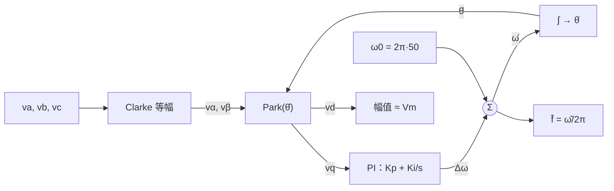

# SRF-PLL 锁相（pll-grid-sync）

> 适用课程：新能源并网技术 / 电力电子技术 / 电力系统自动化 ｜ 难度：★★☆ ｜ 课时：约 45 分钟

参数是一个 380 V / 50 Hz 三相电网、同步旋转坐标系锁相环（SRF-PLL）按 fn = 20 Hz、ζ = 0.707 设计的课堂示例，不是某台逆变器或某个电网的实测数据。本卡只看锁相环本身：电网电压经 Clarke、Park 变换得到 `vq`，PI 调节器把 `vq` 压到零，输出的频率积分成相位 `θ̂`，这个 `θ̂` 就是并网逆变器电流控制用的「电网角度」。重点是**动态跟踪**：相位跳变、频率阶跃、频率斜坡、电压暂降、不平衡与谐波下，PLL 多久重新锁定、过程中频率估计跳多大、稳态误差和脉动有多大，以及带宽怎么取舍。不作为毕业设计或课程设计的锁相环设计成品。

和 [`pi-speed-loop`](../pi-speed-loop/README.md) 是同一套 PI 调参思路（零点 + 二阶系统 ζ、ωn），只不过被控对象从「电机机械惯量」换成了「积分器 θ = ∫ω」；和 [`three-phase-inverter-spwm`](../three-phase-inverter-spwm/README.md)、[`motor-vf`](../motor-vf/README.md) 用的是同一套三相 / αβ / dq 坐标。

## 1. 目标

**SRF-PLL = Park 变换当鉴相器 + PI + 积分器。** 电网 `va = Vm·cos θg`（b、c 依次滞后 120°），用 PLL 自己估计的 `θ̂` 做 Park 变换：

```text
vα = (2/3)(va − vb/2 − vc/2)，   vβ = (vb − vc)/√3           ← 等幅 Clarke，平衡时 |vαβ| = Vm
vd =  vα·cos θ̂ + vβ·sin θ̂ = Vm·cos(θg − θ̂)
vq = −vα·sin θ̂ + vβ·cos θ̂ = Vm·sin(θg − θ̂) ≈ Vm·(θg − θ̂)  ← 鉴相器
ω̂ = ω0 + Kp·vq + Ki·∫vq dt，   θ̂ = ∫ω̂ dt                    ← vq = 0 时锁定，vd = Vm
```

**PI 参数按二阶系统设计（小信号线性化，需自洽）：**

```text
θ̂/θg = (Kp·Vm·s + Ki·Vm) / (s² + Kp·Vm·s + Ki·Vm)
ωn² = Ki·Vm，2ζωn = Kp·Vm   ⇒   Kp = 2ζωn/Vm = 0.57278 (rad/s)/V，Ki = ωn²/Vm = 50.8958 (rad/s²)/V
fn = 20 Hz（ωn = 125.664 rad/s），ζ = 1/√2，Kp·Vm = 177.715 rad/s，Ki·Vm = 15791.37 rad/s²，闭环 −3 dB 带宽 41.13 Hz
```

**脚本实际输出（默认参数）：**

- 工况 A（相位跳变 +30°）：相位误差 **32.73 ms** 进入并保持在 ±2°，频率估计 **47.69 ms** 进入 ±0.1 Hz；反向超调 **20.77%**（线性模型 20.79%）；跳变瞬间频率估计冲到 50 + **14.131 Hz**（= Kp·Vm·sin 30°/2π = 14.142 Hz）。
- 工况 B（频率阶跃 50 → 49.5 Hz）：相位误差最大 −0.6531°，**稳态相位误差 0**（5.7e-12°），频率估计 20.04 ms 进入 ±0.1 Hz、最终 49.50000 Hz——PI 型 PLL 对频率阶跃无静差。
- 工况 C（频率斜坡 −5 Hz/s，100 ms，50 → 49.5 Hz）：斜坡期间稳态相位误差 **−0.1139°**，理论 `2πR/(Ki·Vm) = 2πR/ωn² = −0.1140°`；斜坡结束后回零。
- 工况 D（电压暂降到 0.5 pu 同时跳变 +30°）：不归一化时环路增益减半，等效 ωn = 88.858 rad/s、ζ = 0.5，锁定时间 48.06 / **96.25 ms**（相位 / 频率）、超调 29.82%；`vq` 除以 |vαβ| 归一化后与工况 A 完全相同（32.73 / 47.69 ms、20.77%）。
- 工况 E（10% 负序 + 5% 5 次谐波）：`vq` 出现 100 Hz（2 倍频）+ 300 Hz（6 倍频）脉动，峰峰 77.56 V；相位误差峰峰 **3.795°**、频率估计峰峰 **6.657 Hz**；FFT 测得 100 / 300 Hz 相位误差幅值 1.635° / 0.270°，与线性模型 `k·|H(jω)|` 一致到 3 位小数。

## 2. 接线图示意

PLL 是纯信号处理环节，没有功率回路。三相电压来自电压互感器 / 采样（这里直接用解析式生成），PLL 输出 `θ̂` 给并网逆变器的 dq 电流环。

```text
  电网 ──┬── va ──┐
        ├── vb ──┤ Clarke ──► vα ──┐                 ┌──► vd （≈ Vm，可作幅值检测）
        └── vc ──┘  (等幅)   vβ ──┤ Park(θ̂) ────────┤
                                  │                 └──► vq ──► PI ──► Δω ─(+ω0)─► ω̂ ──► ∫ ──► θ̂
                                  └────────────────────────────────────────────────────────────┘
                                                      θ̂ 反馈到 Park；ω̂/2π 即频率估计 f̂
```



动态工况在 `t_ev = 0.1 s` 施加（之前 PLL 已锁定，从 `θ̂ = θg`、`∫vq = 0` 起算）：

| 工况 | 电网扰动（t ≥ 0.1 s） |
|------|------|
| A | 正序相位 +30° 跳变 |
| B | 频率 50 → 49.5 Hz 阶跃 |
| C | 频率以 −5 Hz/s 斜坡下降 100 ms（50 → 49.5 Hz）后保持 |
| D | 幅值 1 → 0.5 pu 暂降 + 相位 +30° 跳变；对比 vq 不归一化 / 除以 \|vαβ\| 归一化 |
| E | 从 t = 0 起含 10% 负序 + 5% 5 次谐波（看稳态，t ≥ 0.3 s） |

## 3. 参数表

| 符号 | 含义 | 取值 | 单位 |
|------|------|------|------|
| U_LL | 电网线电压有效值 | 380 | V |
| Vm | 相电压峰值 √2·U_LL/√3（Clarke 等幅后 \|vαβ\|） | 310.269 | V |
| f0、ω0 | 额定频率 / PLL 频率前馈 | 50、314.159 | Hz、rad/s |
| fn、ωn | PLL 自然频率（设计值） | 20、125.664 | Hz、rad/s |
| ζ | 阻尼比（设计值） | 0.7071 | — |
| Kp | 比例增益 2ζωn/Vm | 0.57278 | (rad/s)/V |
| Ki | 积分增益 ωn²/Vm | 50.8958 | (rad/s²)/V |
| t_ev | 扰动时刻 | 0.1 | s |
| Δθ | 工况 A / D 相位跳变 | +30 | ° |
| Δf | 工况 B 频率阶跃 | −0.5 | Hz |
| R | 工况 C 频率斜率（持续 100 ms） | −5 | Hz/s |
| sag | 工况 D 暂降深度 | 0.5 | pu |
| k2、k5 | 工况 E 负序、5 次谐波含量（相对 Vm） | 0.10、0.05 | — |
| 锁定判据 | 相位误差 ±2° 且频率误差 ±0.1 Hz（取最后一次越出带的时刻） | — | — |
| dt / t_end | RK4 定步长 / 仿真时长 | 10 μs / 0.4 s | — |

心算：`Kp·Vm = 2 × 0.7071 × 125.66 = 177.7 rad/s`，30° = 0.5236 rad，所以相位跳变瞬间 `Δω̂ = Kp·Vm·sin 30° = 88.86 rad/s`，即频率估计瞬间冲高 14.14 Hz——PI 的比例项直接把相位误差变成频率尖峰。斜坡 −5 Hz/s 对应 `Δω̇ = −31.42 rad/s²`，稳态相位误差 `31.42/15791 = 1.99 mrad = 0.114°`。

## 4. 预期曲线

对照下图（由 `python/pll_grid_sync.py` 生成）。上排：工况 A 的三相电压与 vd、vq；工况 A 相位误差与频率估计；工况 B、C 频率跟踪。下排：工况 D 暂降 + 跳变时归一化对比；工况 E 的 vq 与频率脉动；带宽 fn 扫描。

![左上：三相电压幅值 310 V，跳变瞬间 vd 从 310 V 降到约 269 V（cos30°），vq 从 0 跳到约 155 V（Vm·sin30°），随后约 30 ms 内 vq 回零并出现约 −35 V 的小幅反向，vd 回到 310 V。上中：相位误差从 +30° 指数回落，在约 18 ms 处反向到约 −6.2°（超调 20.8%），约 33 ms 进入 ±2° 绿色带，线性模型虚线与非线性仿真几乎重合；橙色频率估计在跳变瞬间冲到约 64 Hz，再回落、略低于 50 Hz 后回到 50 Hz，标题注明锁定 47.7 ms。右上：工况 B 频率估计从 50 Hz 平滑下降到 49.5 Hz，略低于 49.5 后回升，约 20 ms 跟上；工况 C 频率估计紧贴 −5 Hz/s 的斜坡线下降，细线显示斜坡期间相位误差稳定在约 −0.114°，斜坡结束后回零。左下：暂降 0.5 pu 并跳变 30° 时，不归一化的红线回落更慢、反向超调约 −9°（29.8%）并有第二次过冲，锁定 96.2 ms；归一化的蓝线与工况 A 相同，锁定 47.7 ms。下中：10% 负序和 5% 5 次谐波下 vq 在 ±40 V 间以 100 Hz 为主、叠加 300 Hz 的波形脉动，峰峰 77.6 V，频率估计在约 47 到 53 Hz 之间脉动，峰峰 6.66 Hz。右下：对数坐标，fn 从 5 增加到 80 Hz，工况 A 锁定时间从约 159 ms 降到约 18 ms，工况 E 相位误差峰峰从约 0.95° 升到约 13°，−5 Hz/s 斜坡稳态误差从约 1.8° 降到约 0.007°，竖虚线标出本卡 fn = 20 Hz](img/pll_grid_sync_curves.png)

可量化指标（默认参数 fn = 20 Hz、ζ = 0.707，脚本打印到 2~4 位小数；B、C、E 与 scipy.signal 线性模型逐项核对，偏差超限脚本返回非零）：

| 量 | A：+30° 跳变 | B：−0.5 Hz 阶跃 | C：−5 Hz/s 斜坡 | D：0.5 pu + 30°（不归一化 / 归一化） |
|----|---:|---:|---:|---:|
| 相位误差进入 ±2° | **32.73 ms** | 0（最大 −0.6531°） | 0（最大 −0.1189°） | 48.06 / 32.73 ms |
| 频率误差进入 ±0.1 Hz | **47.69 ms** | 20.04 ms | 始终在带内（最大 0.0181 Hz） | **96.25** / 47.69 ms |
| 反向超调 | **20.77%**（线性 20.79%） | 频率下冲 0.1039 Hz | — | 29.82% / 20.77% |
| 频率估计最大偏差 | **14.131 Hz** | 0.5 Hz（阶跃瞬间的差） | — | 7.124 / 14.131 Hz |
| 稳态相位误差 | 0 | **0**（5.7e-12°） | **−0.1139°**（理论 −0.1140°） | 0 |

工况 A 的线性模型核对：相位误差进入 ±2° 为 32.63 ms（非线性 32.73 ms），超调 20.79%，频率尖峰 14.810 Hz（线性把 sin 30° 当成 0.5236 rad，所以比非线性的 14.131 Hz 大 4.8%）。工况 B 相位误差峰值非线性与线性均为 −0.6531°。

工况 E（稳态，t ≥ 0.3 s）：

| 量 | 值 |
|----|---:|
| vq 峰峰 | 77.56 V |
| 相位误差峰峰 | 3.795° |
| 频率估计峰峰 | 6.657 Hz |
| \|H(j2ω0)\|、\|H(j6ω0)\| | 0.2854、0.0944 |
| 100 Hz 相位误差幅值：线性 0.10·\|H(j2ω0)\| / FFT | 1.635° / 1.635° |
| 300 Hz 相位误差幅值：线性 0.05·\|H(j6ω0)\| / FFT | 0.270° / 0.270° |

带宽扫描（ζ = 0.707，Kp、Ki 都按 fn 重新计算；锁定 = 工况 A 同时满足 ±2° 和 ±0.1 Hz）：

| fn | Kp | Ki | A 锁定时间 | A 频率尖峰 | E 相位误差峰峰 | E 频率峰峰 | −5 Hz/s 斜坡稳态误差（理论） |
|---:|---:|---:|---:|---:|---:|---:|---:|
| 5 Hz | 0.14319 | 3.1810 | 159.43 ms | 3.535 Hz | 0.946° | 1.555 Hz | 1.824° |
| 10 Hz | 0.28639 | 12.7239 | 88.92 ms | 7.068 Hz | 1.893° | 3.181 Hz | 0.456° |
| **20 Hz** | **0.57278** | **50.8958** | **47.69 ms** | **14.131 Hz** | **3.795°** | **6.657 Hz** | **0.114°** |
| 40 Hz | 1.14556 | 203.5831 | 24.95 ms | 28.241 Hz | 7.575° | 14.605 Hz | 0.028° |
| 80 Hz | 2.29111 | 814.3325 | 17.98 ms | 56.396 Hz | 13.013° | 32.141 Hz | 0.007° |

阻尼比扫描（fn = 20 Hz，工况 A）：

| ζ | 相位进入 ±2° | 相位 + 频率都锁定 | 超调 | 频率尖峰 |
|---:|---:|---:|---:|---:|
| 0.5 | 33.98 ms | 70.27 ms | 29.82% | 10.075 Hz |
| **0.707** | **32.73 ms** | **47.69 ms** | **20.77%** | **14.131 Hz** |
| 1.0 | 29.53 ms | 48.21 ms | 13.52% | 19.964 Hz |

读图要点：

- **vq 是鉴相器，vd 是幅值。** 锁定时 vd = Vm = 310.27 V、vq = 0；跳变瞬间 vq = Vm·sin 30° ≈ 155 V，vd = Vm·cos 30° ≈ 269 V。暂降后 vd = 155.13 V，正好 0.5 pu。
- **反向超调来自 PI 的零点。** 带零点的二阶系统，ζ = 0.707 时相位阶跃超调约 20.8%，比无零点的 4.3% 大得多；ζ = 1 也还有 13.5%。所以「ζ = 0.707 超调 4.3%」的口诀不能直接搬过来。
- **频率阶跃无静差，频率斜坡有静差。** 对相位输入而言 PLL 是 Ⅱ 型系统（PI 一个积分 + θ = ∫ω 一个积分）：相位阶跃、频率阶跃稳态误差都为零，频率斜坡（相位的二次曲线）留下 `2πR/ωn²`。−5 Hz/s 下只有 0.114°，但 fn 降到 5 Hz 时变成 1.824°（与 1/ωn² 成正比）。
- **不归一化时环路带宽随电压变。** 增益里含 Vm：电压降到 0.5 pu，ωn 变成 1/√2、ζ 也变成 1/√2 倍（0.5），锁定时间翻倍、超调变大。实用 PLL 常把 vq 除以 |vαβ| 或 vd（即 Simscape PLL 的 Automatic gain control）。
- **带宽取舍。** fn 每翻一倍，锁定时间约减半，但跳变时频率尖峰、不平衡 / 谐波下的相位和频率脉动也近似翻倍。fn = 20 Hz 时频率估计已有 6.66 Hz 峰峰脉动，不能直接当频率测量值用（要再加低通，或用 DSOGI-PLL、DDSRF-PLL 先分离正序）。

## 5. 常见报错

| 现象 | 原因 | 处理 |
|------|------|------|
| PLL 锁在 θg + 180°，或 vd ≈ −Vm | 起始误差在 180° 附近，或 Park 变换符号与 vq 定义不一致 | 本卡 `vq = −vα·sin θ̂ + vβ·cos θ̂`、`va = Vm·cos θg`；若用 `sin` 基准，把 vd/vq 角色对调或加 −90° |
| PLL 越调越偏、频率发散 | 反馈符号反了（vq 正时应让 ω̂ 增大），或 Clarke 的 vβ 写成 vc − vb | 检查 `vβ = (vb − vc)/√3`；vq > 0 表示电网超前，ω̂ 应加快 |
| 锁定时间、超调与本卡对不上 | Clarke 用了等功率形式（\|vαβ\| = √(3/2)·Vm，环路增益偏大 22.5%），或用线电压峰值做 Vm | Kp、Ki 里的 Vm 要和实际进入 Park 的幅值一致；本卡等幅 Clarke，Vm = 310.27 V |
| 频率估计在跳变时冲到 60 多 Hz 被当成故障 | 比例项把相位误差直接变成频率尖峰（本卡 14.13 Hz） | 频率输出另加低通 / 用积分支路输出做频率测量；或降低 fn |
| 电压暂降时锁相变慢、振荡 | vq 未归一化，环路增益随电压下降 | vq 除以 \|vαβ\| 或 vd；Simscape PLL 勾选 Automatic gain control |
| 稳态时 θ̂ 和 f̂ 有 100 Hz / 300 Hz 波动 | 电网不平衡（负序）→ 2 倍频；5、7 次谐波 → 6 倍频 | 降带宽、加陷波 / 滑窗平均、改用 DSOGI-PLL 或 DDSRF-PLL |
| Simscape PLL (3ph) 相位跳变后响应比本卡慢很多 | 模块默认频率变化率限幅（Hz/s）和一个周期的滑动平均滤波 | 对照时把变化率限幅调大；理解滑动平均带来的约半周期延时 |
| θ 积分器数值越来越大，cos/sin 精度变差 | 长时间仿真未做 0~2π 取模 | Integrator 勾选 Wrap state（0~2π），或输出后 `mod(θ, 2π)` |
| Python 报 `ModuleNotFoundError: scipy`（或 matplotlib） | 未装案例依赖 | `pip install -r cases/pll-grid-sync/python/requirements.txt` |
| MATLAB 报「脚本中的函数定义必须出现在文件末尾」 | 版本早于 R2016b | 用 R2016b 以上；或把末尾函数存成同名 `.m` |

## 6. 平台指引

三个平台用同一组参数。Python 给出已实际运行验证的脚本；MATLAB 脚本与 Python 同方程、同积分器（RK4，dt = 10 μs）；Simulink 按步骤搭，不附 `.slx`。

### Simulink

步骤见 [`simulink/README.md`](simulink/README.md)。要点：

- **搭法 A（基础库，与脚本完全一致）**：`Clock`/`Step`/`Ramp` 合成电网相位 θg（含 +30° `Step`）→ 三个 `Fcn`（`Vm*cos(u)`、`Vm*cos(u-2*pi/3)`、`Vm*cos(u+2*pi/3)`）→ `Gain`（Clarke 2×3 矩阵）→ Park（`Trigonometric Function` + `Product` + `Sum`）→ `Gain Kp` 与 `Integrator`+`Gain Ki` 相加 → `+ω0` → `Integrator`（θ̂，Wrap state 0~2π）反馈到 Park。
- **搭法 B（Simscape Electrical / Specialized Power Systems）**：`Three-Phase Programmable Voltage Source`（Phase / Frequency / Amplitude 的 Step 变化）+ `Three-Phase V-I Measurement` + `PLL (3ph)`（Regulator gains `[Kp·Vm  Ki·Vm  0]` = `[177.7  15791  0]`，勾选 Automatic gain control）。
- 求解器：搭法 A 用 `ode4` 固定步长 `1e-5`，Stop time `0.4`；搭法 B 用 powergui Discrete `Ts = 1e-5`。

### MATLAB

脚本：[`matlab/pll_grid_sync.m`](matlab/pll_grid_sync.m)。只用基础函数（for 循环 RK4、`plot`），不需要工具箱（不用 Control System Toolbox 的 `tf`/`step`）；末尾有局部函数，需要 R2016b 以上。

```matlab
run('cases/pll-grid-sync/matlab/pll_grid_sync.m')
```

打印的字段是 Python 的子集（A~E 工况与 fn 扫描锁定时间，不含线性模型核对和 ζ 扫描），积分器和步长相同，数值应一致到第 2~3 位小数。图片写到 `img/pll_grid_sync_curves_matlab.png`（运行后才有）。说明：本仓库自动化环境没有 MATLAB；该脚本的计算部分已在 GNU Octave 9.4 中实际运行（函数移到文件开头以适配 Octave），打印的全部数字与 Python 一致，绘图部分因无显示环境未出图。第一次上课前请在 MATLAB 中先跑一遍，对照第 4 节的数字。

### Python

脚本：[`python/pll_grid_sync.py`](python/pll_grid_sync.py)。依赖 numpy、scipy（`scipy.signal` 做线性模型核对：阶跃 / 冲激响应、Bode、频率响应）、matplotlib，见 [`python/requirements.txt`](python/requirements.txt)。运行约 10 s。

```bash
pip install -r cases/pll-grid-sync/python/requirements.txt
python cases/pll-grid-sync/python/pll_grid_sync.py
```

控制台应出现（节选）：

```text
SRF-PLL grid synchronization (teaching example)
  Kp_rad_s_per_V                = 0.57278
  Ki_rad_s2_per_V               = 50.8958
  closed_loop_-3dB_Hz           = 41.13
[A] 相位跳变 +30°
  lock_time_phase_2deg_ms       = 32.73
  lock_time_freq_0.1Hz_ms       = 47.69
  overshoot_pct                 = 20.77
  peak_freq_dev_Hz              = 14.131
  linear_overshoot_pct          = 20.79
  linear_peak_freq_dev_Hz       = 14.810
[B] 频率阶跃 50 → 49.5 Hz
  phase_err_peak_deg            = -0.6531
  phase_err_final_deg           = 5.70e-12
  lock_time_freq_0.1Hz_ms       = 20.04
  f_pll_final_Hz                = 49.50000
[C] 频率斜坡 −5 Hz/s，持续 100 ms
  ramp_ss_err_sim_deg           = -0.1139
  ramp_ss_err_theory_deg        = -0.1140
  phase_err_final_deg           = 8.78e-10
[D] 电压暂降到 0.5 pu 同时相位跳变 +30°
  eff_zeta (no norm)            = 0.5000
  no_norm_lock_time_freq_ms     = 96.25
  no_norm_overshoot_pct         = 29.82
  no_norm_peak_freq_dev_Hz      = 7.124
  norm_lock_time_freq_ms        = 47.69
  norm_overshoot_pct            = 20.77
  norm_peak_freq_dev_Hz         = 14.131
[E] 10% 负序 + 5% 5 次谐波（稳态，t ≥ 0.3 s）
  phase_err_pp_deg              = 3.795
  f_pll_pp_Hz                   = 6.657
  fft_err_amp_100Hz_deg         = 1.635
[sweep fn] ζ = 0.707：A 相位跳变 / E 畸变 / C 斜坡
  fn= 20.0 Hz  Kp= 0.57278  Ki=  50.8958  lock(±2°&±0.1Hz)=  47.69 ms  fdev= 14.131 Hz  E: e_pp= 3.795°  f_pp=  6.657 Hz  ramp5Hz/s_err= 0.114°
```

每个校验项：工况 B 相位误差峰值、工况 C 斜坡稳态误差与线性模型相对偏差超过 5%，或工况 E 的 100 Hz 脉动幅值偏差超过 10% 时，脚本返回非零。曲线保存为 [`img/pll_grid_sync_curves.png`](img/pll_grid_sync_curves.png)。没有图形界面时只保存图片、不弹窗。

想自己改工况：改脚本开头的 `FN`、`ZETA`（PLL 设计），或在 `main()` 里改工况字典，例如 `{"jump": -60.0}`、`{"df": 1.0}`、`{"k2": 0.2}`、`{"jump": 30.0, "sag": 0.2}`。

## 7. 课堂提问

1. 用 `vq ≈ Vm·(θg − θ̂)` 推出 PLL 的闭环传递函数，说明为什么 `Kp`、`Ki` 里都有 `1/Vm`。如果改用等功率 Clarke，Kp、Ki 要怎么改？
2. 工况 A 中频率估计瞬间冲高 14.13 Hz，用 `Kp·Vm·sin 30°/2π` 心算验证。若把这个 f̂ 直接送给频率保护（如 ±0.5 Hz 告警），会发生什么？怎么改？
3. 为什么频率阶跃没有稳态相位误差，频率斜坡却有？用终值定理求斜坡下的 `e_ss`，并验证 −5 Hz/s 时为 0.114°。若 fn 降到 5 Hz 呢？
4. 带零点的二阶系统 ζ = 0.707 时超调为什么是约 20.8% 而不是 4.3%？在工况 A 的图里找出零点的作用。
5. 电压暂降到 0.5 pu 时不归一化的 PLL 等效 ζ 是多少？如果暂降到 0.1 pu 呢？归一化有没有代价（提示：电压接近零时）？
6. 10% 负序为什么在 vq 里表现为 100 Hz，5 次谐波为什么是 300 Hz？如果是 7 次谐波（正序），会是多少 Hz？
7. 并网逆变器的 PLL 带宽一般比电流环低得多，结合本卡带宽扫描表说说原因；弱电网下 PLL 带宽过高又会带来什么问题？

## 8. 相关链接

- 案例卡字段约定：[docs/case-convention.md](../../docs/case-convention.md)
- 同一套 PI 设计思路：[直流电机 PI 转速环（pi-speed-loop）](../pi-speed-loop/README.md)。那里 PI 零点对消电机慢极点，这里被控对象是纯积分器 θ = ∫ω，零点保留下来带来较大超调。
- 三相 / αβ 坐标：[三相 SPWM 逆变器（three-phase-inverter-spwm）](../three-phase-inverter-spwm/README.md)。PLL 输出的 θ̂ 就是并网时调制波的参考相位。
- 上一张卡：[三相短路电流暂态（three-phase-short-circuit）](../three-phase-short-circuit/README.md)。短路切除、电压暂降往往伴随相位跳变，正是本卡工况 D 的来源。
- 下一张卡：[光伏 MPPT 扰动观察法（pv-mppt-po）](../pv-mppt-po/README.md)。PLL 负责「往哪个角度送」，MPPT 负责「从光伏取多少功率」，两者一起构成光伏并网逆变器的控制主干。
