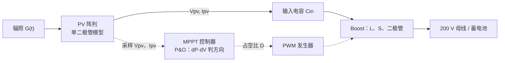

# 光伏 MPPT 扰动观察法（pv-mppt-po）

> 适用课程：新能源发电技术 / 光伏发电系统 / 电力电子技术 ｜ 难度：★★☆ ｜ 课时：约 45 分钟

参数是 3 块 60 片组件串联的课堂示例阵列（单二极管模型，STC 下约 696 W），经 Boost 接到 200 V 直流母线 / 蓄电池组，不是某一型号组件或某座电站的实测数据。本卡只看最大功率点跟踪（MPPT）里最常用的**扰动观察法（Perturb & Observe，P&O）**：每隔 20 ms 采一次 PV 电压、电流，把占空比 D 往一个方向挪一步，功率变大就继续，变小就掉头。重点是**步长取舍**：步长小，稳态振荡小但跟踪慢；步长大，跟得快但在最大功率点（MPP）附近来回摆得大。同时看辐照阶跃（1000 → 600 W/m²）和辐照斜坡下 P&O 的动态。不作为毕业设计或课程设计的 MPPT 控制器成品。

和 [`boost-pwm`](../boost-pwm/README.md) 是同一个 Boost，只是输入从恒压源换成了光伏阵列、输出从电阻换成了恒压母线，于是 `Vpv ≈ (1 − D)·Vbus`：**调 D 就是调 PV 的工作电压**。

## 1. 目标

**光伏阵列是一个「电流源 + 二极管」，功率曲线有一个峰。** 单二极管模型（阵列 = 3 块组件 × 60 片电池串联）：

```text
I = Iph − I0·[exp((V + I·Rs)/a) − 1] − (V + I·Rs)/Rsh
a = Nser·Ns·n·Vt = 3 × 60 × 1.3 × 25.693 mV = 6.0121 V，Iph = Isc·G/1000（T = 25 ℃ 不变）
I0 由单块 Voc = 37.5 V 反推：I0 = Isc / [exp(3 × 37.5 / a) − 1] = 6.3495e-8 A
```

I 是 V 的隐函数，脚本用牛顿迭代求。`P = V·I` 在 `dP/dV = 0` 处最大，即 MPP。

**Boost 把 MPP 变成一个占空比。** 输出接恒压母线时，平均模型稳态 `Vpv = (1 − D)·Vbus + RL·iL`，所以 `D_mpp = 1 − (Vmp + RL·Imp)/Vbus`。D 增大 → Vpv 降低（往短路电流那边走），D 减小 → Vpv 升高（往开路电压那边走）。

**P&O 的规则（每 T_MPPT 一次）：**

```text
dP = P(k) − P(k−1)，dV = V(k) − V(k−1)
dP·dV > 0（电压升、功率升，或电压降、功率降 → 在 MPP 左侧）→ 升电压：D −= ΔD
dP·dV < 0（在 MPP 右侧）                                    → 降电压：D += ΔD
dP = 0 → 不动作
```

稳态时 D 在 `D*−ΔD、D*、D*+ΔD` 三个值之间来回（「三点振荡」），永远不会停在 MPP 上。

**脚本实际输出（默认参数）：**

- MPP：1000 W/m² 时 **Vmp = 89.158 V、Imp = 7.808 A、Pmp = 696.168 W**（Voc = 112.393 V，Isc = 8.490 A，FF = 0.7296，D_mpp = 0.5464）；600 W/m² 时 **88.655 V、4.653 A、412.515 W**（Voc = 109.255 V，D_mpp = 0.5521）。辐照降 40%，Vmp 只降 0.5 V。
- 工况 A（从开路附近 D0 = 0.45 启动，1.5 s 辐照 1000 → 600 W/m²）三种步长：

  | ΔD（≈ ΔV/步） | 跟踪到 99% Pmpp | 稳态功率峰峰（1000 W/m²） | 稳态跟踪效率 | 0~3 s 全程跟踪效率 |
  |---:|---:|---:|---:|---:|
  | 0.002（0.4 V） | **0.961 s** | **0.17 W** | 99.993% | 88.182% |
  | 0.005（1.0 V） | **0.400 s** | **1.75 W** | 99.937% | 94.987% |
  | 0.02（4.0 V） | **0.101 s** | **26.99 W** | 99.291% | 97.657% |

- 辐照阶跃 1000 → 600 W/m²：功率随辐照立刻落到新 MPP 附近；Boost 输入侧 L–Cin 暂态让功率瞬间跌到新 Pmpp 的 **74~80%**，约 **1.1 ms** 回到 99% 带内。P&O 下一次采样看到 dP ≈ **−280 W**，把它当成「上一步走错了」而掉头一步——但由于 Vmp 只移动 0.5 V，D 始终留在新的三点振荡范围内，无需额外动作。
- 工况 C（600 → 1000 W/m²，1 s 斜坡）：ΔD = 0.002 时 50 次动作**全部是降电压**，Vpv 偏离 Vmp 最多 **19.80 V**，斜坡期间跟踪效率只有 **92.601%**（ΔD = 0.005：12.57 V、98.045%；ΔD = 0.02：10.74 V、99.043%）——这就是 P&O 的「误判漂移」。

## 2. 接线图示意

功率回路：PV 阵列 → 输入电容 Cin → Boost（L、开关 S、二极管）→ 200 V 母线（蓄电池组或后级逆变器的直流侧，视为恒压源；也可换成负载电阻 + 大电容，见第 5 节）。控制回路：MPPT 控制器采样 Vpv、Ipv，输出占空比 D 给 PWM。

```text
             Ipv →            iL →                二极管
   ┌───────┐  +─────+────( L )──+──────|>|──────+────────── + 
   │  PV   │        |           |                |          |
   │ 阵列  │      === Cin      [ S ] ◄── PWM(D)  |       [ Vbus = 200 V ]
   │ 3×60片│        |           |       ▲        |      （蓄电池组 / 直流母线）
   └───────┘  −─────+───────────+───────┼────────+────────── −
       │ Vpv、Ipv 采样                  │
       └──────────► [ MPPT 控制器：P&O，每 20 ms 一次 ] ──► D
```



本卡的脚本用 Boost **平均模型**（不含开关纹波）：

```text
Cin·dVpv/dt = Ipv(Vpv) − iL
L·diL/dt   = Vpv − RL·iL − (1 − D)·Vbus        （iL ≥ 0：二极管阻断反向电流）
```

| 工况 | 内容 |
|------|------|
| A | 从开路附近（D0 = 0.45，Vpv(0) = Voc）启动；t = 1.5 s 辐照 1000 → 600 W/m² 阶跃；ΔD = 0.002 / 0.005 / 0.02 对比 |
| B | 恒定 1000 W/m²，ΔD = 0.001 ~ 0.03 扫描 |
| C | 600 W/m²（D0 = 0.50 起），1.5 ~ 2.5 s 线性升到 1000 W/m²（400 W/m²/s），看漂移 |
| D | 600 W/m²、D0 = 0.45 启动：小步长「卡死」在开路区（见第 5 节） |

## 3. 参数表

| 符号 | 含义 | 取值 | 单位 |
|------|------|------|------|
| Nser × Ns | 串联组件数 × 每块电池片数 | 3 × 60 | — |
| Isc | 短路电流（STC，取 Iph = Isc·G/1000） | 8.5 | A |
| Voc,mod | 单块组件开路电压（用于反推 I0） | 37.5 | V |
| n | 二极管理想因子 | 1.3 | — |
| T、Vt | 电池温度、热电压 kT/q | 25、25.693 | ℃、mV |
| a | 阵列修正热电压 Nser·Ns·n·Vt | 6.0121 | V |
| I0 | 反向饱和电流 | 6.3495e-8 | A |
| Rs、Rsh | 阵列串联 / 并联电阻（单块 0.3 / 250 Ω） | 0.9、750 | Ω |
| G | 辐照度 | 1000 → 600 | W/m² |
| Vbus | 直流母线 / 蓄电池电压 | 200 | V |
| L、RL | Boost 电感、等效电阻 | 3、0.2 | mH、Ω |
| Cin | PV 侧输入电容 | 47 | μF |
| D0、D 限幅 | 起始占空比、上下限 | 0.45、0.05~0.90 | — |
| T_MPPT | P&O 执行周期 | 20 | ms |
| ΔD | 扰动步长（ΔV ≈ ΔD·Vbus） | 0.002 / 0.005 / 0.02 | — |
| 跟踪判据 | P ≥ 99% Pmpp(G) 的首次时刻 | — | — |
| 跟踪效率 η | ∫P dt / ∫Pmpp dt | — | — |
| dt / t_end | RK4 定步长 / 仿真时长 | 50 μs / 3 s（工况 C 3.5 s） | — |

心算：`D_mpp − D0 = 0.5464 − 0.45 ≈ 0.096`，每 20 ms 走一步，跟踪时间 ≈ `0.096/ΔD × 20 ms`：ΔD = 0.002 约 48 步 ≈ 0.96 s，0.005 约 19 步 ≈ 0.39 s，0.02 约 5 步 ≈ 0.10 s，和仿真一致。

T_MPPT 为什么取 20 ms：L–Cin 在 MPP 处线性化，PV 的增量电导 `g = −dI/dV = Imp/Vmp = 0.08758 S` 给 LC 提供阻尼，`fn = 1/(2π√(L·Cin)) = 423.8 Hz`、`ζ = 0.362`，调节时间 `4/(ζωn) ≈ 4.15 ms`。P&O 周期必须明显长于它，否则采到的是暂态功率、会误判。

## 4. 预期曲线

对照下图（由 `python/pv_mppt_po.py` 生成）。上排：I-V / P-V 曲线与 MPP；工况 A 的功率；工况 A 的 PV 电压与占空比；工况 C 斜坡下的 PV 电压。下排：1000 W/m² 稳态三点振荡放大；辐照阶跃附近放大；步长扫描（跟踪时间 vs 功率峰峰）；跟踪效率 vs 步长。

![左上：两条 I-V 曲线（1000、600 W/m²）短路电流约 8.5 A 和 5.1 A，在 90 V 以后急剧下降；两条 P-V 曲线峰值分别 696.2 W @ 89.16 V、412.5 W @ 88.66 V，绿色采样点从开路附近沿 P-V 曲线爬到峰顶。上二：三种步长的功率从 0 起爬升，红色（ΔD = 0.02）约 0.1 s 到达 696 W，绿色约 0.4 s，蓝色约 1 s；1.5 s 处全部跌到约 412 W；红线在稳态有明显向下的周期性尖刺。上三：Vpv 从 112 V 降到约 89 V 附近，红线在约 81~92 V 之间摆动，紫色点线为 D 从 0.45 升到约 0.55。右上：斜坡期间（灰底）蓝线（ΔD = 0.002）一路向下漂到约 69 V 后才回升，绿线也下探到约 77 V，红线摆幅大但围绕 89 V。左下：放大的稳态，蓝线几乎贴着 696 W 虚线，绿线每次下扰约 2 W，红线周期性跌到约 670 W 并带 LC 振荡。下二：阶跃瞬间功率从 696 W 跳到约 410 W，伴随约 1 ms 的向下尖峰到 300 多 W。下三：对数横轴，跟踪时间从 1.94 s（ΔD = 0.001）降到 0.08 s（0.03），功率峰峰从 0.04 W 升到 49.7 W，两条曲线在 ΔD ≈ 0.01 附近交叉。右下：稳态效率从 99.998% 缓降到 98.35%，含启动的 0~3 s 效率从约 81.5% 升到约 98% 后在 0.03 回落](img/pv_mppt_po_curves.png)

可量化指标（默认参数，脚本打印到 2~3 位小数；MPP 黄金分割结果与 20001 点密集扫描偏差超过 0.1%、或平均模型稳态 `Vpv = (1 − D)·Vbus + RL·iL` 偏差超过 0.2 V 时脚本返回非零）：

**MPP**

| 量 | 1000 W/m² | 600 W/m² |
|----|---:|---:|
| Isc | 8.490 A | 5.094 A |
| Voc | 112.393 V | 109.255 V |
| Vmp / Imp | **89.158 V / 7.808 A** | **88.655 V / 4.653 A** |
| Pmp | **696.168 W** | **412.515 W** |
| 填充因子 FF | 0.7296 | 0.7412 |
| D_mpp | 0.5464 | 0.5521 |

**工况 A：启动 + 辐照阶跃 1000 → 600 W/m²**

| 量 | ΔD = 0.002 | ΔD = 0.005 | ΔD = 0.02 |
|----|---:|---:|---:|
| 每步 ΔV ≈ ΔD·Vbus | 0.4 V | 1.0 V | 4.0 V |
| 启动跟踪到 99% Pmpp | **0.961 s** | **0.400 s** | **0.101 s** |
| 稳态功率峰峰（1000 W/m²，1.2~1.5 s） | **0.17 W**（0.02%） | **1.75 W**（0.25%） | **26.99 W**（3.9%） |
| 稳态 Vpv 峰峰 | 1.02 V | 2.51 V | 10.93 V |
| 稳态 D 取值个数 | 3 | 3 | 3 |
| 稳态跟踪效率（1000 W/m²） | 99.993% | 99.937% | 99.291% |
| 阶跃后功率最低 / 新 Pmpp | 80.17% | 78.91% | 74.24% |
| 阶跃后回到 99% 带内 | 1.15 ms | 1.10 ms | 1.05 ms |
| 阶跃后首次 P&O：dP、上一步 / 这一步 ΔD | −279.28 W，−0.002 → +0.002 | −279.85 W，−0.005 → +0.005 | −279.89 W，−0.02 → +0.02 |
| 稳态功率峰峰（600 W/m²，2.7~3.0 s） | 0.20 W | 1.23 W | 19.26 W |
| 稳态跟踪效率（600 W/m²） | 99.990% | 99.939% | 99.079% |
| **0~3 s 全程跟踪效率** | **88.182%** | **94.987%** | **97.657%** |

**工况 B：步长扫描（恒定 1000 W/m²，0~3 s，稳态窗口 2.7~3.0 s；最后一列为工况 A 全程）**

| ΔD | ΔV/步 | 跟踪到 99% | 稳态功率峰峰 | 稳态 Vpv 峰峰 | 稳态 η | 0~3 s η | 工况 A η |
|---:|---:|---:|---:|---:|---:|---:|---:|
| 0.001 | 0.2 V | 1.940 s | 0.04 W | 0.51 V | 99.998% | 81.505% | 76.933% |
| **0.002** | 0.4 V | **0.961 s** | **0.17 W** | 1.02 V | 99.992% | 90.594% | 88.182% |
| 0.003 | 0.6 V | 0.641 s | 0.59 W | 1.52 V | 99.980% | 93.613% | 91.979% |
| **0.005** | 1.0 V | **0.400 s** | **1.75 W** | 2.51 V | 99.936% | 96.000% | 94.987% |
| 0.01 | 2.0 V | 0.201 s | 5.35 W | 5.02 V | 99.823% | 97.683% | 97.130% |
| **0.02** | 4.0 V | **0.101 s** | **26.99 W** | 10.93 V | 99.160% | 97.999% | 97.657% |
| 0.03 | 6.0 V | 0.080 s | 49.71 W | 16.40 V | 98.354% | 97.539% | 97.255% |

**工况 C：辐照斜坡 600 → 1000 W/m²（1.5~2.5 s）**

| ΔD | 斜坡期间 η | 斜坡期间 max\|Vpv − Vmp\| | 斜坡期间升压 / 降压动作次数 | 0~3.5 s η |
|---:|---:|---:|---:|---:|
| 0.002 | **92.601%** | **19.80 V** | **0 / 50** | 94.216% |
| 0.005 | 98.045% | 12.57 V | 22 / 28 | 98.894% |
| 0.02 | 99.043% | 10.74 V | 25 / 25 | 98.997% |

读图要点：

- **步长 ΔD 定了两件事：多快到、到了以后摆多大。** 跟踪时间约 ∝ 1/ΔD（0.961 → 0.400 → 0.101 s）；稳态功率峰峰约 ∝ ΔD²（P-V 曲线在峰顶是抛物线，0.17 → 1.75 → 26.99 W，步长 ×10 峰峰 ×159）。所以小步长稳态几乎不损失（99.99%），大步长稳态损失约 0.7%，但大步长启动快，0~3 s 全程反而更高。
- **没有「最好」的步长，只有「看场景」的步长。** 0~3 s 全程效率在 ΔD ≈ 0.02 附近最高（97.999%），ΔD = 0.03 又回落——稳态损失开始压过启动收益。辐照常变（多云）的场合偏大步长，辐照稳定的场合偏小步长；变步长 P&O（ΔD ∝ |dP/dV|）就是想两头都要。
- **辐照阶跃本身不难。** 1000 → 600 W/m² 时 Vmp 只从 89.158 V 降到 88.655 V，P&O 在原地附近继续振荡即可；看到的 1 ms 功率尖峰是 Boost 输入 L–Cin 的电路暂态，不是 MPPT 的问题。P&O 把 −280 W 的辐照变化误当成「这一步走错了」而掉头，只是此处恰好无害。
- **辐照持续上升时 P&O 会被「骗」。** 斜坡期间每 20 ms 功率都在涨，不论 D 往哪走 dP 都 > 0，于是 P&O 一直沿着同一方向走。ΔD = 0.002 时 50 次全是降电压，Vpv 偏到 Vmp 下方 19.80 V；大步长时自身扰动引起的 dP 盖过了辐照引起的 dP，判方向反而对。这也是小步长的又一个代价。
- **三点振荡是 P&O 的指纹。** 稳态 D 只有 3 个取值；功率曲线每三个周期出现一次「下扰」（左下图），这就是在 MPP 两侧各试探一次。

## 5. 常见报错

| 现象 | 原因 | 处理 |
|------|------|------|
| 越跟越远，Vpv 一路降到 0 或升到 Voc | 方向符号反了：Boost 中 D 增大 Vpv 降低，写成了 Buck 的习惯（D 增大电压升高） | 本卡 `dP·dV > 0 → D −= ΔD`；先手动把 D 调大，看 Vpv 是不是变小 |
| 启动后功率一直为 0，D 不动（工况 D：600 W/m²、D0 = 0.45、ΔD = 0.002 时 1.5 s 内平均功率 0.00 W） | `(1 − D)·Vbus = 110 V` 高于 Voc = 109.255 V，二极管不导通，P = 0 → dP = 0 → 经典 P&O 不动作 | D0 取大一些（如 `1 − 0.8·Voc/Vbus`）；或 dP = 0 时也按原方向继续扰动；或先做一次恒压（0.8 Voc）启动 |
| 稳态功率振荡很大、效率低 | 步长过大（ΔD = 0.03 时峰峰 49.71 W） | 减小 ΔD，或用变步长 P&O；看第 4 节扫描表取舍 |
| 跟踪很慢，几秒还没到 MPP | 步长过小（ΔD = 0.001 要 1.94 s） | 增大 ΔD，或启动段用大步长、接近 MPP 后切小步长 |
| 方向乱跳、功率在 MPP 附近乱走 | T_MPPT 短于 L–Cin 暂态（本卡约 4 ms），采到暂态功率 | T_MPPT 取暂态时间的数倍（本卡 20 ms）；采样前对 V、I 做一个周期的平均 |
| 多云 / 辐照上升时偏离 MPP 越来越远 | P&O 误判漂移：辐照引起的 dP 盖过扰动引起的 dP | 用 dP-P&O（在一个周期内多测一点区分两种 dP）、电导增量法（INC），或适当加大步长 |
| Simulink 里 Vpv 有很大的开关纹波、P&O 判方向抖动 | 开关模型含 fs 级纹波，直接用瞬时值算 P | 采样前加滑动平均 / 低通（截止远低于 fs、高于 1/T_MPPT），或在 PWM 周期中点同步采样 |
| Simscape 输出接电阻负载时跟不到 MPP 或 D 顶到上限 | 电阻负载时 `Vpv = Vo·(1 − D)` 但 Vo 也随 D 变；R 太小 / 太大时 MPP 不在可调范围内 | 输出接电池 / 电压源（本卡做法），或按 `R_in = R·(1 − D)² = Vmp/Imp = 11.42 Ω` 选 R |
| MATLAB Function 里 P&O 记不住上一拍 | 局部变量每次调用都重新初始化 | 用 `persistent` 变量保存 `Vprev、Pprev、D`，并用 `isempty` 初始化；块采样时间设成 T_MPPT |
| Python 报 `ModuleNotFoundError: matplotlib` | 未装案例依赖 | `pip install -r cases/pv-mppt-po/python/requirements.txt` |
| MATLAB 报「脚本中的函数定义必须出现在文件末尾」 | 版本早于 R2016b | 用 R2016b 以上；或把末尾函数存成同名 `.m` |

## 6. 平台指引

三个平台用同一组参数。Python 给出已实际运行验证的脚本；MATLAB 脚本与 Python 同方程、同积分器（RK4，dt = 50 μs）；Simulink 按步骤搭，不附 `.slx`。

### Simulink

步骤见 [`simulink/README.md`](simulink/README.md)。要点：

- **Simscape Electrical（Specialized Power Systems）**：`PV Array`（User-defined 模块参数，或用本卡参数自定义）+ 输入电容 + `Boost` 用 `IGBT/Diode` 搭（或平均值模型 `Controlled Voltage Source`）+ 200 V `DC Voltage Source`/`Battery`；`Repeating Sequence`/`PWM Generator (DC-DC)` 产生 PWM。
- **MPPT 控制器**：`MATLAB Function` 块写 P&O（`persistent` 保存上一拍 V、P、D），前面接 `Zero-Order Hold`（Ts = T_MPPT = 0.02 s）采样 Vpv、Ipv。
- **辐照**：`Step`（1.5 s，1000 → 600）或 `Repeating Sequence Interpolated`/`From Workspace`（斜坡）接 PV Array 的 Ir 输入。
- 求解器：开关模型用 powergui Discrete `Ts = 1e-6`（fs = 20 kHz 时每周期 50 点）；平均值模型可用 `ode23tb`。

### MATLAB

脚本：[`matlab/pv_mppt_po.m`](matlab/pv_mppt_po.m)。只用基础函数（for 循环 RK4、牛顿迭代、`interp1`、`trapz`、`plot`），不需要工具箱；末尾有局部函数，需要 R2016b 以上。

```matlab
run('cases/pv-mppt-po/matlab/pv_mppt_po.m')
```

打印的字段是 Python 的子集（MPP、工况 A 三种步长、工况 C 斜坡、[D] 启动卡死，不含步长扫描和 LC 阻尼计算），积分器和步长相同。图片写到 `img/pv_mppt_po_curves_matlab.png`（运行后才有）。说明：本仓库自动化环境没有 MATLAB；该脚本的计算部分已在 GNU Octave 9.4 中实际运行（函数移到文件开头以适配 Octave，约 3 分钟），打印的全部数字与 Python 一致，绘图部分因无显示环境未出图。第一次上课前请在 MATLAB 中先跑一遍，对照第 4 节的数字。

### Python

脚本：[`python/pv_mppt_po.py`](python/pv_mppt_po.py)。依赖 numpy、matplotlib，见 [`python/requirements.txt`](python/requirements.txt)。运行约 8 s。

```bash
pip install -r cases/pv-mppt-po/python/requirements.txt
python cases/pv-mppt-po/python/pv_mppt_po.py
```

控制台应出现（节选）：

```text
PV MPPT perturb & observe (teaching example)
  a_array_V                     = 6.0121
  I0_A                          = 6.3495e-08
[MPP] G = 1000 W/m²
  Vmp_V                         = 89.158
  Imp_A                         = 7.808
  Pmp_W                         = 696.168
[MPP] G = 600 W/m²
  Pmp_W                         = 412.515
[LC] Boost 输入侧 L–Cin（1000 W/m² MPP 处线性化）
  fn_LC_Hz                      = 423.8
  zeta_LC                       = 0.362
[A] 启动 D0 = 0.45，1.5 s 辐照 1000 → 600 W/m²，T_MPPT = 20 ms
  ΔD = 0.002（ΔV ≈ 0.4 V/步）
    t_track_99%_s               = 0.961
    P_pp_1000_W                 = 0.17
    eta_ss_1000_pct             = 99.993
    eta_total_0-3s_pct          = 88.182
  ΔD = 0.005（ΔV ≈ 1.0 V/步）
    t_track_99%_s               = 0.400
    P_pp_1000_W                 = 1.75
    eta_total_0-3s_pct          = 94.987
  ΔD = 0.020（ΔV ≈ 4.0 V/步）
    t_track_99%_s               = 0.101
    P_pp_1000_W                 = 26.99
    P_min/Pmpp_after_step_pct   = 74.24
    t_back_in_99%_ms            = 1.05
    eta_total_0-3s_pct          = 97.657
[C] 辐照斜坡 600 → 1000 W/m²（1.5 ~ 2.5 s，400 W/m²/s）
  ΔD=0.002  η_ramp=92.601%  max|Vpv−Vmp|=19.80 V  升压/降压动作=0/50  η_total=94.216%
[D] 600 W/m² 恒定，D0 = 0.45：(1 − D0)·Vbus = 110.0 V，Voc(600) = 109.255 V
  ΔD=0.002  首次扰动后 (1 − D)·Vbus =  109.6 V  t = 1.4~1.5 s 平均功率    0.00 W（Pmpp 412.52 W），D = 0.452
```

曲线保存为 [`img/pv_mppt_po_curves.png`](img/pv_mppt_po_curves.png)。没有图形界面时只保存图片、不弹窗。

想自己改：改脚本开头的 `STEPS`（三种对比步长）、`SWEEP`、`T_MPPT`、`G1/G2`、`T_STEP`、`RAMP`，或 PV 参数 `ISC_STC`、`N_IDEAL`、`RS_MOD`、`RSH_MOD`、`NSER`。例如把 `T_MPPT` 改成 `2e-3`（短于 LC 暂态）看判方向乱跳，或把 `G2` 改成 `200.0` 看弱光下 Vmp 的偏移。

## 7. 课堂提问

1. 为什么 Boost 接恒压母线时「调 D 就是调 PV 电压」？写出 `D_mpp`，并用本卡数字验证 1000 W/m² 时 D_mpp = 0.5464。
2. 用 `(D_mpp − D0)/ΔD × T_MPPT` 心算三种步长的跟踪时间，和仿真的 0.961 / 0.400 / 0.101 s 对比。
3. 稳态功率峰峰为什么近似与 ΔD² 成正比？提示：P-V 曲线在 MPP 附近 `P ≈ Pmp − k·(V − Vmp)²`。
4. 辐照从 1000 降到 600 W/m²，Pmp 降了 41%，Vmp 为什么只降了 0.5 V？温度升高时 Vmp 会怎样变？
5. 辐照持续上升时，为什么小步长 P&O 会一路朝一个方向「漂」？画出连续 3 个周期的 dP、dV 符号说明。
6. T_MPPT 能不能取 2 ms？结合 L–Cin 的 fn = 423.8 Hz、ζ = 0.362 说明。
7. 如果你要给一个多云地区的小型光伏充电控制器选 ΔD，会怎么选？变步长 P&O 和电导增量法分别解决了本卡哪个问题？

## 8. 相关链接

- 案例卡字段约定：[docs/case-convention.md](../../docs/case-convention.md)
- 同一个 Boost：[Boost 变换器开环 PWM（boost-pwm）](../boost-pwm/README.md)。那里输入恒压、输出接电阻，`Vo = Vin/(1 − D)`；这里输出恒压、输入接光伏，反过来 `Vpv = (1 − D)·Vbus`。
- 二阶电路暂态：[RLC 串联阶跃（rlc-series-step）](../rlc-series-step/README.md)。辐照阶跃时 1 ms 的功率尖峰就是 L–Cin 的欠阻尼振荡，PV 的增量电导充当并联阻尼电阻。
- 并网侧：[SRF-PLL 锁相（pll-grid-sync）](../pll-grid-sync/README.md)。MPPT 决定从光伏取多少功率，后级并网逆变器靠 PLL 的相位把功率送进电网。
- 上一张卡：[SRF-PLL 锁相（pll-grid-sync）](../pll-grid-sync/README.md)。本卡是主题队列的第 14 条，也是目前最后一条。
