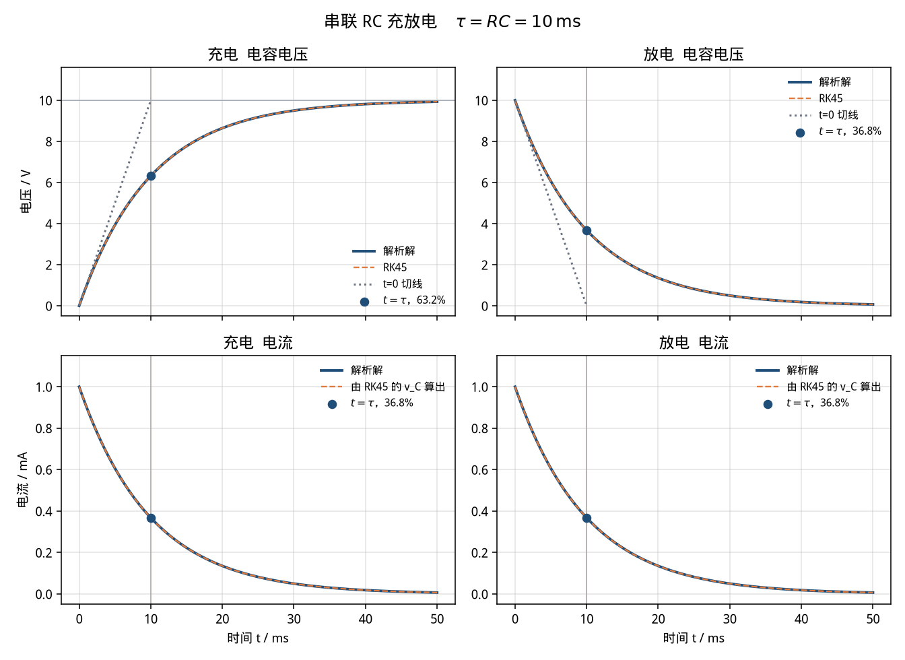

# RC 充放电（rc-charge）

> 适用课程：电路分析 / 电工基础 ｜ 难度：★☆☆ ｜ 课时：约 30 分钟

参数是课堂用的圆整值，用来看清时间常数，不是某一台设备的实测数据。本卡只讲「这条曲线说明什么」，不作为毕业设计或课程设计的电路成品。

和 [`rl-step`](../rl-step/README.md) 对照着看：那边的状态量是电感电流，这边是电容电压。时间常数都取 10 ms，百分数的来源都是 `e^(-1)`，不要把字母 L 换成 C 就算讲完。

## 1. 目标

看懂串联 RC 的两次换路。充电是零状态响应：电容电压不能跳变，从 0 按指数升向 `Vs`，一个 `τ = RC` 时走到稳态的 `1 - e^(-1) ≈ 63.2%`。放电是零输入响应：同一条指数，电压从 `Vs` 往 0 掉，一个 `τ` 时还剩 `e^(-1) ≈ 36.8%`。快慢只由 `τ` 决定；电流可以跳变，电压不行。

## 2. 接线图示意

充电：`t = 0` 闭合，闭合前电容电压为 0。

```text
                         i(t)
        .--------[ R ]--------| C |--------.
        |                                  |
        |                                  |
       Vs = 10 V · 1(t)                    |
        |                                  |
        '----------------------------------'
```

关联参考方向：电流从电源正极流出，`v_R`、`v_C` 都沿电流方向。KVL 与电容的定义：

```text
Vs = v_R + v_C = R i + v_C
i  = C dv_C/dt
```

没有 Simscape 时，用同一方程搭方框图（Sum 的输出是 `v_R`，积分器输出是 `v_C`）：

```text
Step(Vs) -->(+) Sum --+--> ×(1/(RC)) --> ∫ --> v_C --> Scope
               (-)    |                    ^
                ^     +--> ×(1/R) --> i    |
                |                          |
                +--------------------------+
```

放电：电源已经断开，电容事先充到 10 V，再经同一个电阻放掉。`i_放` 从正极板流出。

```text
              i_放(t)
        .--------[ R ]--------.
        |                     |
        |                     |
        '--------| C |--------'
              v_C(0) = 10 V
```

```text
v_C = R i_放
C dv_C/dt = - i_放
```

方框图里不再有 Step，积分器初值就是 10 V，反馈增益是 `-1/(RC)`。

## 3. 参数表

| 符号 | 含义 | 取值 | 单位 |
|------|------|------|------|
| Vs | 充电电源电压；放电时的电容初值 | 10 | V |
| R | 串联电阻（10 kΩ） | 10000 | Ω |
| C | 电容（1 μF） | 1e-6 | F |
| τ | 时间常数 RC | 10 | ms |
| v_C(∞) | 充电稳态电压 | 10 | V |
| v_C(0) 充电 | 电容电压初值 | 0 | V |
| v_C(0) 放电 | 电容电压初值 | 10 | V |
| i(0+) | 换路瞬间电流大小 Vs/R | 1 | mA |
| t_end | 建议仿真时长（5τ） | 50 | ms |

脚本里必须用国际单位：`R = 10000`，`C = 1e-6`。不要把 1 μF 写成 `1`，也不要把 10 kΩ 写成 `10`。

## 4. 预期曲线

解析解（`t ≥ 0`）：

```text
充电   v_C(t) = Vs (1 - e^(-t/τ))
       i(t)   = (Vs/R) e^(-t/τ)

放电   v_C(t) = Vs e^(-t/τ)
       i_放(t) = (Vs/R) e^(-t/τ)
```

对照下图（由 `python/rc_charge.py` 生成，RK45 与解析解重叠）。竖线是 `t = τ`，圆点是该时刻的电压或电流。



可量化指标（默认参数，脚本打印到 6 位小数）：

- `τ = RC = 0.010000 s`（10 ms）。充电电压在 `t = 0` 的切线斜率 `Vs/(RC) = 1000 V/s`，这条切线在 `t = τ` 时到达稳态电压 10 V；曲线自己在这一刻只到 `6.321206 V`。
- 充电 `v_C(τ) / Vs = 0.632121`，即 `1 - e^(-1) ≈ 63.2%`。`v_C(3τ) = 9.502129 V`（约 95%），`v_C(5τ) = 9.932621 V`（约 99.3%）。50 ms 以后再拉长仿真，电压几乎是水平线。
- 放电 `v_C(τ) = 3.678794 V`，即初值的 `e^(-1) ≈ 36.8%`。`t = 0` 的切线斜率为 `-1000 V/s`，在 `t = τ` 时落到 0，曲线自己还剩 36.8%。
- 充电电流 `i(0+) = 1.000000 mA`，`i(τ) = 0.367879 mA`（初值的 36.8%），稳态电流为 0。电容电压连续，电流在换路瞬间可以跳变。
- 放电电流用上面的 `i_放` 方向时，大小和充电电流是同一条指数：`t = τ` 也是 `0.367879 mA`。任意时刻充电满足 `v_R + v_C = 10 V`，放电满足 `v_C = R i_放`（残差应在数值误差以内）。

`63.2%` 和 `36.8%` 不是两个时间常数，是同一个 `e^(-1)`：充电电压看「已经走到稳态的多少」，放电电压和电流看「还剩多少」。

改参数时只记住两件事：充电稳态电压看电源（`v_C(∞) = Vs`），快慢看 `τ = RC`。`R` 加倍则 `τ` 加倍、初始电流减半，曲线变慢。

## 5. 常见报错

| 现象 | 原因 | 处理 |
|------|------|------|
| 电压一下跳到 10 V，看不见指数 | 停止时间用了数秒，10 ms 的过程被挤成一条竖线；或最大步长远大于 τ | Stop time 设为 `0.05`，最大步长 `≤ 1e-4`（约 τ/100），再放大横轴 |
| 电压振荡，而不是单调变化 | Specialized Power Systems 的 Series RLC Branch 电感仍是默认值，电路变成了 RLC | 本案例把 Inductance 设为 `0`，只保留 R 和 C |
| 仿真直接报代数环、奇异或电容被短路 | 理想电压源直接并联纯电容（`R = 0`），换路后没有电阻限流 | 保留串联电阻；不要把电压源并到电容两端 |
| 充电电压不从 0 开始，或放电一开始就是 0 | 积分器 / 电容的初始电压设反了 | 充电初值 `0`，放电初值 `10`。两次换路不要共用一个初值 |
| 电流 Scope 上「几乎是 0」 | 纵轴单位是 A，1 mA 写成 0.001，被当成没有电流 | 读数先乘 1000，或在电流支路加 Gain = `1000` 改成 mA |
| `τ` 变成 10 s 或 10000 s，曲线像一条斜线 | 把 10 kΩ 写成 `10`，或把 1 μF 写成 `1` | 统一 SI：`R = 10000` Ω，`C = 1e-6` F，先心算 `τ = 0.01` s、`i(0+) = 1` mA |
| 把 63.2% 标到了放电曲线上 | 充电电压是 `1 - e^(-1)`，放电电压和电流是 `e^(-1)` | 先问这一条是在靠近稳态，还是在离开初值 |
| `v_C` 在 0 时刻出现尖峰后乱振 | 用 Derivative 模块对阶跃求导 | 删掉 Derivative。电流取 `(Vs - v_C)/R`，电容电压用积分器 |
| Python 报 `ModuleNotFoundError: scipy`（或 matplotlib） | 未装案例依赖 | 在 `python/` 下执行 `pip install -r requirements.txt` |
| MATLAB 曲线与命令行数字对不上 | 改了工作区里的 `R`、`C` 后没有重新运行脚本 | 重新运行 `rc_charge.m`；以命令行打印的 `v_c_tau_charge_V` 为准 |

## 6. 平台指引

三个平台用同一组参数。Python 与 MATLAB 都给出可运行脚本；Simulink 按下面的模块清单搭，不附带 `.slx`。

### Simulink

用基础库搭状态方程即可，不必安装电力工具箱。逐步点击说明见 [`simulink/README.md`](simulink/README.md)。

充电模块清单：

| 模块 | 参数 |
|------|------|
| Step | Step time = `0`，Initial = `0`，Final = `10` |
| Sum | 符号 `+-`（正端接 Step，负端接 `v_C`） |
| Gain | `1/(RC) = 100`，接在 Sum 之后 |
| Integrator | 初值 `0`，输出为 `v_C` |
| Gain | `1/R = 1e-4`，从 Sum 的输出得到电流（单位 A） |
| Scope | 分别观察 `v_C` 和 `i` |

放电：去掉 Step，积分器初值改为 `10`，反馈增益改为 `-100`，电流改为 `v_C / R`。详见搭建步骤。

求解器：**Variable-step / ode45**，Stop time = `0.05`，Max step size = `1e-4`，Relative tolerance = `1e-4`。

读数：充电电压在 10 ms 附近应为 6.32 V，放电电压在 10 ms 附近应为 3.68 V。不要再接 Derivative。

已安装 Specialized Power Systems 时，可用 `powergui`（Continuous）+ Series RLC Branch（`R = 10000`，`L = 0`，`C = 1e-6`）。充电加 10 V 直流源、电容初值 0；放电去掉电源、电容初值 10。求解器改为 `ode23tb`，停止时间和最大步长同上。

### MATLAB

脚本：[`matlab/rc_charge.m`](matlab/rc_charge.m)。只用基础函数（`ode45`、`exp`、`plot`），不需要工具箱。

```matlab
run('cases/rc-charge/matlab/rc_charge.m')
```

脚本把解析解和 `ode45` 画在一起，并打印 `tau_s`、`v_c_tau_charge_V`、`v_c_tau_discharge_V`。两段电压的最大偏差都应小于 `1e-4` V，否则脚本会报错停下。图片写到 `img/rc_charge_curves_matlab.png`（运行后才有）。

### Python

脚本：[`python/rc_charge.py`](python/rc_charge.py)。依赖 numpy、scipy、matplotlib，见 [`python/requirements.txt`](python/requirements.txt)。

```bash
pip install -r cases/rc-charge/python/requirements.txt
python cases/rc-charge/python/rc_charge.py
```

控制台应出现：

```text
tau_s                  = 0.010000
v_inf_V                = 10.000000
v_c_tau_charge_V       = 6.321206
pct_charge_at_tau      = 0.632121
v_c_3tau_charge_V      = 9.502129
v_c_5tau_charge_V      = 9.932621
v_c_tau_discharge_V    = 3.678794
pct_discharge_at_tau   = 0.367879
i0_mA                  = 1.000000
i_tau_mA               = 0.367879
slope0_V_per_s         = 1000.000000
```

`max_abs_err_vc_charge` 和 `max_abs_err_vc_dis` 是 RK45 相对解析解的最大偏差，默认参数下应远小于 `1e-4`。曲线保存为 [`img/rc_charge_curves.png`](img/rc_charge_curves.png)。没有图形界面时只保存图片、不弹窗。

## 7. 课堂提问

1. `t = 0+` 时电容电压为什么仍是 0，电流为什么可以立刻变成 1 mA？
2. 充电的 `v_C(τ)` 是稳态的 63.2%，放电的 `v_C(τ)` 是初值的 36.8%。这是两个时间常数，还是同一个 `e^(-1)`？
3. 把 `R` 改为 20 kΩ、`C` 不变，`τ` 和充电初始电流各变成多少？曲线变快还是变慢？
4. 充电电压过原点的切线，为什么在一个 `τ` 处碰到 10 V，而曲线自己只到 6.32 V？这和 63.2% 是不是同一件事？

## 8. 相关链接

- 案例卡字段约定：[docs/case-convention.md](../../docs/case-convention.md)
- 同一阶系统的对照案例：[RL 电路阶跃响应（rl-step）](../rl-step/README.md)。两边都把 `τ` 取成 10 ms：那边看电流升到 63.2%，这边看电容电压升到 63.2%。
