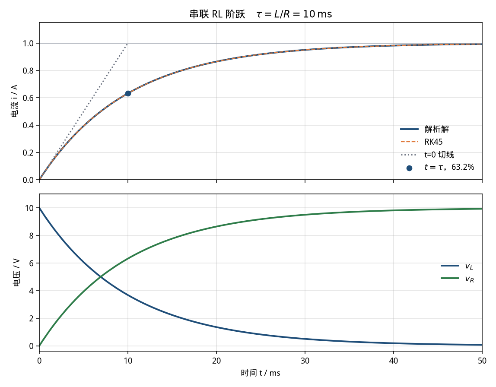

# RL 电路阶跃响应（rl-step）

> 适用课程：电路分析 / 电工基础 ｜ 难度：★☆☆ ｜ 课时：约 25 分钟

参数是课堂用的圆整值，用来看清时间常数，不是某一台设备的实测数据。本卡只讲「这条曲线说明什么」，不作为毕业设计或课程设计的电路成品。

## 1. 目标

看懂串联 RL 在直流阶跃下的电流：电感电流不能跳变，按指数升向 `Vs/R`；快慢只由时间常数 `τ = L/R` 决定。电阻电压与电流同形，电感电压从 `Vs` 指数落到 0，二者之和始终等于电源电压。

## 2. 接线图示意

开关在 `t = 0` 闭合，闭合前电流为 0。

```text
                         i(t)
        .--------[ R ]--------( L )--------.
        |                                  |
        |                                  |
       Vs = 10 V · 1(t)                    |
        |                                  |
        '----------------------------------'
```

关联参考方向：电流从电源正极流出，`v_R`、`v_L` 都沿电流方向。KVL：

```text
Vs = v_R + v_L = R i + L di/dt
```

没有 Simscape 时，用同一方程搭方框图（Sum 的输出就是 `v_L`）：

```text
Step(Vs) -->(+) Sum --+--> ×(1/L) --> ∫ --> i --> Scope
               (-)    |
                ^     +--> v_L --> Scope
                |
                +---------- ×(R) <--- i
```

## 3. 参数表

| 符号 | 含义 | 取值 | 单位 |
|------|------|------|------|
| Vs | 阶跃电压幅值 | 10 | V |
| R | 串联电阻 | 10 | Ω |
| L | 串联电感（100 mH） | 0.1 | H |
| τ | 时间常数 L/R | 10 | ms |
| I∞ | 稳态电流 Vs/R | 1 | A |
| i(0) | 电感电流初值 | 0 | A |
| t_end | 建议仿真时长（5τ） | 50 | ms |

脚本里电感必须用亨利：`L = 0.1`，不要把 100 mH 写成 `100`。

## 4. 预期曲线

解析解（`t ≥ 0`）：

```text
i(t)   = (Vs/R) (1 - e^(-t/τ))
v_L(t) = Vs e^(-t/τ)
v_R(t) = R i(t)
```

对照下图（由 `python/rl_step.py` 生成，RK45 与解析解重叠）：



可量化指标（默认参数，脚本打印到 6 位小数）：

- `τ = L/R = 0.010000 s`（10 ms）。`t = 0` 的切线斜率 `Vs/L = 100 A/s`，这条切线在 `t = τ` 时到达稳态电流 1 A。
- `i(τ) = 0.632121 A`，即稳态的 `1 - e^(-1) ≈ 63.2%`。
- `i(3τ) = 0.950213 A`（约 95%），`i(5τ) = 0.993262 A`（约 99.3%）。50 ms 以后再拉长仿真，曲线几乎是水平线。
- `v_L(0+) = 10 V`，`v_L(τ) = 3.678794 V`，稳态 `v_L → 0`。电流连续，电感电压可以跳变。
- `v_R` 与 `i` 同形，稳态 `v_R → 10 V`。任意时刻 `v_R + v_L = 10 V`（KVL 残差应在数值误差以内）。

改参数时只记住两件事：稳态看 `R`（`I∞ = Vs/R`），快慢看 `τ = L/R`。`R` 加倍则稳态电流减半、`τ` 也减半。

## 5. 常见报错

| 现象 | 原因 | 处理 |
|------|------|------|
| 电流一下跳到 1 A，看不见指数 | 停止时间用了数秒，10 ms 的过程被挤成一条竖线；或最大步长远大于 τ | Stop time 设为 `0.05`，最大步长 `≤ 1e-4`（约 τ/100），再放大横轴 |
| 电流振荡，而不是单调上升 | Specialized Power Systems 的 Series RLC Branch 电容仍是默认值，电路变成了 RLC | 本案例把 Capacitance 设为 `inf`，只保留 R 和 L |
| 仿真直接报代数环、奇异或电感被短路 | 理想电压源直接并联纯电感（`R = 0`），或电容被设成 0 | 保留串联电阻；Series RLC 的 C 用 `inf` 而不是 0 |
| 电流不从 0 开始 | 电感初始电流不是 0，或积分器初值被改过 | Integrator / Inductor 的初始电流设为 0 |
| `v_L` 在 0 时刻出现尖峰后乱振 | 用 Derivative 模块对阶跃求导 | 删掉 Derivative。电感电压取 Sum 的输出 `Vs - R i`，或用 `L di/dt` 的状态方程 |
| 稳态电流变成 0.1 A 或 100 A | 把 100 mH 当成 100 H，或电阻多写了一个 0 | 统一 SI：`L = 0.1` H，`R = 10` Ω，先心算 `I∞ = 1` A |
| Python 报 `ModuleNotFoundError: scipy`（或 matplotlib） | 未装案例依赖 | 在 `python/` 下执行 `pip install -r requirements.txt` |
| MATLAB 曲线与命令行数字对不上 | 改了工作区里的 `R`、`L` 后没有重新运行脚本 | 重新运行 `rl_step.m`；以命令行打印的 `i_tau_A` 为准 |

## 6. 平台指引

三个平台用同一组参数。Python 与 MATLAB 都给出可运行脚本；Simulink 按下面的模块清单搭，不附带 `.slx`。

### Simulink

用基础库搭状态方程即可，不必安装电力工具箱。逐步点击说明见 [`simulink/README.md`](simulink/README.md)。

模块清单：

| 模块 | 参数 |
|------|------|
| Step | Step time = `0`，Initial = `0`，Final = `10` |
| Sum | 符号 `+-`（正端接 Step，负端接 `R*i`） |
| Gain | `1/L = 10`，接在 Sum 之后 |
| Integrator | 初值 `0`，输出为 `i` |
| Gain | `R = 10`，从 `i` 反馈到 Sum 的负端 |
| Scope | 分别观察 `i` 和 Sum 输出 `v_L` |

求解器：**Variable-step / ode45**，Stop time = `0.05`，Max step size = `1e-4`，Relative tolerance = `1e-4`。

读数：`i` 在 10 ms 附近应为 0.632 A，50 ms 附近应为 0.993 A。Sum 的输出从 10 V 落到 0，不要再接 Derivative。

已安装 Specialized Power Systems 时，可用 `powergui`（Continuous）+ 10 V 直流源 + Series RLC Branch（`R = 10`，`L = 0.1`，`C = inf`，初始电流 0），求解器改为 `ode23tb`，停止时间和最大步长同上。

### MATLAB

脚本：[`matlab/rl_step.m`](matlab/rl_step.m)。只用基础函数（`ode45`、`exp`、`plot`），不需要工具箱。

```matlab
run('cases/rl-step/matlab/rl_step.m')
```

脚本把解析解和 `ode45` 画在一起，并打印 `tau_s`、`i_tau_A`、`i_5tau_A`。两者电流最大偏差应小于 `1e-4` A，否则脚本会报错停下。图片写到 `img/rl_step_curves_matlab.png`（运行后才有）。

### Python

脚本：[`python/rl_step.py`](python/rl_step.py)。依赖 numpy、scipy、matplotlib，见 [`python/requirements.txt`](python/requirements.txt)。

```bash
pip install -r cases/rl-step/python/requirements.txt
python cases/rl-step/python/rl_step.py
```

控制台应出现：

```text
tau_s            = 0.010000
i_inf_A          = 1.000000
i_tau_A          = 0.632121
i_3tau_A         = 0.950213
i_5tau_A         = 0.993262
v_l_0_V          = 10.000000
v_l_tau_V        = 3.678794
slope0_A_per_s   = 100.000000
```

`max_abs_err_i_A` 是 RK45 相对解析解的最大偏差，默认参数下应远小于 `1e-4`。曲线保存为 [`img/rl_step_curves.png`](img/rl_step_curves.png)。没有图形界面时只保存图片、不弹窗。

## 7. 课堂提问

1. `t = 0+` 时电流为什么仍是 0，电感电压为什么可以立刻变成 10 V？
2. 把 `R` 改为 20 Ω、`L` 不变，稳态电流和 `τ` 各变成多少？曲线变快还是变慢？
3. 过原点的切线为什么在一个 `τ` 处碰到稳态值？这和 `i(τ) = 63.2%` 是不是同一件事？
4. 若闭合前电感里已经有 0.2 A，还用本卡的解析式吗？哪一个量必须改？

## 8. 相关链接

- 案例卡字段约定：[docs/case-convention.md](../../docs/case-convention.md)
- 同一阶系统的对照主题：`rc-charge`（RC 充放电，`τ = RC`），见仓库根目录 `themes.md`。那张卡单独成文之前，不要把本卡的 RL 公式直接换字母交差。
