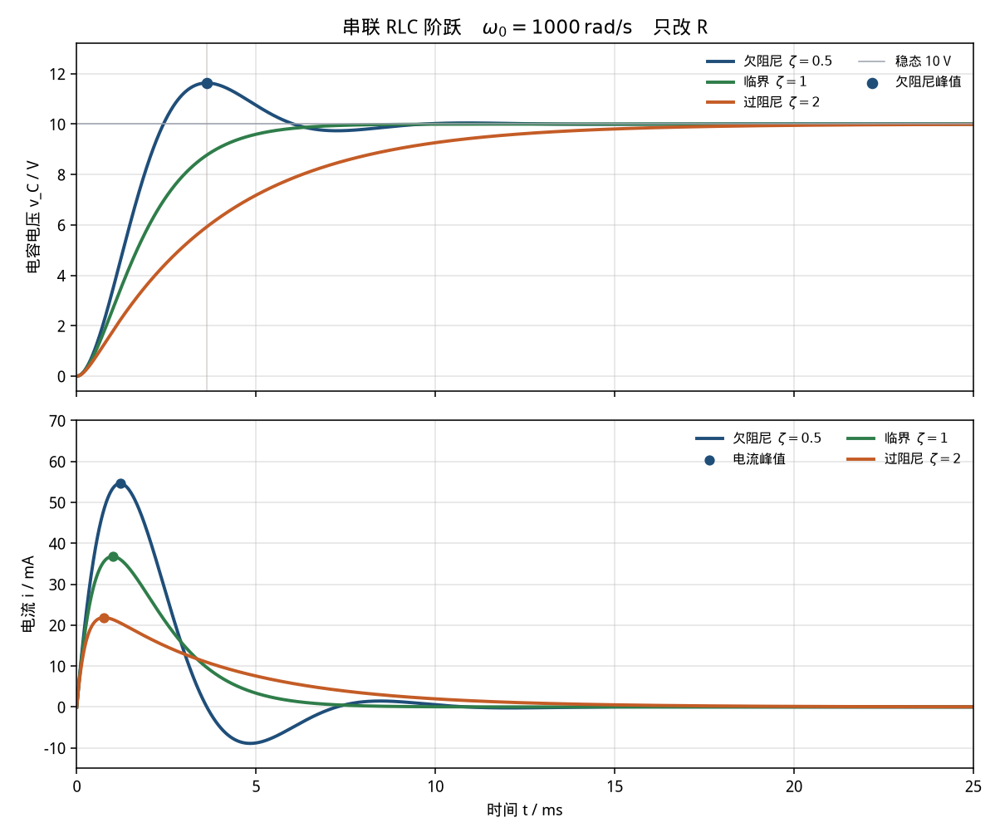

# RLC 串联阶跃：欠/临界/过阻尼（rlc-series-step）

> 适用课程：电路分析 / 电工基础 ｜ 难度：★★☆ ｜ 课时：约 40 分钟

参数是课堂用的圆整值，用来把三条阻尼曲线拉开，不是某一台设备的实测数据。本卡只讲「ζ 不同时这条电压、电流说明什么」，不作为毕业设计或课程设计的电路成品。

和 [`rl-step`](../rl-step/README.md)、[`rc-charge`](../rc-charge/README.md) 接在一起看：前两张卡里另一个储能元件被拿掉了，响应是一条指数。这里电感和电容都留下，回路变成二阶。L、C 和电源固定，只改电阻，阻尼比 ζ 取 0.5、1、2。

## 1. 目标

看懂串联 RLC 在直流阶跃下的零状态响应。电容电压和电感电流都不能跳变，所以 `t = 0+` 时两者仍是 0，电源电压先全部落在电感上。稳态时电容相当于开路，`v_C → Vs`，电流回到 0；电阻不改变这两个稳态值，只改变靠近稳态的方式。

阻尼比 `ζ = (R/2) · √(C/L)`：

- `ζ = 0.5` 欠阻尼：电容电压越过 `Vs`，再摆回来
- `ζ = 1` 临界阻尼：电压从下面单调靠近 `Vs`，是不过冲情形里最快的一档
- `ζ = 2` 过阻尼：同样不过冲，但慢极点拖着，比临界更慢

三条曲线的自然角频率相同：`ω0 = 1/√(LC) = 1000 rad/s`。后面控制课里的 ζ，就是这里这个数。

## 2. 接线图示意

开关在 `t = 0` 闭合。闭合前电容电压为 0，电感电流为 0。对比时只更换 R，L 和 C 不动。

```text
                         i(t)
        .--------[ R ]--------( L )--------| C |--------.
        |                                                   |
        |                                                   |
       Vs = 10 V · 1(t)                                     |
        |                                                   |
        '---------------------------------------------------'
```

关联参考方向：电流从电源正极流出，`v_R`、`v_L`、`v_C` 都沿电流方向。KVL 与元件方程：

```text
Vs = v_R + v_L + v_C = R i + L di/dt + v_C
i  = C dv_C/dt
```

没有 Simscape 时，用两个积分器搭同一组状态方程。Sum 的三个输入是 `Vs`、`v_C`、`R i`，符号 `+--`，输出再乘 `1/L` 就是 `di/dt`：

```text
                         +---------------- v_C ------------------+
                         |                                       |
                         v                                       |
Step(Vs) -->(+) Sum(+--) --> ×(1/L) --> ∫ --> i --+--> ×(1/C) --> ∫ --> v_C
                 ^    ^                    |       |
                 |    |                    |       +--> Scope
                 |    +-------- ×(R) <-----+
                 |
                 +------------- v_C
```

课堂对比把这条链复制三份，R 分别取 100 Ω、200 Ω、400 Ω，三路 `v_C` 送进一个 Mux，三路 `i` 送进另一个 Mux。一次仿真就能把三条曲线叠在同一个 Scope 上。

## 3. 参数表

| 符号 | 含义 | 取值 | 单位 |
|------|------|------|------|
| Vs | 阶跃电压幅值 | 10 | V |
| L | 串联电感（100 mH），三档共用 | 0.1 | H |
| C | 串联电容（10 μF），三档共用 | 1e-5 | F |
| ω0 | 无阻尼自然角频率 1/√(LC) | 1000 | rad/s |
| R | 串联电阻，三档只改这一项 | 100 / 200 / 400 | Ω |
| ζ | 阻尼比 (R/2)·√(C/L) = R/200 | 0.5 / 1 / 2 | — |
| v_C(∞) | 稳态电容电压，三档相同 | 10 | V |
| i(∞) | 稳态电流，三档相同 | 0 | A |
| v_C(0) | 电容电压初值 | 0 | V |
| i(0) | 电感电流初值 | 0 | A |
| t_end | 仿真时长 | 25 | ms |

`√(C/L) = √(1e-5 / 0.1) = 0.01`，所以 `ζ = R/200`。心算：100 Ω 是 0.5，200 Ω 是 1，400 Ω 是 2。

脚本里用国际单位：`L = 0.1`，`C = 1e-5`。不要把 100 mH 写成 `100`，也不要把 10 μF 写成 `10`。

## 4. 预期曲线

`t ≥ 0` 的解析解。记 `α = ζ ω0`。

欠阻尼（`ζ < 1`，`ωd = ω0 √(1-ζ²)`，`φ = arccos(ζ)`）：

```text
i(t)   = (Vs / (ωd L)) e^(-α t) sin(ωd t)
v_C(t) = Vs [ 1 - e^(-α t) / √(1-ζ²) · sin(ωd t + φ) ]
```

临界阻尼（`ζ = 1`）：

```text
i(t)   = (Vs / L) t e^(-ω0 t)
v_C(t) = Vs [ 1 - e^(-ω0 t) (1 + ω0 t) ]
```

过阻尼（`ζ > 1`，`s1`、`s2` 是两个负实根，`s1` 离原点更近）：

```text
s1, s2 = -ζ ω0 ± ω0 √(ζ² - 1)
i(t)   = (Vs / L) / (s1 - s2) · (e^(s1 t) - e^(s2 t))
v_C(t) = Vs [ 1 + (s2 e^(s1 t) - s1 e^(s2 t)) / (s1 - s2) ]
```

对照下图（由 `python/rlc_series_step.py` 生成）。实线是解析解，RK45 用同色虚线叠上，默认参数下两者重合。



可量化指标（默认参数，脚本打印到 6 位小数）：

- `ω0 = 1000 rad/s`。三档在 `t = 0` 的电流斜率都是 `di/dt = Vs/L = 100 A/s`，电容电压的初始曲率都是 `d²v_C/dt² = Vs/(LC) = 1e7 V/s²`。电阻要等电流出现才起作用，所以出发的那一小段分不开。
- `t = 0+` 时 `v_C = 0`、`i = 0`、`v_R = 0`，电感电压 `v_L = 10 V`。任意时刻 `v_R + v_L + v_C = 10 V`（KVL 残差应在数值误差以内）。
- 欠阻尼 `ζ = 0.5`：`ωd = 866.025404 rad/s`，振荡周期 `Td = 7.255197 ms`。电压峰值在 `t = 3.627599 ms`，`v_C = 11.630335 V`，超调比例 `0.163034`（16.3%）。谷值在 `t = 7.255197 ms`，`v_C = 9.734201 V`。
- 欠阻尼电流峰值 `0.054629 A`（54.629 mA），时刻 `1.209200 ms`。电流在电压峰值处过零，负向峰值 `-0.008906 A`，时刻 `4.836798 ms`。
- 欠阻尼进入 `10 V ± 2%`：曲线最后一次穿过 9.8 V 在 `8.076349 ms`；误差包络 `Vs e^(-αt) / √(1-ζ²)` 降到 2% 在 `8.111728 ms`。口算用 `4/α = 4/500 = 8 ms`，三个数挨在一起。
- 同一时刻的电压，阻尼越大爬得越慢。`t = 1 ms`：欠阻尼 `3.402998 V`，临界 `2.642411 V`，过阻尼 `1.777366 V`。`t = 5 ms`：欠阻尼已经在 10 V 上方（`10.745906 V`），临界 `9.595723 V`，过阻尼 `7.178288 V`。
- 临界 `ζ = 1`：电流峰值 `0.036788 A`，正好在 `t = 1/ω0 = 1.000000 ms`。`t = 10 ms` 时电压 `9.995006 V`。整条电压不超过 10 V。
- 过阻尼 `ζ = 2`：实根 `s1 = -267.949192 rad/s`、`s2 = -3732.050808 rad/s`。电流峰值更小也更早：`0.021856 A`，在 `0.760346 ms`。慢极点的时间常数约 `1/267.9 ≈ 3.73 ms`，所以 `t = 10 ms` 还只有 `9.260959 V`，`t = 25 ms` 才到 `9.986722 V`。

改参数时只改 R：稳态电压仍是 `Vs`，稳态电流仍是 0，变的是 ζ。R 从 200 Ω 加大到 400 Ω 后，电压更晚才靠近 10 V。

## 5. 常见报错

| 现象 | 原因 | 处理 |
|------|------|------|
| 25 ms 的过程挤成 t = 0 处一条竖线 | Stop time 用了数秒 | Stop time 设为 `0.025`，横轴放大到 0–25 ms |
| 临界、过阻尼也在抖，三条都像正弦 | 最大步长大于振荡周期，求解器把数值振荡当成电路振荡 | Max step size 设为 `1e-5`。先看 `ζ = 1` 那条是否单调，再谈电路 |
| 电流升到 `Vs/R` 后停住，不回 0 | Series RLC Branch 的电容仍是 `inf`，回路其实是 RL | 电容设为 `1e-5`。本卡稳态电流是 0 |
| 电压单调上升，怎么改 R 都没有过冲 | 电感被设成 0，回路退化成一阶 RC | 电感设为 `0.1`。欠阻尼要 L 和 C 同时存在 |
| 三条曲线频率差很远，不好比 | 改阻尼时把 L 或 C 一起改了，`ω0` 也变了 | 本卡只改 R。L、C、Vs 三档共用 |
| 算出来 ζ 是几千，觉得「全是过阻尼」 | 公式写成了 `(R/2)·√(L/C)`，根号里 L、C 放反 | 用 `ζ = (R/2)·√(C/L)`。R = 100 Ω 时应得到 0.5 |
| 电压冲到几十伏或反向发散 | Sum 的反馈接成了正反馈，或 `1/L`、`1/C` 的符号多了一个负号 | Sum 符号保持 `+--`：电源为正，`v_C` 和 `R i` 为负 |
| `t = 0` 电压或电流不是 0 | 积分器初值、电感初始电流或电容初始电压被改过 | 两个积分器初值都设为 0。本卡是零状态 |
| 稳态电压变成 1 V 或 20 V | Step 已经是 10，传递函数分子又乘了 10；或 Step 仍是 1，输出没有乘 Vs | 二选一：Step Final = `10` 且分子为 `1`，或单位阶跃再乘 10 |
| 把 16.3% 当成一阶电路的 63.2% | 超调是 `e^(-ζπ/√(1-ζ²))`，和 `1 - e^(-1)` 不是同一个数 | 先问这条曲线有没有越过稳态。63.2% 属于 [`rl-step`](../rl-step/README.md) / [`rc-charge`](../rc-charge/README.md) |
| 在 2 ms 处把电流峰值当成稳态 | 示波器停在电流最大的地方 | 读 25 ms。三档电流都应回到 0 附近 |
| `v_L` 在 0 时刻尖峰后乱振 | 用 Derivative 对阶跃求导 | 删掉 Derivative。`v_L` 取 `L di/dt`，而 `di/dt` 是前一个积分器的输入 |
| `ω0` 变成几十 rad/s，25 ms 内几乎是直线 | 100 mH 写成 `100`，或 10 μF 写成 `10` | 统一 SI：`L = 0.1` H，`C = 1e-5` F，先心算 `ω0 = 1000` |
| Python 报 `ModuleNotFoundError: scipy`（或 matplotlib） | 未装案例依赖 | 在 `python/` 下执行 `pip install -r requirements.txt` |
| MATLAB 曲线与命令行数字对不上 | 改了工作区里的 `R`、`L`、`C` 后没有重新运行脚本 | 重新运行 `rlc_series_step.m`；以命令行打印的 `under_v_peak_V` 为准 |

## 6. 平台指引

三个平台用同一组参数。Python 与 MATLAB 都给出可运行脚本；Simulink 按下面的模块清单搭，不附带 `.slx`。

### Simulink

用基础库搭状态方程即可，不必安装电力工具箱。逐步点击说明见 [`simulink/README.md`](simulink/README.md)。

一条链的模块清单（复制三份，只改 R）：

| 模块 | 参数 |
|------|------|
| Step | Step time = `0`，Initial = `0`，Final = `10`，Sample time = `0`。三份可以共用这一个 Step |
| Sum | 符号 `+--`（`Vs` 为正，`v_C` 与 `R i` 为负） |
| Gain `1/L` | `1/0.1 = 10` |
| Integrator | 初值 `0`，输出为 `i` |
| Gain `R` | 三份分别是 `100`、`200`、`400` |
| Gain `1/C` | `1/1e-5 = 1e5` |
| Integrator | 初值 `0`，输出为 `v_C` |
| Mux ×2 | 三路电压一路，三路电流一路 |
| Scope ×2 | 一个看 `v_C`，一个看 `i` |

求解器：**Variable-step / ode45**，Stop time = `0.025`，Max step size = `1e-5`，Relative tolerance = `1e-4`。

读数：蓝（100 Ω）在约 3.63 ms 处到 11.63 V；绿（200 Ω）和橙（400 Ω）不超过 10 V；25 ms 处三路电流都接近 0。电流 Scope 的单位是 A，峰值约 0.055 A，不是 55。课堂若要直接读毫安，在电流支路加 Gain = `1000`。不要再接 Derivative。

已安装 Specialized Power Systems 时，可用 `powergui`（Continuous）+ 10 V 直流源 + Series RLC Branch（`L = 0.1`，`C = 1e-5`，初始电流 0，初始电压 0）。电阻分三次设为 `100`、`200`、`400`，或在模型里放三条支路。求解器改为 `ode23tb`，停止时间和最大步长同上。

### MATLAB

脚本：[`matlab/rlc_series_step.m`](matlab/rlc_series_step.m)。只用基础函数（`ode45`、`exp`、`plot`），不需要工具箱。文件末尾的局部函数从 R2016b 起属于基础语言。

```matlab
run('cases/rlc-series-step/matlab/rlc_series_step.m')
```

脚本把解析解和 `ode45` 画在一起，并打印与 Python 相同的字段。电压最大偏差应小于 `1e-4` V，电流最大偏差应小于 `1e-5` A，否则脚本会报错停下。图片写到 `img/rlc_series_step_curves_matlab.png`（运行后才有）。

### Python

脚本：[`python/rlc_series_step.py`](python/rlc_series_step.py)。依赖 numpy、scipy、matplotlib，见 [`python/requirements.txt`](python/requirements.txt)。

```bash
pip install -r cases/rlc-series-step/python/requirements.txt
python cases/rlc-series-step/python/rlc_series_step.py
```

控制台应出现：

```text
omega0_rad_s           = 1000.000000
di_dt0_A_per_s         = 100.000000
curvature0_V_per_s2    = 10000000.000000
under_R_ohm            = 100.000000
under_zeta             = 0.500000
under_wd_rad_s         = 866.025404
under_Td_ms            = 7.255197
under_tp_ms            = 3.627599
under_v_peak_V         = 11.630335
under_os_frac          = 0.163034
under_v_valley_V       = 9.734201
under_ti_ms            = 1.209200
under_i_peak_A         = 0.054629
under_ti_neg_ms        = 4.836798
under_i_neg_A          = -0.008906
under_t_2pct_ms        = 8.076349
under_t_env2pct_ms     = 8.111728
under_vc_1ms_V         = 3.402998
under_vc_5ms_V         = 10.745906
crit_R_ohm             = 200.000000
crit_zeta              = 1.000000
crit_ti_ms             = 1.000000
crit_i_peak_A          = 0.036788
crit_vc_1ms_V          = 2.642411
crit_vc_5ms_V          = 9.595723
crit_vc_10ms_V         = 9.995006
over_R_ohm             = 400.000000
over_zeta              = 2.000000
over_s1_rad_s          = -267.949192
over_s2_rad_s          = -3732.050808
over_ti_ms             = 0.760346
over_i_peak_A          = 0.021856
over_vc_1ms_V          = 1.777366
over_vc_5ms_V          = 7.178288
over_vc_10ms_V         = 9.260959
over_vc_25ms_V         = 9.986722
```

`max_abs_err_vc_V` 和 `max_abs_err_i_A` 是三档里 RK45 相对解析解的最大偏差，默认参数下应分别远小于 `1e-4` 和 `1e-5`。曲线保存为 [`img/rlc_series_step_curves.png`](img/rlc_series_step_curves.png)。没有图形界面时只保存图片、不弹窗。

## 7. 课堂提问

1. `t = 0+` 时电容电压和电流都还是 0，电感电压为什么已经是 10 V？为什么这时三条 ζ 曲线还分不开？
2. 三档电阻不同，稳态电容电压却都是 10 V。电阻究竟改变了哪一段？
3. `ζ = 0.5` 的超调是 16.3%。它和一阶电路里的 63.2% 各自由什么式子来？
4. 把 R 从 200 Ω 改成 400 Ω，电压为什么反而更晚靠近 10 V？「阻尼更大」在这张卡里对应哪一条曲线？

## 8. 相关链接

- 案例卡字段约定：[docs/case-convention.md](../../docs/case-convention.md)
- 电感单独存在时的一阶阶跃：[RL 电路阶跃响应（rl-step）](../rl-step/README.md)。那边稳态电流是 `Vs/R`，这边稳态电流是 0。
- 电容单独存在时的一阶充放电：[RC 充放电（rc-charge）](../rc-charge/README.md)。那边电压单调趋向 `Vs`，这边只有 `ζ ≥ 1` 才单调。
