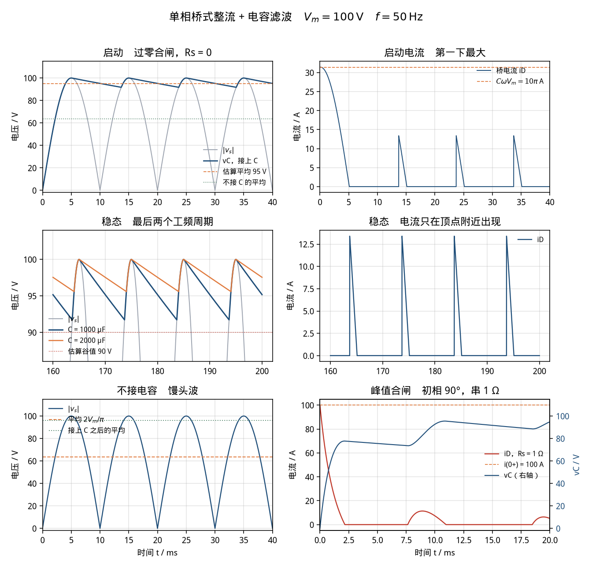

# 单相桥式整流 + 电容滤波（single-phase-rectifier）

> 适用课程：电力电子技术 / 电工基础 ｜ 难度：★★☆ ｜ 课时：约 45 分钟

参数是课堂用的圆整值，用来把「不接电容的平均值」和「纹波估算」算在整数附近，不是某一台电源或电网的实测数据。本卡只讲「电容把馒头波抬成一条带着纹波的直流」，不作为毕业设计或课程设计的整流电源成品。

和 [`rc-charge`](../rc-charge/README.md) 接在一起看：二极管截止的那一段，就是电容经电阻放电。这里 `τ = RC = 100 ms`，半个工频周期只有 10 ms，所以放电只走了指数的一小段，看起来几乎是直线。

## 1. 目标

看懂理想单相桥在电阻负载上的两件事，以及接上滤波电容之后多出来的第三件。

不接电容时，输出就是交流电压的绝对值，常叫馒头波。全波每个周期有两座馒头，平均值是 `2·Vm/π`，不是峰值，也不是有效值。

接上电容以后，只有 `|v_s|` 高于电容电压时二极管才导通，电容被充到接近峰值；二极管一截止，电容单独给电阻供电，电压慢慢掉。所以直流平均值被抬到峰值附近，不再是 `2·Vm/π`。纹波的课堂估算是

```text
ΔV ≈ Io / (2 f C) ，   Io ≈ Vm / R
```

`2f` 是因为全波每半周充一次，纹波频率是 100 Hz，不是 50 Hz。这个估算把放电时间当成整整半个周期，算出来是上限：实际导通要占掉大约 1.4 ms，纹波比 10 V 小一截。

还要看见合闸电流。过零合闸时，第一下大约 `C·ω·Vm = 10π A`。合闸若正赶在电压峰值、电源又没有内阻，理想模型里的电流没有上限。

## 2. 接线图示意

`v_s = Vm sin(ωt)`，四只理想二极管，`Vf = 0`。电容和负载并联在直流侧。`t = 0` 以前电容电压为 0。主工况不串电源内阻。

```text
                 D1                         D2
        +-------|>|-------+------- +vo ----|<|-------+
        |                 |                |         |
        |                === C             |         |
   vs ~ +                 |                |         + ~ vs
        |                [ R ]             |         |
        |                 |                |         |
        +-------|<|-------+------- -vo ----|>|-------+
                 D4                         D3
                          |
                       参考地（取 -vo）
```

左端为正时 D1、D3 导通，右端为正时 D2、D4 导通。任何时刻导通的是对角两只，另外两只反偏。方向反了一只，输出会变成 0，或者交流直接穿到直流侧。

主工况的元件方程（`Rs = 0`）：

```text
v_s = Vm sin(ωt)

导通（|v_s| 不低于按 RC 自然放电的电压，且桥电流 ≥ 0）
    v_C = |v_s|
    i_D = C d|v_s|/dt + |v_s|/R

截止
    C dv_C/dt = -v_C/R
    i_D = 0

不接电容
    v_O = |v_s|
    平均值 = 2 Vm / π
```

讨论「合闸在峰值」时，在交流支路串一只 `Rs`。否则理想电压源直接给空电容充电，电流是冲激，仿真求解器会报代数环，或者画出一条没有宽度的针。

```text
i_D = max(|v_s| - v_C, 0) / Rs
C dv_C/dt = i_D - v_C/R
合闸在峰值、v_C(0) = 0 时，i(0+) = Vm / Rs
```

没有 Simscape 时，用 `Rs = 1 Ω` 的这一组方程搭方框图，见 [`simulink/README.md`](simulink/README.md)。`Rs = 0` 的主工况在方框图里是代数约束，基础库不好直接搭。

## 3. 参数表

| 符号 | 含义 | 取值 | 单位 |
|------|------|------|------|
| Vm | 交流峰值 | 100 | V |
| f | 工频 | 50 | Hz |
| ω | 角频率 2πf，等于 100π | 314.159265 | rad/s |
| R | 负载 | 100 | Ω |
| C | 滤波电容，主工况（1000 μF） | 1000e-6 | F |
| C2 | 对照：电容加倍 | 2000e-6 | F |
| Rs | 主工况电源内阻 | 0 | Ω |
| Rs_in | 峰值合闸讨论时串联 | 1 | Ω |
| φ | 主工况合闸角 | 0 | ° |
| φ_in | 冲击讨论的合闸角 | 90 | ° |
| Vavg0 | 不接电容的平均 2·Vm/π | 63.661977 | V |
| Io | 估算用的电流 Vm/R | 1 | A |
| ΔV | 纹波估算 Io/(2·f·C) | 10 | V |
| Vdc | 平均电压估算 Vm − ΔV/2 | 95 | V |
| ΔV2 | C 加倍后的纹波估算 | 5 | V |
| Vdc2 | C 加倍后的平均估算 | 97.5 | V |
| v_C(0) | 电容初值 | 0 | V |
| t_end | 仿真时长 | 0.2 | s |

心算主工况：`100/100 = 1 A`，`2×50×0.001 = 0.1`，`1/0.1 = 10 V`，`100 − 5 = 95 V`。不接电容：`2×100/π ≈ 63.662 V`。电容改成 2000 μF 时，估算的分母翻倍，纹波从 10 V 变成 5 V，平均估算从 95 V 变成 97.5 V。

脚本里电容写 `1000e-6` 或 `1e-3`，不要写成 `1000`。频率是 50 Hz；自己搭方框图时，Simulink 的 Sine Wave 要填 `100*pi`，那个框的单位是 rad/s。

峰值 `Vm = 100 V` 是为了把纹波估成整数。不要把它换成 220 V 电网的 `220√2`，那一组数心算不下来，也不是本卡要讲的东西。

## 4. 预期曲线

三组对照，都用上面的 Vm、f、R。

```text
不接 C          平均值 = 2 Vm / π
接上 C，手算     ΔV ≈ (Vm/R) / (2 f C) ，  Vdc ≈ Vm − ΔV/2
接上 C，Rs = 0   峰值仍是 Vm（导通窗口盖住正弦顶点）
                谷值由导通角决定，比 Vm − ΔV 高一点
```

手算为什么偏大：它假设电容整整 10 ms 都在以 1 A 放电。实际二极管只在顶点附近导通，主工况大约从 66.5° 到 91.8°，占半周的 14%，导通 1.41 ms，放电只有 8.59 ms。平均电流也不是 1 A，而是 `Vavg/R ≈ 0.96 A`。用这两个数回算 `0.96 A × 8.59 ms / 1000 μF ≈ 8.25 V`，就和解析解的 8.28 V 对齐了。第一遍先算 10 V，第二遍再讲它是上限。

对照下图（由 `python/single_phase_rectifier.py` 生成）。



可量化指标（默认参数，脚本打印到 6 位小数）。这些是演示读数，用来对曲线，不是作业的标准答案。

不接电容，最后两个工频周期：

- 解析 `2·Vm/π = 63.661977 V`，同一网格上的采样平均 `63.661964 V`。差 `0.000013 V`，是步长，不是公式。

接上 1000 μF，`Rs = 0`，过零合闸。导通角把半周分成两段：

| 量 | 手算 | 导通角解析 | 仿真 |
|----|-----:|----------:|-----:|
| 峰值 | 100 V | 100.000000 V | 100.000000 V |
| 谷值 | 90 V | 91.718345 V | 91.718731 V |
| 纹波 ΔV | 10 V | 8.281655 V | 8.281269 V |
| 平均 | 95 V | 96.006573 V | 96.006565 V |
| 负载电流 | 1 A | 0.960066 A | — |

- 相对手算：平均高 `1.06%`（`rel_err_Vavg_vs_est = 0.010595`），纹波低 `17.2%`（`rel_err_dV_vs_est = -0.171873`）。平均这条在本卡参数下意外地准，是因为峰值没到满、谷值又没掉到 90 V，两头差不多抵消。不要由此认为纹波公式同样准。
- 相对导通角解析：平均差 0.000008 V，纹波差 0.0004 V（`rel_err_dV_vs_thy = -0.000047`）。谷值差在步长上：放电的最低点落在两个采样之间。
- 导通从 `66.517734°` 到 `91.823166°`，`t_on = 1.405857 ms`，`t_off = 8.594143 ms`，占半周 `0.140586`。仿真统计的导通占比 `0.140500`。
- 稳态脉冲电流的解析峰值是 `13.435337 A`，出现在刚导通的那一瞬间。仿真采到 `13.394524 A`，低大约 0.04 A：前沿是跳变，差一步就错过了最高的那一点。
- 截止区间是严格的指数。脚本拿最长的一段截止，用 `v(t1) = v(t0)·exp(-(t1-t0)/RC)` 去对，偏差 `6.636e-12 V`。

启动（过零、`Rs = 0`）不是纹波。电容从 0 跟着第一座正弦爬到 100 V，电流在过零后大约 0.1 ms 达到最大：

```text
i(0+) = C · ω · Vm = 10π ≈ 31.415927 A
严格峰值 = (Vm/R) · sqrt(1 + (ωRC)^2) = sqrt(1 + (10π)^2) = 31.431838 A
```

`ωRC = 10π` 是因为 `RC = 0.1 s`、`ω = 100π`。仿真第一座的最高点 `31.431835 A`。进了稳态以后，导通从 66.5° 才开始，脉冲只到约 13.4 A。图上第一座又高又宽，后面三座又矮又窄，就是这个差别。

电容加倍，`C = 2000 μF`。手算纹波严格减半，变成 5 V，平均估算 97.5 V。导通角也变短，所以仿真不是刚好一半：

| 量 | 手算 | 导通角解析 | 仿真 |
|----|-----:|----------:|-----:|
| 纹波 | 5 V | 4.412470 V | 4.412046 V |
| 平均 | 97.5 V | 97.853755 V | 97.853753 V |
| 谷值 | 95 V | 95.587530 V | 95.587954 V |

1000 μF 的纹波 8.281 V，2000 μF 是 4.412 V，比值 0.53。课堂上可以说「大约减半」，不要说「一定正好一半」。

峰值合闸，串 `Rs = 1 Ω`，初相 90°。这一组不再用 10 V 的纹波公式对读数，专门看电流。

- `i(0+) = Vm/Rs = 100 A`，仿真峰值就是这 100 A，出现在 `t = 0`。
- 2 ms 时电容只有 `77.564033 V`。正弦自己已经从 100 V 掉到 81 V 附近，二极管截止，第一下并没有把电容充满。
- 9.645 ms，下一个半周的上升沿才让电压过 90 V。10 ms 的顶点上，`v_C = 92.669067 V`。
- 稳态（不论过零还是 90° 合闸）平均 `92.996527 V`，纹波 `7.225159 V`，峰值 `96.580966 V`，谷值 `89.355807 V`。内阻把峰值从 100 V 拉低了大约 3.4 V。稳态脉冲约 `6.091133 A`。
- 同样是 `Rs = 1 Ω` 但过零合闸，第一下电流是 `24.794216 A`，比理想的 31.4 A 小，因为内阻分担了一部分电压。

改电容时先问手算还是解析。`C` 加大，两种算法的纹波都下降，平均值都更靠近 100 V，导通时间更短。把 `R` 加大时，放电变慢，纹波变小，和「电流小、电容掉得慢」是同一句话。

## 5. 常见报错

| 现象 | 原因 | 处理 |
|------|------|------|
| 输出是两座馒头，平均约 63.7 V，几乎没有被抬高 | 电容没接上、被短路，或初值设了但电容支路是断开的 | 电容必须和电阻并联在直流侧。先看不接电容的 63.7 V，再把电容接回去 |
| 平均电压拿 100 V 或 70.7 V 去对示波器 | 100 V 是峰值；`Vm/√2 ≈ 70.7 V` 是正弦的有效值。不接电容的平均是 `2Vm/π` | 不接 C 对 63.7 V。接上 C 以后平均到 96 V 附近，仍然到不了 100 V |
| 纹波按公式算出 20 V，示波器上大约 8 V | 用了半波的 `Io/(f C)`。全波的纹波频率是 `2f` | 本卡用 `Io/(2 f C) = 10 V`。10 V 仍比仿真大，见下一行 |
| 手算 10 V，仿真 8.3 V，以为模型错了 | 估算把放电时间当成整整 10 ms。实际只放电 8.6 ms | 10 V 是上限。和导通角解析的 8.282 V 对，或和脚本打印的 `dV_meas_V` 对 |
| 直流侧是 50 Hz 的半波，不是 100 Hz 的纹波 | 四只二极管接成了单只，或桥臂少了一只 | 对角两只同时导通。纹波两座峰之间应是 10 ms |
| 输出接近 0，或交流直接出现在直流侧 | 某一只二极管反了 | 阴极（横杠）都朝向 `+vo`。D1、D2 的阴极接在一起；D3、D4 的阳极接在一起 |
| 合闸在 90°，求解器报代数环，电流是一条没有宽度的针 | `Rs = 0` 且 `v_C = 0`，电压源和电容之间没有电阻 | 冲击讨论把串联电阻设成 `1 Ω`。主工况的纹波仍用初相 0、`Rs = 0` |
| 串了 1 Ω 仍觉得「没充满」，2 ms 时只有 78 V | 正弦在往下掉，二极管到 2 ms 左右就截止了 | 正常。10 ms 的下一个顶点才到 92.7 V。看 `t_vc90_inrush_ms` |
| 过零合闸的第一座电流有 31 A，以为二极管型号选小了 | 空电容跟着正弦爬，`C·ω·Vm = 10π`。稳态脉冲只有 13 A 左右 | 图上对比第一座和后面三座。选型要按启动，不按稳态脉冲 |
| 纹波小到看不见，平均几乎就是 100 V | 1000 μF 写成了 1000 F | `C = 1000e-6`。先心算 `1/(100×0.001) = 10 V` |
| 方框图的周期变成大约 126 ms | Sine Wave 的 Frequency 填了 `50`。那个框的单位是 rad/s | 填 `100*pi`。Simscape 和 powergui 里的交流源才是填 `50` Hz |
| 电压纹波的周期是 20 ms | 用了半波电路，或示波器时基看错了峰的个数 | 全波应 10 ms 一座。数 40 ms 里有没有 4 座 |
| 示波器上只有大约 8 V 的交流，没有 96 V 的直流 | 探头或通道设成了交流耦合 | 改回直流耦合。纹波是叠在 96 V 上的，不是单独一条 8 V 的电源 |
| 电解电容反了，仿真却「很正常」 | 理想电容没有极性。仿真不会替你检查正负极 | 正极接 `+vo`。这张卡的理想模型不包含反接击穿 |
| 稳态平均比 96 V 低 1 V 以上 | 二极管 Forward voltage 没设成 0，或两只通态电阻加起来太大 | 主工况 `Vf = 0`，每只 Ron 用 `0.001 Ω`。讲管压降时先声明公式会偏低 |
| 电流脉冲被削成方块，和 13 A 对不上 | 最大步长大于导通时间。导通只有 1.4 ms | Max step size ≤ `1e-5`。峰值合闸那一组用 `1e-6`。脚本步长是 `5e-6` |
| Python 报 `ModuleNotFoundError: matplotlib`（或 numpy） | 未装案例依赖 | 在 `python/` 下执行 `pip install -r requirements.txt` |
| MATLAB 曲线和命令行数字对不上 | 改了工作区里的参数后没有重新运行脚本 | 重新运行 `single_phase_rectifier.m`。以命令行的 `dV_meas_V` 为准 |

## 6. 平台指引

三个平台用同一组参数。Python 与 MATLAB 都给出可运行脚本；Simulink 按下面的模块清单搭，不附带 `.slx`。逐步点击说明见 [`simulink/README.md`](simulink/README.md)。

### Simulink

实验室若装了 Simscape Electrical，按物理电路搭。二极管前向压降设为 0，通态电阻留很小的 `0.001 Ω`，否则理想电压源和电容构成代数环。两只二极管串联是 `0.002 Ω`，脉冲上只掉几十毫伏，纹波仍在 8.3 V 附近。

| 模块 | 库路径 | 参数 |
|------|--------|------|
| Solver Configuration | Simscape / Utilities | 默认。接到电路任意节点 |
| AC Voltage Source | Simscape / Foundation Library / Electrical / Electrical Sources | Peak amplitude = `100` V，Frequency = `50` Hz，Phase = `0`，单位选 `deg` |
| Diode ×4 | Simscape / Electrical / Semiconductors & Converters | Piecewise linear，Forward voltage = `0`，On resistance = `0.001` Ω，Off conductance = `1e-6` 1/Ω |
| Capacitor | Simscape / Foundation Library / Electrical / Electrical Elements | `1000e-6` F，串联电阻 `0`，初始电压 `0` |
| Resistor | 同上 | `100` Ω |
| Electrical Reference | 同上 | 电路的公共地，接在 `−vo` |
| Current Sensor | Simscape / Foundation Library / Electrical / Electrical Sensors | 串在桥的直流正输出和电容之间，读 `i_D` |
| Voltage Sensor | 同上 | 正端接 `+vo`，负端接参考地 |
| PS-Simulink Converter ×2 | Simscape / Utilities | 单位分别是 `A` 和 `V`，再进 Scope |
| Scope ×2 | Simulink / Sinks | 一个看 `v_C`，一个看 `i_D` |

求解器：**Variable-step / ode23t**，Stop time = `0.2`，Max step size = `1e-5`，Relative tolerance = `1e-4`。

读数：第一座正弦上电压跟着爬到 100 V 附近，电流冲到 30 A 这一量级。40 ms 以后进入稳态，把横轴放到 160–200 ms，电压应在 91.7–100 V 之间锯齿状起伏，峰峰值约 8.3 V；电流是 10 ms 一次的窄脉冲，峰值十几安，其余时间为 0。

峰值合闸：Phase 改成 `90`（度），交流支路串一只 `1 Ω` 电阻，Max step size 改成 `1e-6`。`t = 0` 电流应到 100 A，2 ms 时电压约 78 V，10 ms 附近才到 93 V。不串这只电阻就不要把相位设成 90°。

没有 Simscape 时用第 2 节里 `Rs = 1 Ω` 的方程搭方框图，读数对脚本里的 `Vavg_Rs_meas_V = 92.997 V`、`dV_Rs_meas_V = 7.225 V`，不要去对 96 V。Sine Wave 的 Frequency 填 `100*pi`。

已安装 Specialized Power Systems 时，可用 `powergui`（Continuous）+ AC Voltage Source + Universal Bridge（两桥臂、器件选 Diodes）+ 两段 Series RLC Branch。细节见搭建步骤。

### MATLAB

脚本：[`matlab/single_phase_rectifier.m`](matlab/single_phase_rectifier.m)。只用基础函数（`sin`、`exp`、`atan`、定步长循环、`plot`），不需要工具箱。文件末尾的局部函数从 R2016b 起属于基础语言。

```matlab
run('cases/single-phase-rectifier/matlab/single_phase_rectifier.m')
```

脚本和 Python 用同一步长、同一套判断：`Rs = 0` 时导通步把电压钳到 `|v_s|`，截止步用精确指数；`Rs = 1 Ω` 时用 RK4。打印同一组字段。图片写到 `img/single_phase_rectifier_curves_matlab.png`（运行后才有）。校验不通过会用 `error` 停下来。

### Python

脚本：[`python/single_phase_rectifier.py`](python/single_phase_rectifier.py)。依赖 numpy、matplotlib，见 [`python/requirements.txt`](python/requirements.txt)。不需要 scipy。

```bash
pip install -r cases/single-phase-rectifier/python/requirements.txt
python cases/single-phase-rectifier/python/single_phase_rectifier.py
```

没有图形界面时只保存图片、不弹窗。校验失败时进程返回码不是 0。

控制台应出现：

```text
Single-phase bridge rectifier + C filter
  Vm_V                       = 100.000000
  f_Hz                       = 50.000000
  R_ohm                      = 100.000000
  C_F                        = 0.001000
  Rs_main_ohm                = 0.000000
  omega_rad_s                = 314.159265
  Io_est_A                   = 1.000000
  dV_est_V                   = 10.000000
  Vdc_est_V                  = 95.000000
  Vavg_noc_theory_V          = 63.661977
  Vavg_noc_meas_V            = 63.661964
  theta1_deg                 = 66.517734
  theta2_deg                 = 91.823166
  t_on_ms                    = 1.405857
  t_off_ms                   = 8.594143
  cond_frac_theory           = 0.140586
  Vmax_theory_V              = 100.000000
  Vmin_theory_V              = 91.718345
  dV_theory_V                = 8.281655
  Vavg_theory_V              = 96.006573
  Io_theory_A                = 0.960066
  i_ss_peak_theory_A         = 13.435337
  i0_theory_A                = 31.415927
  i_first_peak_theory_A      = 31.431838
  Vmax_meas_V                = 100.000000
  Vmin_meas_V                = 91.718731
  dV_meas_V                  = 8.281269
  Vavg_meas_V                = 96.006565
  i_ss_peak_meas_A           = 13.394524
  i_first_peak_meas_A        = 31.431835
  cond_frac_meas             = 0.140500
  rel_err_Vavg_vs_est        = 0.010595
  rel_err_dV_vs_est          = -0.171873
  rel_err_Vavg_vs_thy        = 0.000000
  rel_err_dV_vs_thy          = -0.000047
  C2_F                       = 0.002000
  dV_est_C2_V                = 5.000000
  Vdc_est_C2_V               = 97.500000
  dV_theory_C2_V             = 4.412470
  Vavg_theory_C2_V           = 97.853755
  Vmin_theory_C2_V           = 95.587530
  dV_meas_C2_V               = 4.412046
  Vavg_meas_C2_V             = 97.853753
  Vmin_meas_C2_V             = 95.587954
  Rs_inrush_ohm              = 1.000000
  phi_inrush_deg             = 90.000000
  i_inrush_theory_A          = 100.000000
  i_inrush_peak_A            = 100.000000
  t_vc90_inrush_ms           = 9.645000
  vc_inrush_2ms_V            = 77.564033
  vc_inrush_10ms_V           = 92.669067
  Vavg_Rs_meas_V             = 92.996527
  dV_Rs_meas_V               = 7.225159
  Vmax_Rs_meas_V             = 96.580966
  Vmin_Rs_meas_V             = 89.355807
  i_ss_Rs_A                  = 6.091133
  i_start_Rs_A               = 24.794216
  Vavg_Rs90_meas_V           = 92.996527
  exp_err_V                  = 6.636e-12
  exp_err_C2_V               = 4.064e-12
```

上面这些 6 位小数字段，MATLAB 脚本应逐行相同。`rel_err_Vavg_vs_thy` 打印成 0，是因为相对误差远小于 `5e-7`，被收成了 0；两个平均电压本身仍差 0.000008 V。`exp_err_V` 和 `exp_err_C2_V` 应远小于 `1e-6`，MATLAB 的末位可以不同。曲线保存为 [`img/single_phase_rectifier_curves.png`](img/single_phase_rectifier_curves.png)。

## 7. 课堂提问

1. 不接电容时，为什么平均是 `2·Vm/π`，而不是 Vm，也不是 `Vm/√2`？如果拆掉两只二极管、改成半波，平均值变成多少？
2. 接上 1000 μF 以后，平均从 63.7 V 抬到 96 V 附近，为什么仍到不了 100 V？纹波估算的 10 V 和仿真的 8.3 V，哪一个假设偏了？
3. 只把 C 改成 2000 μF，手算纹波和仿真纹波各怎么变？能不能说「一定正好减半」？
4. 过零合闸的第一下大约 31 A，稳态脉冲大约 13 A。合闸改到 90°、又不串电阻，理想模型里的电流会怎样？串 1 Ω 时 `i(0+)` 是多少，2 ms 时电容为什么还只有 78 V？
5. 二极管截止的那一段，和 RC 放电是不是同一条指数？`τ = RC` 是多少，8.6 ms 的放电是 `τ` 的几分之一？为什么看上去几乎是直线？

## 8. 相关链接

- 案例卡字段约定：[docs/case-convention.md](../../docs/case-convention.md)
- 截止以后的那一段指数：[RC 充放电（rc-charge）](../rc-charge/README.md)。这里 `τ = RC = 100 ms`，半周只有 10 ms，放电只走了指数开头的一小段。
- 纹波同样是「电流乘时间再除以 C」：[Boost 变换器开环 PWM（boost-pwm）](../boost-pwm/README.md)。Boost 的 `Δt` 是开关导通时间，这里的 `Δt` 是半个工频周期。很多 Boost 的输入母线，就是这只电容后面的直流。
