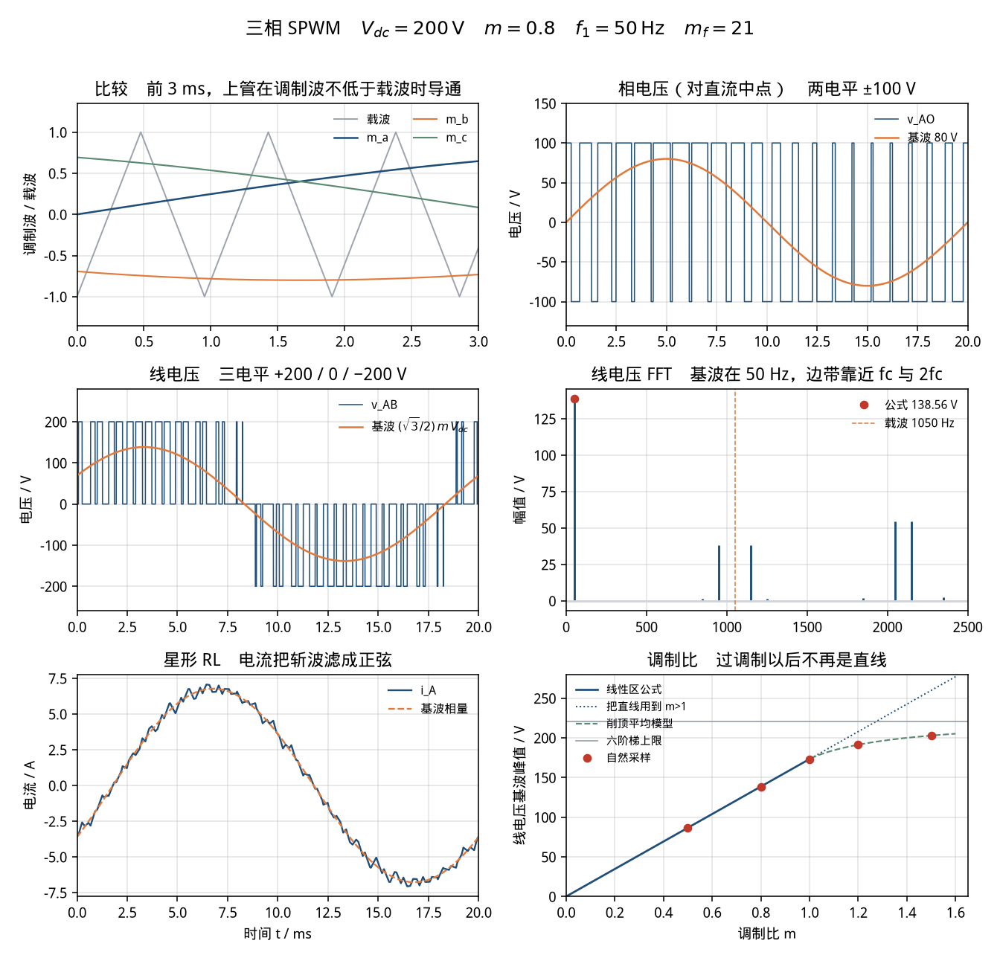

# 三相 SPWM 逆变器（three-phase-inverter-spwm）

> 适用课程：电力电子技术 / 电机控制 ｜ 难度：★★★ ｜ 课时：约 50 分钟

参数是课堂用的圆整值，用来把调制比、线电压基波和六阶梯上限算在 √3、π 附近，不是某一台变频器或 380 V 电网的实测数据。本卡只讲「调制比怎样决定线电压基波，过调制以后这条直线为什么停用」，不作为毕业设计或课程设计的逆变电源成品。

和 [`single-phase-rectifier`](../single-phase-rectifier/README.md) 接在一起看：那边的电容把交流收成一条带着纹波的直流。这里把直流母线当成理想电压源 `Vdc`，专门看桥臂怎么把母线切成三相交流。母线上的 100 Hz 纹波，本卡不放进模型。

## 1. 目标

看懂三相两电平桥在正弦脉宽调制（SPWM）下的三件事。

线性区（调制比 `m ≤ 1`）里，对直流中点的相电压基波峰值只看调制比和母线：

```text
V_AO,1(peak) = m · Vdc / 2
```

线电压是两相之差，夹角 120°，幅值再乘 √3：

```text
V_LL,1(peak) = √3 · m · Vdc / 2 = (√3 / 2) · m · Vdc
V_LL,1(rms)  = (√6 / 4) · m · Vdc ≈ 0.612372 · m · Vdc
```

本卡 `m = 0.8`、`Vdc = 200 V`，所以相电压基波峰值是 80 V，线电压基波峰值是 `80√3 = 138.564065 V`，有效值是 97.979590 V。

`m > 1` 是过调制。调制波超出载波的峰值以后，正弦顶附近的脉冲会连成宽脉冲，基波还在涨，但不再沿上面的直线涨，5 次、7 次谐波出现。涨到头是六阶梯（方波）运行，线电压基波峰值 `(2√3/π)·Vdc = 220.531558 V`，比 `m = 1` 的线性区上限高 `4/π ≈ 27.3%`。

## 2. 接线图示意

理想开关，同一桥臂上下管互补，没有死区。`S1/S4` 是 A 相，`S3/S6` 是 B 相，`S5/S2` 是 C 相。星形 RL 的中性点 N 悬浮，不接直流中点，也不接地。

```text
 Vdc = 200 V
   (+) ----+------ S1 ----+-- A        S3 -- B        S5 -- C
           |              |              |              |
           |              |              |              |
   (−) ----+------ S4 ----+              S6             S2
           |
        参考地（只接直流负极）

 A──L──R──┐
 B──L──R──├── N（悬浮）
 C──L──R──┘
```

载波 `tri` 在 −1 和 +1 之间来回，频率 `fc = mf · f1`。三路调制波：

```text
m_a = m sin(ωt)
m_b = m sin(ωt − 2π/3)
m_c = m sin(ωt + 2π/3)

上管导通（q = 1）当 m_x ≥ tri ，下管为 1 − q
v_AO = +Vdc/2    q = 1
v_AO = −Vdc/2    q = 0
```

`|m_x| ≤ 1` 时，一个载波周期里上管的占空比和下式的平均电压是同一句话：

```text
d = (1 + m_x) / 2
v_AO 的平均 = (2d − 1) · (Vdc/2) = m_x · Vdc/2
```

所以相电压基波峰值是 `m·Vdc/2`。线电压：

```text
v_AB = v_AO − v_BO
sin ωt − sin(ωt − 120°) = 2 cos(ωt − 60°) sin 60°
                         = √3 cos(ωt − 60°)
```

中间那一步里的 `2` 和 `sin 60° = √3/2` 乘成 √3。线电压基波峰值是相电压基波的 √3 倍，也就是 `(√3/2)·m·Vdc`。把 √3/2 和 Vdc/2 同时留在式子里，会得到正确值的一半。

悬浮中性点上的共模是

```text
v_NO = (v_AO + v_BO + v_CO) / 3
v_AN = v_AO − v_NO
```

`v_AO` 只有 ±Vdc/2 两档。`v_AN` 有五档：`±Vdc/3`、`±2Vdc/3` 和 0。基波不含 3 的倍数次，所以 `v_AN` 的基波和 `v_AO` 的基波相同，都是 `m·Vdc/2`。负载电流由 `v_AN` 决定：

```text
v_AN = R i_A + L di_A/dt
I_A,1(peak) = (m · Vdc / 2) / |R + jωL|
φ = atan(ωL / R)          电流滞后
```

没有 Simscape 时，用上面的比较和 `v_AN` 搭方框图，见 [`simulink/README.md`](simulink/README.md)。

## 3. 参数表

| 符号 | 含义 | 取值 | 单位 |
|------|------|------|------|
| Vdc | 直流母线 | 200 | V |
| m | 调制比，主工况，线性区 | 0.8 | — |
| f1 | 基波频率 | 50 | Hz |
| ω | 角频率 2πf1 | 314.159265 | rad/s |
| mf | 频率调制比 fc/f1，奇数且为 3 的倍数 | 21 | — |
| fc | 载波频率 | 1050 | Hz |
| R | 星形每相电阻 | 10 | Ω |
| L | 星形每相电感 | 0.02 | H |
| V_AO,1 | 相电压基波峰值 m·Vdc/2 | 80 | V |
| V_LL,1 | 线电压基波峰值 (√3/2)·m·Vdc | 138.564065 | V |
| V_LL,1rms | 线电压基波有效值 V_LL,1/√2 | 97.979590 | V |
| m_low | 线性区对照 | 0.5 | — |
| m_unity | 线性区上限 | 1 | — |
| m_over | 过调制对照 | 1.2 | — |
| m_deep | 更深的过调制 | 1.5 | — |
| V_LL,six | 六阶梯线电压基波峰值 (2√3/π)·Vdc | 220.531558 | V |
| Z | 每相阻抗模 hypot(R, ωL) | 11.810098 | Ω |
| φ | 阻抗角 atan(ωL/R) | 32.141908 | ° |
| I_A,1 | 电流基波峰值 (m·Vdc/2)/Z | 6.773864 | A |
| t_end | 波形积分时长，3 个基波周期 | 0.06 | s |

心算主工况：`Vdc/2 = 100 V`，`0.8×100 = 80 V`，`80×1.732 ≈ 138.6 V`，`138.6/1.414 ≈ 98.0 V`。`21×50 = 1050 Hz`。`ωL = 2π×50×0.02 = 2π Ω`，和 10 Ω 串在一起，阻抗模约 11.81 Ω，`80/11.81 ≈ 6.77 A`。

脚本里调制比写 `0.8`，不要写成 `80`。正弦的频率在 Simulink 基础库里填 `100*pi`，那个框的单位是 rad/s；载波用 Repeating Sequence，时间用秒，周期是 `1/1050`。

`Vdc = 200 V` 是为了让 `Vdc/2 = 100`，80 V 和 138.6 V 能口算。不要换成 540 V 的变频器母线，那一组数对不了本卡的读数。

## 4. 预期曲线

线性区，基波和载波频率无关，只看 m 和 Vdc：

```text
m ≤ 1
    V_AO,1(peak) = m · Vdc / 2
    V_LL,1(peak) = (√3 / 2) · m · Vdc
    3、5、7 次在线电压里是 0（自然采样，数值上低于 1e−11 V）
    边带留在 fc、2fc 两侧，而且 3 的倍数次互相抵消

m > 1
    直线外推偏高
    削顶平均模型：先把调制波限制在 ±1
        α = arcsin(1/m)
        V_LL,1(peak) ≈ (√3 · Vdc / π) · (m·α + √(1 − 1/m²))
    六阶梯上限 V_LL,1(peak) = (2√3 / π) · Vdc
```

削顶模型是「载波频率足够高时，一个载波周期的平均电压等于被 ±1 夹住的调制波」。它在 `m = 1` 回到线性公式，在 `m → ∞` 回到六阶梯。`mf = 21` 还不算很高，自然采样和这个模型差大约 0.1 V。

对照下图（由 `python/three_phase_inverter_spwm.py` 生成）。主工况是 `m = 0.8`。



可量化指标（默认参数，脚本打印到 6 位小数）。这些是演示读数，用来对曲线，不是作业的标准答案。

线性区三条都落在公式上。自然采样是每段载波斜坡求交点，再对分段常数的波形积傅里叶系数，`fund_err_V` 在 `1e−13` V 这一档，打印出来的 6 位小数和公式相同。

| m | 线性公式 | 自然采样 | 说明 |
|---:|---------:|---------:|------|
| 0.5 | 86.602540 V | 86.602540 V | 仍在直线上 |
| 0.8 | 138.564065 V | 138.564065 V | 主工况 |
| 1.0 | 173.205081 V | 173.205081 V | 线性区上限，(√3/2)·Vdc |
| 1.2 | 207.846097 V | 191.195691 V | 公式外推偏高 16.650 V（8.0%） |
| 1.5 | 259.807621 V | 203.000223 V | 继续涨，离六阶梯还有约 17.5 V |
| 六阶梯 | — | 220.531558 V | (2√3/π)·Vdc，5 次是基波的 1/5 |

`m = 1.2` 的削顶模型是 191.300512 V，自然采样低 0.105 V。`m = 1.5` 的削顶模型是 202.883242 V，自然采样是 203.000223 V。课堂用自然采样这列对示波器，削顶模型用来说明「为什么会弯、弯向哪里」。

主工况线电压的谐波（自然采样，算到 84 次）：

- 3、5、7 次打印为 0.000000 V。脚本里比 `5e−7` 还小的数会印成 0；这三项实际低于 `1e−11` V。
- 载波两侧：19 次和 23 次都是 38.078080 V（`fc ± 2·f1`）。
- 最大的一对在二倍载波两侧：41 次和 43 次都是 54.447529 V（`2·fc ± f1`）。41 不是 3 的倍数，所以留在线电压里。39 次、45 次是 3 的倍数，线电压里抵消。
- 算到 84 次（4.2 kHz，含 4 倍载波）的电压 THD 是 0.787749。线电压看起来是斩波，基波却是对的；THD 大是因为能量在边带上，不是因为基波公式偏了。

均匀网格（每载波 1000 点，约 0.95 μs）上再做一次 FFT，主工况线电压基波是 138.574563 V，比公式高 0.010 V，`rel_err_fft = 0.000076`。这 0.01 V 是开关沿被步长卡住，把每载波的点数加大，这个差会变。变步长、并且踩得到比较交点的仿真，应更靠近 138.564 V，而不是更靠近 200 V。

相电压基波是 80.000000 V，三条线电压基波相同，都是 138.564065 V。线电压波形只有 −200、0、+200 V 三档。悬浮星形的 `v_AN` 是 −133.333、−66.667、0、+66.667、+133.333 V 五档。

`v_AB` 的基波是 `138.564065·cos(ωt − 60°)`。`t = 0` 时它等于峰值的一半，69.282 V。这个数和「误把公式写成 (√3/2)·m·(Vdc/2)」得到的 69.282 V 相同，原因不同：一个是正弦还没走到峰值，一个是式子少乘了一个 2。

电流，最后一周已经稳态（`τ = L/R = 2 ms`，到 20 ms 时启动项只剩 `e^−10`）：

- 相量：`|Z| = 11.810098 Ω`，`φ = 32.141908°`，`I_A,1 = 6.773864 A`。
- 网格上的 FFT：`6.774377 A`，`rel_err_I1 = 0.000076`，和线电压 FFT 的相对误差是同一个步长。
- 滞后角测得 32.133337°，比相量 32.141908° 小 0.0086°。这个差等于 `ω·Δt/2`：网格大约 0.95 μs，半步对应的角度就是 0.0086°。电流写在步长端点上，和电压样本并排做 DFT 时会错开半步。
- 电流 THD（同样算到 84 次）是 0.044573。电压 THD 0.79，电流 THD 0.045，差在电感：边带频率高，`ωL` 把它们挡住了。

过调制的低次谐波：`m = 1.2` 时 5 次 6.222525 V、7 次 1.173840 V。六阶梯的 5 次是 44.106312 V、7 次是 31.504508 V，正好是基波的 1/5 和 1/7。

改 m 时先问有没有超出 1。`m` 在 0 和 1 之间加大，线电压基波严格成比例，载波频率不用改。一旦超过 1，线性公式停用，基波改用仿真或削顶模型，并且开始用 5 次、7 次检查波形是不是已经在过调制。

## 5. 常见报错

| 现象 | 原因 | 处理 |
|------|------|------|
| 线电压基波读成 69.282 V，正好是 138.564 V 的一半 | 式子写成了 `(√3/2)·m·(Vdc/2)`。推导里的 `2·sin60°` 应该合成 √3，不能把 √3/2 和 Vdc/2 都留下 | 用 `(√3/2)·m·Vdc`。相电压基波 80 V 乘 √3，也是 138.564 V |
| `t = 0` 的线电压基波大约 69 V，以为幅值就是 69 V | `v_AB` 的基波是 `V_LL,1·cos(ωt−60°)`，起点正好是峰值的一半 | 看 3.3 ms 附近的峰值，或做 FFT。不要在过零点或 t = 0 读幅值 |
| 示波器峰值是 200 V，和 138.6 V 对不上 | 200 V 是母线，也是线电压的斩波电平。基波只占其中一部分 | 线性区基波峰值是 `(√3/2)·m·Vdc`。m = 1 时也只有 173.2 V，到不了 200 V |
| 相电压基波拿 100 V 去对 | 100 V 是 `Vdc/2`，等于 m = 1 时的相电压基波。m = 0.8 时是 80 V | 先算 `m·Vdc/2` |
| 有效值拿 138.6 V 去对功率表或 FFT 的 RMS 档 | 138.564 V 是峰值。有效值要除 √2 | 97.980 V。系数是 `√6/4 ≈ 0.612372`，不是把 0.612 再乘错一个 √2 |
| m 设成 0.8，输出已经像方波，基波接近 220 V | 正弦幅值填了 80，载波仍是 1，等于 m = 80 | 调制波幅值填 `0.8`。80 只出现在相电压基波的伏特数里 |
| m = 1.2 时期望 207.8 V，仿真大约 191.2 V | 把线性公式用过了 m = 1 | 207.846 V 是外推。自然采样是 191.196 V，削顶模型是 191.301 V |
| 线电压里有明显的 5 次、7 次，但 m 明明填了 0.8 | 实际调制波已经削顶，或死区很大，或 mf 太小而且采样很粗 | 线性区这张卡的 5 次、7 次应印成 0。先确认正弦峰值没有超过载波 |
| 频谱在 50 Hz 旁边漏出一整排 | FFT 的窗口不是整数个基波周期 | 取整整 20 ms。分辨率应是 50 Hz，基波在第一根，不在 25 Hz |
| 相电压只有 ±100 V 两档，和教材上的五电平阶梯不一样 | 探头接在桥臂输出和直流中点之间，看到的是 `v_AO`。教材上的阶梯多半是悬浮中性点的 `v_AN` | 两档是对的。`v_AN` 才是 ±66.7 V 和 ±133.3 V。基波两种接法相同 |
| 中性点接了直流中点或地，电流毛刺很大 | 共模开关电压直接加到了每一相上 | 本卡 N 悬浮。基波仍约 6.77 A，高频不是本卡要修的波形 |
| 上下管一起导通，电源电流是一条针 | 两路门极用了同一个信号 | 下管用上管的反相。本卡没有死区；实验板上的死区要另设，不要用叠导通来代替 |
| 死区一打开，基波变小，还多了低次谐波 | 死区里两个管子都关，输出电压改由电流方向决定，等效调制比下降 | 本卡死区为 0，用来对 138.564 V。死区是下一层的问题，不要和过调制混成一个数 |
| 载波频率填了 50，或 mf 取了 20 | 一个基波周期里几乎没有脉冲；偶数 mf 会留下偶次谐波 | `fc = 1050`。mf 用 21 这种奇数，并且是 3 的倍数 |
| 两相调制波相位相同，线电压变成 0 或者只有两电平 | B、C 相对 A 没有 ±120° | A 的相位 0，B 为 `−2π/3`，C 为 `+2π/3` |
| 基础库正弦的周期大约是 126 ms | Sine Wave 的 Frequency 填了 50。那个框的单位是 rad/s | 填 `100*pi`。SPS 和 Simscape 里的交流源才是填 Hz |
| 求解器一步跨过整个载波，基波偏好几伏 | 最大步长远大于 1/1050 ≈ 0.95 ms | 定步长用 `1e-6`。脚本的网格大约 0.95 μs，FFT 只偏 0.01 V |
| 电流基波不是 6.77 A，波形仍是方的 | 电感写成了 20 H，或 L 没接到电路里 | `L = 0.02`。先心算 `80/11.81 ≈ 6.77 A` |
| Python 报 `ModuleNotFoundError: matplotlib`（或 numpy） | 未装案例依赖 | 在 `python/` 下执行 `pip install -r requirements.txt` |
| MATLAB 曲线和命令行数字对不上 | 改了工作区里的参数后没有重新运行脚本 | 重新运行 `three_phase_inverter_spwm.m`。以命令行的 `Vll1_natural_V` 为准 |

## 6. 平台指引

三个平台用同一组参数。Python 与 MATLAB 都给出可运行脚本；Simulink 按下面的模块清单搭，不附带 `.slx`。逐步点击说明见 [`simulink/README.md`](simulink/README.md)。

### Simulink

实验室若装了 Simscape Electrical，用六只理想开关搭三相桥，门极由正弦和三角波比较得到。开关导通电阻留 `0.001 Ω`，不要填 0。星形中性点悬空。

| 模块 | 库路径 | 参数 |
|------|--------|------|
| Solver Configuration | Simscape / Utilities | 默认。接到直流负极 |
| DC Voltage Source | Simscape / Foundation Library / Electrical / Electrical Sources | Constant voltage = `200` V。负极接参考地 |
| Ideal Semiconductor Switch ×6 | Simscape / Electrical / Semiconductors & Converters | Ron = `0.001` Ω，Goff = `1e-6` 1/Ω，Threshold = `0.5` V。同一桥臂上下管门极相反 |
| Inductor ×3 | Simscape / Foundation Library / Electrical / Electrical Elements | `0.02` H，串联电阻 `0`，初始电流 `0` |
| Resistor ×3 | 同上 | `10` Ω。每相是电感再串电阻，三相在 N 点接在一起，N 不接地 |
| Electrical Reference | 同上 | 只接直流负极 |
| Voltage Sensor | Simscape / Foundation Library / Electrical / Electrical Sensors | 接在 A、B 之间，读 `v_AB` |
| Sine Wave ×3 | Simulink / Sources | Amplitude = `0.8`，Frequency = `100*pi`，Phase 分别是 `0`、`−2*pi/3`、`2*pi/3` |
| Repeating Sequence | Simulink / Sources | Time values = `[0 1/(2*1050) 1/1050]`，Output values = `[-1 1 -1]` |
| Relational Operator ×3 | Simulink / Logic and Bit Operations | 运算符 `>=`。调制波不低于载波时上管导通 |
| Logical Operator NOT ×3 | 同上 | 下管门极 |
| Simulink-PS Converter ×6 | Simscape / Utilities | 单位 `1`，Filtering 选 Provide signals |
| PS-Simulink Converter | Simscape / Utilities | 单位 `V`，再进 Scope |
| Scope | Simulink / Sinks | 看 `v_AB`。有余量再看一相电流 |

求解器：**Fixed-step / ode4**，Fixed-step size = `1e-6`，Stop time = `0.06`。变步长如果最大步长留成 auto，一步就会跨过载波，基波会偏。

读数：线电压在 +200、0、−200 V 之间跳。把最后一个基波周期（40–60 ms，不含右端点）送到工作区，用搭建步骤里的几行求和算基波峰值，应在 138.56 V 附近。不要把斩波的 200 V 当成基波。电流在第二周以后接近正弦，峰值约 6.77 A，相位落后电压大约 32°。

没有 Simscape 时用第 2 节的式子搭方框图。`v_AN` 进传递函数 `1/(0.02s+10)` 就是 `i_A`。Sine Wave 的 Frequency 填 `100*pi`。

已安装 Specialized Power Systems 时，可用 `powergui` + Universal Bridge（三桥臂）+ PWM Generator (2-Level)。调制比填 `0.8`，载波 1050 Hz，输出频率 50 Hz。FFT Analysis 若显示峰值，基波约 138.6 V；若显示有效值，约 98.0 V。细节见搭建步骤。

### MATLAB

脚本：[`matlab/three_phase_inverter_spwm.m`](matlab/three_phase_inverter_spwm.m)。只用基础函数（`sin`、`cos`、`asin`、定步长循环、`plot`），不需要工具箱。频谱图用基础库的 `fft`。文件末尾的局部函数从 R2016b 起属于基础语言。

```matlab
run('cases/three-phase-inverter-spwm/matlab/three_phase_inverter_spwm.m')
```

脚本和 Python 用同一套交点二分、同一套网格。打印同一组字段。图片写到 `img/three_phase_inverter_spwm_curves_matlab.png`（运行后才有）。校验不通过会用 `error` 停下来。

### Python

脚本：[`python/three_phase_inverter_spwm.py`](python/three_phase_inverter_spwm.py)。依赖 numpy、matplotlib，见 [`python/requirements.txt`](python/requirements.txt)。不需要 scipy。

```bash
pip install -r cases/three-phase-inverter-spwm/python/requirements.txt
python cases/three-phase-inverter-spwm/python/three_phase_inverter_spwm.py
```

没有图形界面时只保存图片、不弹窗。校验失败时进程返回码不是 0。

控制台应出现：

```text
Three-phase SPWM inverter
  Vdc_V                      = 200.000000
  m                          = 0.800000
  f1_Hz                      = 50.000000
  mf                         = 21.000000
  fc_Hz                      = 1050.000000
  R_ohm                      = 10.000000
  L_H                        = 0.020000
  Vao1_theory_V              = 80.000000
  Vll1_theory_V              = 138.564065
  Vll1_rms_theory_V          = 97.979590
  k_rms                      = 0.612372
  Vao1_natural_V             = 80.000000
  Vll1_natural_V             = 138.564065
  Vll1_bc_natural_V          = 138.564065
  Vll1_ca_natural_V          = 138.564065
  rel_err_Vll1               = 0.000000
  h3_V                       = 0.000000
  h5_V                       = 0.000000
  h7_V                       = 0.000000
  h19_V                      = 38.078080
  h23_V                      = 38.078080
  h_side_n                   = 41.000000
  h_side_V                   = 54.447529
  h43_V                      = 54.447529
  thd_v_to_h84               = 0.787749
  Vll1_fft_V                 = 138.574563
  rel_err_fft                = 0.000076
  m_low                      = 0.500000
  Vll1_theory_low_V          = 86.602540
  Vll1_natural_low_V         = 86.602540
  m_unity                    = 1.000000
  Vll1_theory_unity_V        = 173.205081
  Vll1_natural_unity_V       = 173.205081
  m_over                     = 1.200000
  Vll1_linear_over_V         = 207.846097
  Vll1_clip_over_V           = 191.300512
  Vll1_natural_over_V        = 191.195691
  h5_over_V                  = 6.222525
  h7_over_V                  = 1.173840
  m_deep                     = 1.500000
  Vll1_linear_deep_V         = 259.807621
  Vll1_clip_deep_V           = 202.883242
  Vll1_natural_deep_V        = 203.000223
  Vll1_six_theory_V          = 220.531558
  Vll1_six_V                 = 220.531558
  Vao1_six_V                 = 127.323954
  h5_six_V                   = 44.106312
  h7_six_V                   = 31.504508
  Z_ohm                      = 11.810098
  phi_deg                    = 32.141908
  I1_theory_A                = 6.773864
  I1_fft_A                   = 6.774377
  rel_err_I1                 = 0.000076
  lag_meas_deg               = 32.133337
  thd_i_to_h84               = 0.044573
  fund_err_V                 = -2.274e-13
```

上面这些 6 位小数字段，MATLAB 脚本应逐行相同。`rel_err_Vll1`、`h3_V`、`h5_V`、`h7_V` 印成 0，是因为绝对误差远小于 `5e−7`。`fund_err_V` 才是自然采样和公式的伏特差，应在 `1e−12` V 量级，MATLAB 的末位可以不同。曲线保存为 [`img/three_phase_inverter_spwm_curves.png`](img/three_phase_inverter_spwm_curves.png)。

## 7. 课堂提问

1. 占空比 `d = (1+m_x)/2` 怎样变成相电压基波 `m·Vdc/2`？从两相相减走到线电压时，为什么乘的是 √3，而不是再乘一个 √3/2？
2. 只把 m 从 0.8 改成 0.5，线电压基波峰值变成多少？载波还要不要改？3 次、5 次谐波应不应该出现？
3. 示波器上的线电压在 +200 V 和 −200 V 之间跳。为什么基波峰值是 138.6 V，不是 200 V，也不是 100 V？`t = 0` 读到大约 69 V，这个数是幅值吗？
4. `m = 1.2` 时把线性公式外推得到 207.8 V，仿真大约 191.2 V。少掉的十几伏去哪了？再往上加调制比，基波最高能到多少？
5. 线电压 THD 约 0.79，电流 THD 约 0.045。是谁在滤波？只把 L 减半，电流基波幅值变不变，波形上的毛刺变不变？

## 8. 相关链接

- 案例卡字段约定：[docs/case-convention.md](../../docs/case-convention.md)
- 直流母线从哪来：[单相桥式整流 + 电容滤波（single-phase-rectifier）](../single-phase-rectifier/README.md)。那边的电容把馒头波收成直流；这里把 `Vdc` 当成理想电压源，不再带那 100 Hz 的纹波。
