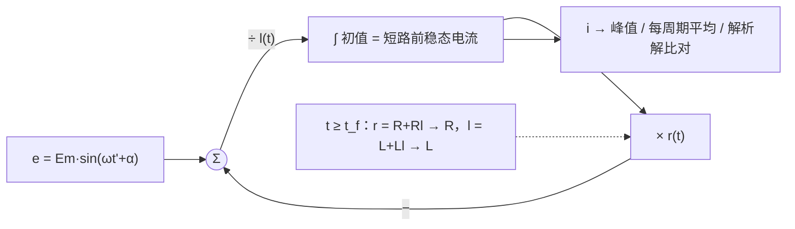

# 三相短路电流暂态（three-phase-short-circuit）

> 适用课程：电力系统暂态分析 / 电力系统分析 / 供配电技术 ｜ 难度：★★☆ ｜ 课时：约 45 分钟

参数是一个 10.5 kV 无限大电源经一段线路（X = 0.5 Ω，X/R ≈ 15.7）供电、线路末端发生三相金属性短路的课堂示例，不是某个变电站的实测数据。本卡只看「短路那一下」：短路电流由一个幅值不变的**周期分量**和一个按 `Ta = L/R` 衰减的**非周期分量**（直流分量）组成，非周期分量的大小由短路瞬间的电压相位决定，三相各不相同；最严重相在约半个周期后出现**冲击电流** `i_im ≈ Kim·Ipm`。不作为毕业设计或课程设计的短路计算成品。

和 [`rl-step`](../rl-step/README.md)、[`transformer-inrush`](../transformer-inrush/README.md) 一脉相承：都是 RL 回路在正弦电压下换路，电感电流不能突变，于是多出一个衰减的直流分量。励磁涌流里它出现在磁链上，被铁心饱和放大；这里它直接出现在电流上，最多让首峰接近周期分量幅值的 2 倍。

## 1. 目标

**全电流 = 周期分量 + 非周期分量。** 短路后（t' = t − t_f）a 相：

```text
i_a(t') = Ipm·sin(ωt' + α − φk) + i_ap0·e^(−t'/Ta)
i_ap0   = I0m·sin(α − φ0) − Ipm·sin(α − φk)        ← 短路前后瞬间电流相等（电感电流连续）
Ipm = Em/|R + jX| = 17.112 kA，  φk = arctan(X/R) = 86.357°，  Ta = L/R = 50 ms
```

**三相非周期分量此消彼长，没有哪个 α 能让三相都没有。** 三相 `i_ap0` 之和恒为零（脚本输出 1e-12 A 量级），a 相为零时 b、c 两相正好一正一负、都很大。

**脚本实际输出（默认参数）：**

- 工况 A（带负荷，a 相非周期分量最大，α = 177.98°）：`i_ap0,a = −16.830 kA`，a 相首峰 **−30.939 kA**（9.75 ms），冲击系数 **1.808**；b、c 相首峰 24.497 / 23.573 kA。
- 工况 B（带负荷，a 相非周期分量为零，α = 87.98°）：a 相从一开始就是对称正弦（峰值 17.112 kA = Ipm），但 c 相 −29.490 kA、b 相 28.691 kA，最严重相仍有 1.723 倍 Ipm。
- 工况 C（空载，α = φk + 90° = 176.36°，教材「最严重条件」）：`i_ap0,a = −Ipm`，首峰 **−31.145 kA**，Kim = **1.820**，与教材公式 `1 + e^(−0.01/Ta) = 1.8187` 相差 0.08%。
- α 扫描（带负荷）：三相最大瞬时值在 29.103 ~ 30.967 kA 之间，**任何 α 下总有一相超过 1.70 倍 Ipm**。所以短路计算直接按最严重相取冲击电流。

**非周期分量的衰减就是 `Ta`。** 每周期平均值的对数斜率拟合出 Ta = 50.000 ms；工况 A 的非周期分量在 148.96 ms（约 7.5 个周期）后降到 Ipm 的 5% 以下。

## 2. 接线图示意

三相对称，Y 接、中性点接地，三相之间没有耦合，所以每相可以单独列方程。负荷在短路点之后，短路后被短接。

```text
                 R = 0.0318 Ω   L = 1.5915 mH        K（t_f 三相同时接地）
  e_a ~ ──────────[ R ]──────( L )────────●──────────┬──────[ Rl ]──( Ll )── N
  e_b ~ ──────────[ R ]──────( L )────────●──────────┼──────[ Rl ]──( Ll )── N
  e_c ~ ──────────[ R ]──────( L )────────●──────────┼──────[ Rl ]──( Ll )── N
   │                                      └────┴────┴──── ⏚
   N（无限大电源，中性点接地）                        负荷 13.6 Ω + j6.6 Ω / 相
```

方程（每相，线路电流 i 连续）：

```text
短路前  (L + Ll)·di/dt = e − (R + Rl)·i          稳态 I0m = Em/|Z + Zl| = 557.79 A（394.42 A 有效值，cos φ0 = 0.887）
短路后       L·di/dt = e − R·i                 时间常数 Ta = L/R = 50 ms
e_a = Em·sin(ω(t − t_f) + α)，e_b、e_c 依次滞后 120°，Em = √2·10.5/√3 kV = 8.573 kV
```



## 3. 参数表

| 符号 | 含义 | 取值 | 单位 |
|------|------|------|------|
| U_N | 母线线电压有效值（无限大电源） | 10.5 | kV |
| f | 频率 | 50 | Hz |
| Em | 相电压峰值 √2·U_N/√3 | 8.5732 | kV |
| X | 电源到短路点的电抗（线路 / 变压器等效） | 0.5 | Ω |
| L | 对应电感 X/ω | 1.5915 | mH |
| Ta | 非周期分量时间常数 L/R（给定） | 50 | ms |
| R | 回路电阻 L/Ta（X/R = 15.708） | 0.031831 | Ω |
| Rl、Xl | 短路前负荷（每相，Y 接）；Ll = 21.0085 mH | 13.6、6.6 | Ω |
| t_f | 短路时刻（先跑 2 个整周期稳态） | 40 | ms |
| α | 短路瞬间 a 相电压相位：A 177.98° / B 87.98° / C 176.36° | — | ° |
| dt | RK4 定步长（每周期 2000 点） | 10 | μs |
| t_end | 仿真时长（短路后 15 个周期） | 340 | ms |

心算：`|Z| = √(0.5² + 0.0318²) = 0.50101 Ω`，`Ipm = 8573.2/0.50101 = 17.112 kA`，周期分量有效值 `Ip = 12.100 kA`，短路容量 `√3·10.5·12.100 = 220.05 MVA`。冲击电流 `i_im ≈ 1.8187 × 17.112 = 31.12 kA`（教材取 Kim = 1.8 时为 30.80 kA），冲击电流有效值 `Iim = Ip·√(1 + 2(Kim − 1)²) = 18.51 kA`。

## 4. 预期曲线

对照下图（由 `python/three_phase_short_circuit.py` 生成）。左上：工况 A 三相电流（短路前 2 个周期 + 短路后 8 个周期）；右上：工况 A 最严重相（a 相）分解为周期分量和非周期分量；左下：α 扫描，三相首周期最大瞬时值；右下：冲击系数 Kim 与 X/R。


可量化指标（默认参数，脚本打印到 3~4 位小数；RK4 与解析解逐点比对，最大偏差 / Ipm ≤ 1.3e-13）：

| 量 | A：177.98°，带负荷 | B：87.98°，带负荷 | C：176.36°，空载 |
|----|---:|---:|---:|
| 短路前电流有效值 | 394.416 A | 394.416 A | 0 |
| i_ap0：a / b / c 相 | **−16.830** / 8.416 / 8.414 kA | 0.000 / 14.575 / −14.575 kA | **−17.112** / 8.556 / 8.556 kA |
| 三相 i_ap0 之和 | −1.8e-12 A | 3.6e-12 A | −3.6e-12 A |
| 首峰：a / b / c 相 | **−30.939** / 24.497 / 23.573 kA | −17.112 / 28.691 / −29.490 kA | **−31.145** / 24.606 / 23.670 kA |
| 最严重相 / 峰值时刻 | a / 9.750 ms | c / 8.100 ms | a / 9.830 ms |
| 冲击电流 i_im | **30.939 kA** | 29.490 kA | **31.145 kA** |
| Kim = i_im / Ipm | **1.808** | 1.723 | **1.820** |
| 冲击电流有效值（峰值前后一周期方均根） | 18.552 kA | 18.237 kA | 18.674 kA |
| 同上，公式 Ip·√(1 + 2(Kim − 1)²) | 18.374 kA | 17.310 kA | 18.529 kA |
| 最严重相每周期平均值：第 1 / 5 / 10 周期 | −13.873 / −2.801 / −0.379 kA | −12.014 / −2.426 / −0.328 kA | −14.105 / −2.848 / −0.385 kA |
| 拟合 Ta | 50.000 ms | 50.000 ms | 50.000 ms |
| 非周期分量 < 5% Ipm | 148.96 ms | 141.77 ms | 149.79 ms |

α 扫描（带负荷，0~180° 步长 0.1°，首周期三相最大瞬时值）：最大 30.967 kA（α = 1.7°，与 181.7° 等价），最小 29.103 kA（α = 31.3°），即 1.701 ~ 1.810 倍 Ipm，曲线每 60° 重复一次（三相轮换）。

X/R 扫描（空载、扫 α 取最严重，首周期峰值 / Ipm）：

| X/R | Ta | Kim 精确 | 1 + e^(−0.01/Ta) |
|---:|---:|---:|---:|
| 3 | 9.549 ms | 1.3786 | 1.3509 |
| 5 | 15.915 ms | 1.5503 | 1.5335 |
| 10 | 31.831 ms | 1.7368 | 1.7304 |
| **15.708** | **50.000 ms** | **1.8218** | **1.8187** |
| 30 | 95.493 ms | 1.9015 | 1.9006 |
| 50 | 159.155 ms | 1.9395 | 1.9391 |

说明：「每周期平均值」从短路瞬间起每 20 ms 一个窗口取平均，周期分量在整周期内平均为零，剩下的就是非周期分量在该周期内的平均，所以对数线性拟合给出的 Ta 是精确的 50 ms（不是巧合）。教材近似假设峰值正好出现在 t' = 10 ms，而实际峰值出现得略早（9.75~9.83 ms），所以精确 Kim 比近似略大，X/R 越小差别越大。

读图要点：

- **非周期分量 = 「短路前电流」−「短路后周期分量」在 t' = 0 的差。** 电感电流不能突变，差多少就靠直流分量补多少。空载时 i_ap0 = −Ipm·sin(α − φk)，α − φk = ±90° 时最大，等于 Ipm。
- **φk 接近 90° 时，最严重条件就是「电压过零时短路」。** 本卡 φk = 86.4°，最严重的 α = 176.4°（或 −3.6°），a 相电压几乎正好过零。这和励磁涌流「电压过零合闸最严重」是同一回事。
- **短路前负荷电流的影响很小。** A 与 C 对比：带 394 A 负荷时冲击电流 30.939 kA，空载 31.145 kA，差 0.7%。负荷电流只有短路电流的 3%，而且功率因数角 27.5° 与 φk 相差很远，所以工程上常按空载计算，偏保守。
- **三相不可能同时没有非周期分量。** B 中 a 相干干净净，c 相却有 1.72 倍 Ipm。左下图最低点仍有 1.70 倍 Ipm。
- **衰减只看 Ta。** 无限大电源下周期分量幅值不变（Ip = 12.100 kA 一直不变），只有非周期分量衰减；约 3Ta = 150 ms 后电流基本对称。断路器在这之前开断就要承受直流分量（「直流分量百分比」）。

## 5. 常见报错

| 现象 | 原因 | 处理 |
|------|------|------|
| 短路前那两个周期电流就在漂移，或短路后数值与本卡对不上 | 积分器初值没设成短路前稳态（例如填了 0）；SPS 中 powergui 没做稳态初始化 | 用 `i0 = Em/|Z0|·sin(ph − ωt_f − ∠Z0)`；或先跑 2 个周期再短路 |
| 冲击电流接近 2·Ipm 甚至更大，且不衰减 | R 设成 0 或极小（Ta → ∞） | R = L/Ta = 0.031831 Ω |
| 非周期分量衰减太快，Kim 只有 1.3 左右 | 把 R 和 X 填反，或 X/R 用错（如 X/R = 3） | X = 0.5 Ω、R = 0.0318 Ω；X/R = 15.7 |
| 最严重相不是 a 相、α 对不上 | 电源写成 `cos`，或 Phase 填了度数而不是弧度（基础库 Sine Wave 用 rad，SPS Three-Phase Source 用 deg） | 本卡 `e_a = Em·sin(ω(t − t_f) + α)`；注意两类模块单位不同 |
| 短路电流约 √3 / 2 倍偏小 | 把线电压当相电压峰值的基准，或误用了两相短路 | Em = √2·U_N/√3；Three-Phase Fault 三相 + 接地全勾 |
| 周期分量幅值也在衰减 | 用了带内阻抗 / 励磁暂态的发电机模型，而不是无限大电源 | 本卡是无限大电源；发电机端短路见课堂提问 5 |
| SPS 中电流有尖刺或峰值略小 | 故障电阻、缓冲电阻取值不当；最大步长太大跳过峰值 | 故障电阻 1e-4 Ω，Snubber Rs = 1e6 Ω、Cs = inf；Max step `1e-5` |
| Python 报 `ModuleNotFoundError: scipy`（或 matplotlib） | 未装案例依赖 | `pip install -r cases/three-phase-short-circuit/python/requirements.txt` |
| MATLAB 报「脚本中的函数定义必须出现在文件末尾」 | 版本早于 R2016b | 用 R2016b 以上；或把末尾函数存成同名 `.m` |

## 6. 平台指引

三个平台用同一组参数。Python 给出已实际运行验证的脚本；MATLAB 脚本与 Python 同方程、同积分器（RK4，dt = 10 μs）；Simulink 按步骤搭，不附 `.slx`。

### Simulink

步骤见 [`simulink/README.md`](simulink/README.md)。要点：

- **搭法 A（基础库，与脚本完全一致）**：3 相向量 `Sine Wave`（Phase = `ph - w*tf` rad）→ `Sum` → `÷ l(t)` → `Integrator`（初值 = 短路前稳态电流 `i0`）→ `× r(t)` 负反馈；`r(t)`、`l(t)` 用两个 `Step` 在 `t_f` 由 `R+Rl / L+Ll` 跳到 `R / L`。
- **搭法 B（Simscape Electrical / Specialized Power Systems）**：`Three-Phase Source`（10.5 kV、Yg、内阻抗 0）+ `Three-Phase Series RLC Branch`（R、L）+ `Three-Phase V-I Measurement` + `Three-Phase Fault`（ABC+G，Transition time = `0.04`）+ RL 负荷；A 相相角（deg）即 α。
- 求解器：搭法 A 用 `ode4` 固定步长 `1e-5`；搭法 B 用 powergui Continuous + `ode23tb`，Max step `1e-5`。

### MATLAB

脚本：[`matlab/three_phase_short_circuit.m`](matlab/three_phase_short_circuit.m)。只用基础函数（for 循环 RK4、`polyfit`、`plot`），不需要工具箱；末尾有局部函数，需要 R2016b 以上。

```matlab
run('cases/three-phase-short-circuit/matlab/three_phase_short_circuit.m')
```

打印的字段是 Python 的子集（含 α 扫描，不含 X/R 精确扫描），积分器和步长相同，数值应一致到第 3~4 位小数。图片写到 `img/three_phase_short_circuit_curves_matlab.png`（运行后才有）。说明：本仓库自动化环境没有 MATLAB，该脚本未在 MATLAB 中实际运行过；第一次上课前请先跑一遍，对照第 4 节的数字。

### Python

脚本：[`python/three_phase_short_circuit.py`](python/three_phase_short_circuit.py)。依赖 numpy、matplotlib（requirements 中的 scipy 本脚本未用到，保留与其他案例一致），见 [`python/requirements.txt`](python/requirements.txt)。运行约 5 s。

```bash
pip install -r cases/three-phase-short-circuit/python/requirements.txt
python cases/three-phase-short-circuit/python/three_phase_short_circuit.py
```

控制台应出现（节选）：

```text
Three-phase symmetrical short circuit fed by an infinite bus
  R_ohm                       = 0.031831
  X_over_R                    = 15.708
  phi_k_deg                   = 86.357
  Ipm_kA                      = 17.1118
  Ip_rms_kA                   = 12.0999
  S_k_MVA                     = 220.05
  pre_fault_I_rms_A           = 394.416
  Kim_textbook                = 1.8187
  alpha_scan_max_peak_kA      = 30.9666
  alpha_scan_min_peak_kA      = 29.1026
[A] a 相非周期分量最大 α=177.98°（带负荷）
  dc0_a_kA                    = -16.8300
  peak_a_kA                   = -30.9385
  Kim_measured                = 1.8080
  Ta_fit_ms                   = 50.000
  rk4_vs_analytic_max_rel     = 1.2e-13
[B] a 相非周期分量为零 α=87.98°（带负荷）
  dc0_a_kA                    = -0.0001
  peak_c_kA                   = -29.4898
  Kim_measured                = 1.7234
[C] 空载 α=φk+90°=176.36°（教材最严重条件）
  dc0_a_kA                    = -17.1118
  peak_a_kA                   = -31.1451
  Kim_measured                = 1.8201
[X/R sweep] 空载、最严重 α，首周期峰值 / Ipm
  X/R= 15.708  Ta=  50.000 ms  Kim_exact=1.8218  Kim_1+e^(-0.01/Ta)=1.8187
```

每个工况最后一行 `rk4_vs_analytic_max_rel` 是 RK4 数值解与教材解析解在短路后 15 个周期内的最大偏差 / Ipm；超过 1e-6 时脚本返回非零。曲线保存为 [`img/three_phase_short_circuit_curves.png`](img/three_phase_short_circuit_curves.png)。没有图形界面时只保存图片、不弹窗。

想自己改工况：改脚本开头的 `X`、`TA`（X/R）、`RL`、`XL`（负荷），或在 `main()` 的工况元组里加一行 `("D", 45.0, True, "α=45°")`。

## 7. 课堂提问

1. 用 `i_ap0 = I0m·sin(α − φ0) − Ipm·sin(α − φk)` 心算：空载时 α 取多少 a 相非周期分量最大？取多少为零？与工况 B、C 的 α 对得上吗？
2. 为什么三相非周期分量之和恒为零？这对中性点电流意味着什么？
3. 教材 Kim = 1 + e^(−0.01/Ta) 假设峰值在 10 ms 出现。脚本里实际峰值在 9.75~9.83 ms，为什么略早？X/R = 3 时近似误差多大？
4. 把负荷改成 5 倍（Rl、Xl 除以 5），冲击电流变大还是变小？用脚本验证「按空载计算偏保守」是否仍成立。
5. 本卡是无限大电源，周期分量幅值不变。若电源是发电机（有次暂态、暂态电抗），周期分量会怎样变化？Ip 应该用哪个电抗算？
6. 断路器在短路后 60 ms 开断，此刻最严重相的直流分量占周期分量幅值的百分之几？（提示：e^(−60/50)）

## 8. 相关链接

- 案例卡字段约定：[docs/case-convention.md](../../docs/case-convention.md)
- 换路与时间常数：[RL 电路阶跃响应（rl-step）](../rl-step/README.md)。本卡把直流电源换成三相正弦电源，非周期分量的衰减时间常数就是那里的 τ = L/R。
- 上一张卡：[变压器励磁涌流（transformer-inrush）](../transformer-inrush/README.md)。那边直流分量出现在磁链上、经饱和放大成几百倍空载电流；本卡直接出现在电流上，最多接近 2 倍周期分量幅值。两者都是「电压过零时换路最严重」。
- 下一张卡：[SRF-PLL 锁相（pll-grid-sync）](../pll-grid-sync/README.md)。短路切除、电压暂降常伴随相位跳变，那张卡看并网锁相环多久重新锁定、暂降时为什么要做幅值归一化。
