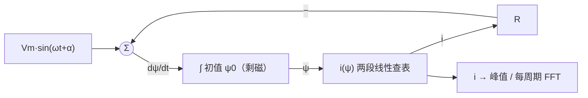
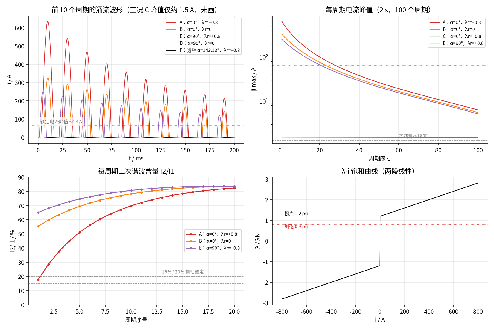

# 变压器励磁涌流（transformer-inrush）

> 适用课程：电机学 / 电力系统继电保护 ｜ 难度：★★☆ ｜ 课时：约 45 分钟

参数是一台 10 kVA、220 V / 50 Hz 单相变压器的课堂示例（标幺值取整：R = 0.01、Xσ = 0.02、Xm = 50、空心电抗 0.13 pu，饱和拐点 1.2 pu，剩磁 0.8 pu），不是某台变压器的铭牌，也没有实测数据。本卡只看「空载合闸那一下」：合闸角和剩磁怎样决定铁心磁链会不会冲过饱和拐点，冲过去以后电流有多大、衰减多慢、二次谐波有多少。不作为毕业设计或课程设计的保护整定成品。

和 [`rl-step`](../rl-step/README.md) 一脉相承：RL 电路正弦电源合闸时，电流里会出现一个衰减的直流分量，大小取决于合闸角。这里同样的事情发生在**磁链**上，只是铁心一饱和，电感从 0.77 H 掉到 2.3 mH，几百倍的落差把「磁链多一点」放大成「电流多几百倍」。

## 1. 目标

**磁链偏移是根源。** 忽略电阻时，铁心磁链为

```text
λ(t) = λr + λN·[cos α − cos(ωt + α)]，     λN = √2·U/ω = 0.990348 Wb
```

`λN·cos α` 是合闸瞬间的「直流磁链」。电压过零合闸（α = 0°）时它最大，半个周期后磁链到 `λr + 2λN`；电压峰值合闸（α = 90°）时它为零，磁链直接进入稳态 `±λN`。只要 `λ` 的最大值超过拐点 1.2 pu，就有涌流。

**合闸角 + 剩磁一起看（脚本实际输出）：**

- α = 0°、剩磁 +0.8 pu（工况 A，最严重）：磁链冲到 2.8 pu，涌流峰值 **634.052 A**，是额定电流有效值的 **13.949 倍**（额定峰值的 9.864 倍），是空载稳态励磁电流峰值的 493 倍。
- α = 0°、无剩磁（B）：325.036 A，7.151 倍额定。
- α = 90°、无剩磁（D）：**没有涌流**，峰值 1.285 A 就是空载电流。
- α = 90°、剩磁 +0.8 pu（E）：峰值合闸也挡不住剩磁，249.301 A，5.485 倍额定。
- 选相合闸（F）：在 `cos α* = −λr/λN` 处合闸（α* = 143.130°），稳态磁链在合闸瞬间正好等于剩磁，峰值 1.295 A，涌流消失。

**涌流里二次谐波很多，但最严重时恰好最少。** 第一个周期的 I2/I1：B 为 55.430%、E 为 65.146%，远超差动保护常用的 15%~20% 二次谐波制动整定；工况 A 只有 **17.771%**，落在 15% 和 20% 之间——整定 15% 能制动，整定 20% 就会误动。这正是深度饱和、剩磁大的变压器最难办的情形。

**衰减比 L/R 慢得多。** 饱和段 `(Lair + Lσ)/R = 47.746 ms`，但每周期只饱和一小段，工况 A 前 11 个周期峰值拟合的等效时间常数为 171.228 ms，第 28 个周期（0.56 s）后才低于额定电流峰值。

## 2. 接线图示意

一次侧空载合闸，二次侧开路。电源内阻并入绕组电阻 R，漏感 Lσ 全部折到一次侧；励磁支路只有非线性电感（不计铁耗 Rm、不计磁滞）。

```text
        S（t = 0 合闸，电压相位 α）
  ┌────/ ───[ R ]───( Lσ )───┬──────────┐
  │                          │          │
 (~) v = Vm·sin(ωt+α)    ( Lm(λ) )    二次侧开路
  │                     λ-i 饱和曲线     │
  └──────────────────────────┴──────────┘
```

λ-i 曲线（两段线性，关于原点对称；右下图）：

```text
   λ
   │            ／ 斜率 Lair = 2.0028 mH（饱和后只剩空心电感）
1.2│──────────●  拐点 (ik = 1.5428 A, λk = 1.188418 Wb)
   │         │
   │         │ 斜率 Lm = 0.7703 H（几乎竖直）
   └─────────┴────────── i
```

方程（令总磁链 `ψ = λ + Lσ·i`，ψ 与 i 仍是两段线性，只剩一个状态量）：

```text
v = R·i + Lσ·di/dt + dλ/dt     ⇒     dψ/dt = Vm·sin(ωt + α) − R·i(ψ)
|ψ| ≤ ψk：i = ψ/(Lm + Lσ)
|ψ| > ψk：i = sign(ψ)·[ik + (|ψ| − ψk)/(Lair + Lσ)]，   ψk = λk + Lσ·ik
剩磁：ψ(0) = λr·(1 + Lσ/Lm)
```



## 3. 参数表

| 符号 | 含义 | 取值 | 单位 |
|------|------|------|------|
| S_N | 额定容量 | 10 | kVA |
| U_N | 一次侧额定电压（有效值） | 220 | V |
| f | 频率 | 50 | Hz |
| I_N | 额定电流有效值（峰值 64.282 A） | 45.455 | A |
| Z_b | 阻抗基值 U_N²/S_N | 4.84 | Ω |
| λN | 额定磁链峰值 √2·U_N/ω（磁链基值） | 0.990348 | Wb |
| R | 绕组 + 电源电阻（0.01 pu） | 0.0484 | Ω |
| Lσ | 一次侧漏感（0.02 pu） | 0.3081 | mH |
| Lm | 不饱和励磁电感（50 pu，空载电流 1.999%） | 0.7703 | H |
| Lair | 饱和后空心电感（0.13 pu） | 2.0028 | mH |
| λk | 饱和拐点（1.2 pu） | 1.188418 | Wb |
| ik | 拐点电流 λk/Lm | 1.5428 | A |
| λr | 剩磁：A/E/F 为 +0.8，B/D 为 0，C 为 −0.8 | 0.8 | pu |
| α | 合闸瞬间电压相位：0° / 90° / 选相 143.130° | — | ° |
| dt | RK4 定步长（每周期 2000 点） | 10 | μs |
| t_end | 仿真时长（100 个周期） | 2.0 | s |

心算：空载稳态电流峰值 `Vm/|R + jω(Lm + Lσ)| = 1.2851 A`。工况 A 若忽略 R，超过拐点的磁链 `(2.8 − 1.2)·λN = 1.5846 Wb`，除以 `Lair + Lσ = 2.311 mH` 再加 ik，得 **687.222 A**；仿真峰值 634.052 A 低约 8%，差在第一个半周里电阻已经吃掉了一部分直流磁链。B、E 的同样估算是 344.382 A、258.673 A（仿真 325.036 A、249.301 A）。

## 4. 预期曲线

对照下图（由 `python/transformer_inrush.py` 生成）。左上：前 10 个周期的电流；右上：每周期峰值（对数坐标，100 个周期）；左下：每周期 I2/I1，虚线为 15% / 20%；右下：λ-i 曲线。



可量化指标（默认参数，脚本打印到 3 位小数；RK4 定步长，工况 A 前 0.3 s 用 Radau 核对，峰值相对偏差 3.6e-09）：

| 量 | A：0° / +0.8 | B：0° / 0 | C：0° / −0.8 | D：90° / 0 | E：90° / +0.8 | F：选相 / +0.8 |
|----|---:|---:|---:|---:|---:|---:|
| 首周期最大磁链（忽略 R） | 2.8 pu | 2.0 pu | 1.2 pu | 1.0 pu | 1.8 pu | 1.0 pu |
| 峰值粗估（忽略 R） | 687.222 A | 344.382 A | 1.543 A | 1.286 A | 258.673 A | 1.286 A |
| 仿真峰值 \|i\| | **634.052 A** | 325.036 A | 1.532 A | 1.285 A | 249.301 A | 1.295 A |
| 峰值时刻 | 9.690 ms | 9.840 ms | 10.000 ms | 15.000 ms | 4.880 ms | 2.050 ms |
| ÷ I_N 有效值 | **13.949** | 7.151 | 0.034 | 0.028 | 5.485 | 0.028 |
| ÷ I_N 峰值 | 9.864 | 5.056 | 0.024 | 0.020 | 3.878 | 0.020 |
| ÷ 空载稳态峰值 1.2851 A | 493.374 | 252.920 | 1.192 | 1.000 | 193.989 | 1.008 |
| 首周期 I2/I1 | **17.771%** | 55.430% | — | — | 65.146% | — |
| 第 20 周期 I2/I1 | 82.381% | 83.684% | — | — | 83.658% | — |
| 首周期直流分量 / I1 | 75.614% | 59.760% | — | — | 57.053% | — |
| 第 2 / 5 / 10 周期峰值 | 539.926 / 359.344 / 212.735 A | 290.798 / 215.667 / 142.690 A | — | — | 226.267 / 173.705 / 119.568 A | — |
| 第 50 / 100 周期峰值 | 26.363 / 6.353 A | 22.489 / 5.531 A | — | — | 20.799 / 5.140 A | — |
| 等效衰减时间常数（拟合） | 171.228 ms（11 周期） | 243.000 ms（15 周期） | — | — | 278.212 ms（17 周期） | — |
| 峰值降到首峰一半 | 6 个周期后 | 8 个周期后 | — | — | 9 个周期后 | — |
| 峰值低于 I_N 峰值 64.282 A | 28 个周期后 | 23 个周期后 | — | — | 20 个周期后 | — |

说明：「每周期」从合闸瞬间起每 20 ms 一个窗口，I1、I2 用该窗口 2000 点的 DFT（模拟保护装置一周波傅氏算法）。「拟合」是对峰值 ≥ 首峰 30% 的开头若干周期做 ln(峰值) 的线性回归。「N 个周期后」指从合闸起第 N 个整周期结束时（例如 28 个周期 = 0.56 s）。

读图要点：

- **涌流是单向尖峰。** 只在磁链冲过拐点的那一小段导通大电流，另外大半个周期电流接近零（「间断角」）。这既是直流分量大的原因，也是二次谐波大的原因；差动保护的「间断角闭锁」就利用这一特征。
- **剩磁方向决定是帮还是抵。** C 与 A 只差剩磁符号：A 的直流磁链和剩磁同向叠到 2.8 pu，C 中两者相消，最大磁链刚好 1.2 pu，峰值 1.532 A，刚好碰到拐点电流 1.5428 A。
- **峰值合闸不是万能的。** D 没有涌流是因为剩磁为零；E 同样峰值合闸，剩磁 0.8 pu 照样带来 5.5 倍额定的涌流。真正消除涌流要「按剩磁选相」（F）。
- **二次谐波随衰减上升。** 饱和越深，尖峰越宽、越像正弦，I2/I1 越小；涌流衰减时尖峰变窄，I2/I1 一路上升，第 20 个周期已达 82.381%（A）/ 83.684%（B）/ 83.658%（E）（左下图）。所以最危险的是合闸后头一两个周期。
- **衰减拖尾很长。** 磁链一旦退回不饱和区，剩下的直流磁链按 `(Lm + Lσ)/R = 15.922 s` 衰减，所以峰值在后面几十个周期里下降越来越慢（右上图的曲率），100 个周期后仍有 5~6 A，是空载电流的 4~5 倍。

## 5. 常见报错

| 现象 | 原因 | 处理 |
|------|------|------|
| 所有工况都没有涌流，峰值都约 1.3 A | 饱和曲线没生效（只用了线性 Lm），或拐点设得太高（> 2.8 pu） | 检查查表 / Saturation characteristic 的第二段斜率；拐点 1.2 pu |
| 涌流有几万安，而且不衰减 | R 设为 0，或饱和段斜率填成 0（电感为零） | R = 0.0484 Ω；饱和后斜率 Lair = 2.0028 mH，不能为 0 |
| α = 0° 与 α = 90° 结果对调 | 电源写成 `cos`，或 Sine Wave 的 Phase 填了度数而不是弧度 | 本卡电压 `Vm·sin(ωt + α)`；Simulink Sine Wave 的 Phase 单位是 rad |
| 剩磁设了 0.8 却和无剩磁一样 | 积分器初值没改，或 Saturable Transformer 没勾 *Specify initial flux* | 积分器初值 `ψ0 = λr·(1 + Lσ/Lm)`；SPS 块勾选并填 0.8 pu |
| 峰值比本卡小一截，衰减也更快 | SPS 模型里 Rm 不够大，或断路器缓冲电阻太小 | Rm 设大（例如 1e4 pu）；Breaker 缓冲 Rs = 1e6 Ω、Cs = inf |
| 曲线尖峰被削平、峰值偏低 | 变步长求解器最大步长没限制，跳过了尖峰 | Max step `1e-5`；或固定步长 `1e-5` |
| 二次谐波比例对不上 | FFT 窗口不是整周期，或用了整段 2 s 数据做一次 FFT | 每 20 ms 一个窗口，正好 2000 点；不要加窗函数 |
| Python 报 `ModuleNotFoundError: scipy`（或 matplotlib） | 未装案例依赖 | `pip install -r cases/transformer-inrush/python/requirements.txt` |
| MATLAB 报「脚本中的函数定义必须出现在文件末尾」 | 版本早于 R2016b | 用 R2016b 以上；或把末尾 3 个函数各存成同名 `.m` |
| MATLAB 报 `yline` 未定义 | 版本早于 R2018b | 删掉两行 `yline`，或用 `plot(xlim, [15 15], '--')` 代替 |

## 6. 平台指引

三个平台用同一组参数。Python 给出已实际运行验证的脚本；MATLAB 脚本与 Python 同方程、同积分器（RK4，dt = 10 μs）；Simulink 按步骤搭，不附 `.slx`。

### Simulink

步骤见 [`simulink/README.md`](simulink/README.md)。要点：

- **搭法 A（基础库，与脚本完全一致）**：`Sine Wave`（Amplitude `Vm`，Frequency `2*pi*50` rad/s，Phase `alpha` rad）→ `Sum` → `Integrator`（Initial condition `psi0`）→ `1-D Lookup Table`（ψ → i，两段线性，Extrapolation = Linear）→ `Gain R` 负反馈回 `Sum`。
- **搭法 B（Simscape Electrical / Specialized Power Systems）**：`AC Voltage Source` + `Breaker` + `Saturable Transformer`（R1 = 0.01 pu、L1 = 0.02 pu，饱和特性 `[0 0; 0.024 1.2; 13.8702 3.0]` pu，勾 *Specify initial flux*，phi0 = 0.8 pu），用 Breaker 的合闸时刻设合闸角：`t_close = 0.04 + α/(360·50)`。
- 求解器：搭法 A 用 `ode45` 或 `ode4` 固定步长 `1e-5`；搭法 B 用 powergui Continuous + `ode23tb`，Max step `1e-5`。

### MATLAB

脚本：[`matlab/transformer_inrush.m`](matlab/transformer_inrush.m)。只用基础函数（for 循环 RK4、`fft`、`polyfit`、`plot`），不需要工具箱；末尾有局部函数，需要 R2016b 以上（`yline` 需 R2018b）。

```matlab
run('cases/transformer-inrush/matlab/transformer_inrush.m')
```

打印的字段是 Python 的子集（不含 Radau 核对），积分器和步长相同，数值应一致到第 3 位小数。图片写到 `img/transformer_inrush_curves_matlab.png`（运行后才有）。说明：本仓库自动化环境没有 MATLAB，该脚本未在 MATLAB 中实际运行过；第一次上课前请先跑一遍，对照第 4 节的数字。

### Python

脚本：[`python/transformer_inrush.py`](python/transformer_inrush.py)。依赖 numpy、scipy、matplotlib，见 [`python/requirements.txt`](python/requirements.txt)。运行约 10 s（6 个工况向量化 RK4 共 20 万步，加一次 Radau 核对）。

```bash
pip install -r cases/transformer-inrush/python/requirements.txt
python cases/transformer-inrush/python/transformer_inrush.py
```

控制台应出现（节选）：

```text
Single-phase transformer no-load energization (inrush)
  I_N_A                     = 45.455
  L_m_H                     = 0.7703
  L_air_mH                  = 2.0028
  I0_peak_steady_A          = 1.2851
  tau_sat_ms                = 47.746
  tau_lin_s                 = 15.922
  alpha_select_deg          = 143.130
[A] α=0°，λr=+0.8
  est_peak_A_noR            = 687.222
  i_peak_A                  = 634.052
  peak_over_IN_rms          = 13.949
  cyc1_I2_over_I1_pct       = 17.771
  tau_fit_ms                = 171.228
  cycles_to_below_IN_peak   = 28
[B] α=0°，λr=0
  i_peak_A                  = 325.036
  cyc1_I2_over_I1_pct       = 55.430
[D] α=90°，λr=0
  i_peak_A                  = -1.285
[E] α=90°，λr=+0.8
  i_peak_A                  = 249.301
  cyc1_I2_over_I1_pct       = 65.146
[F] 选相 α=143.13°，λr=+0.8
  i_peak_A                  = 1.295
  A_rk4_vs_radau_peak_rel   = 3.6e-09
  A_rk4_vs_radau_max_abs_A  = 1.7e-05
```

最后两行是工况 A 前 0.3 s RK4 与 Radau（rtol = 1e-10）的峰值相对偏差和最大电流差。峰值相对偏差超过 0.5%，或 D、F 首周期峰值偏离空载稳态解析值超过 1% 时，脚本返回非零。曲线保存为 [`img/transformer_inrush_curves.png`](img/transformer_inrush_curves.png)。没有图形界面时只保存图片、不弹窗。

想自己改工况：改脚本开头的 `CASES` 字典，例如加 `"G": (45.0, 0.5, "α=45°，λr=+0.5")`，作图颜色表 `colors` 也要加一项；改剩磁大小改 `LR_PU`，改饱和程度改 `LAMK_PU` 或 `XAIR_PU`。

## 7. 课堂提问

1. 用 `λ(t) = λr + λN·[cos α − cos(ωt + α)]` 心算 A~F 六个工况的最大磁链。哪几个超过 1.2 pu？与表中「有没有涌流」是否一致？
2. 为什么 RL 电路合闸最多是稳态电流的 2 倍，而变压器空载合闸能到空载电流的近 500 倍？关键差别在哪个参数？
3. 工况 A 首周期 I2/I1 = 17.8%。若差动保护二次谐波制动整定为 20%，会发生什么？为什么剩磁越大、饱和越深，二次谐波反而越小？
4. 选相合闸角 `α* = arccos(−λr/λN)` 是怎么推出来的？如果剩磁估计错了 0.2 pu（实际 0.6 pu），用脚本算一下还剩多大涌流。
5. 把 R 加倍（0.02 pu），峰值和衰减时间常数怎样变？为什么大容量变压器（R 的标幺值更小）的涌流衰减可以持续好几秒？
6. 三相变压器三相合闸角互差 120°，能否三相同时做到「峰值合闸」？这对选相合闸装置意味着什么？

## 8. 相关链接

- 案例卡字段约定：[docs/case-convention.md](../../docs/case-convention.md)
- 合闸角与直流分量：[RL 电路阶跃响应（rl-step）](../rl-step/README.md)。那边是直流电源阶跃；把电源换成正弦，电流里同样会出现由合闸角决定、按 `L/R` 衰减的直流分量，本卡把它放到了磁链上。
- 另一种合闸冲击：[单相桥式整流 + 电容滤波（single-phase-rectifier）](../single-phase-rectifier/README.md)。那边峰值合闸冲击最大（电容电流正比于 dv/dt），本卡过零合闸冲击最大（磁链正比于 ∫v dt），正好相反。
- 上一张卡：[直流电机 PI 转速环（pi-speed-loop）](../pi-speed-loop/README.md)。
- 下一张卡：[三相短路电流暂态（three-phase-short-circuit）](../three-phase-short-circuit/README.md)。短路电流里的非周期分量与本卡的直流磁链是同一个数学结构：合闸（短路）瞬间的相位决定直流分量大小。
